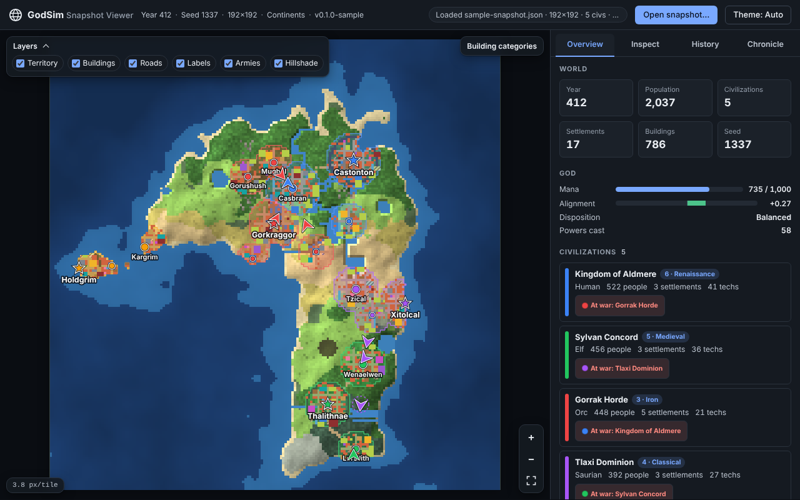
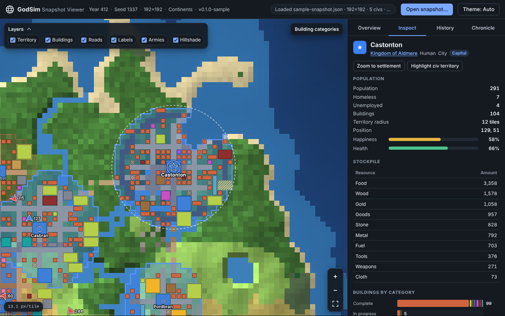
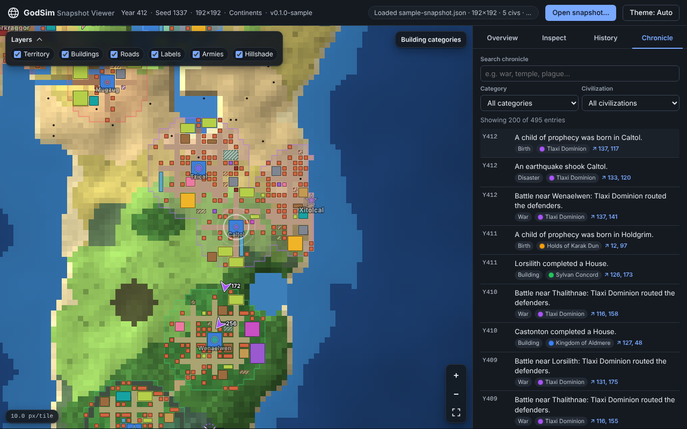
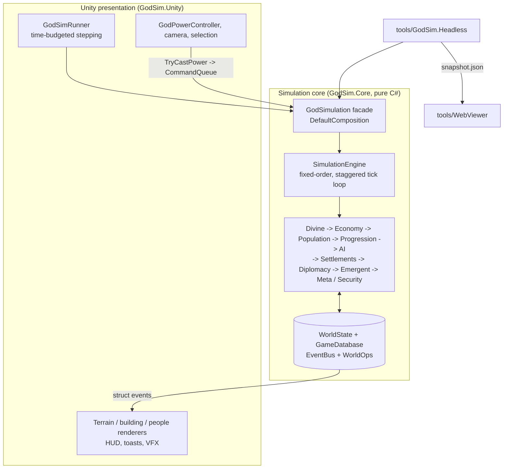

# GodSim

<!-- Status badges: placeholders until CI is configured. Replace with real workflow badge URLs. -->


**Five races. Ten ages. One god: you.**

GodSim is a top-down god simulator built on a deterministic simulation core written in pure C#.
The same core runs in Unity 6 and headless. Humans, Elves, Dwarves, Orcs and Saurians found
civilizations that an AI runs entirely on its own. Every town grows one building at a time, with a
new dwelling for every 3 to 5 people, in architecture that differs by race. You watch from above
and decide whether they get rain and prophets, or lightning and plague.

---

## Features

- **Five distinct races.** Each has its own habitat, lifespan, aptitudes, AI personality, names and
  architecture:

  | Race | Character | Builds with |
  |---|---|---|
  | Humans | balanced, fertile traders | timber, then stone, brick and glass |
  | Elves | long-lived forest scholars | tree platforms |
  | Dwarves | industrious miners | half-sunk stone halls |
  | Orcs | aggressive expansionists | spiked hide and timber |
  | Saurians | pious swamp-dwellers who lay large clutches | stilts and stepped pyramids |
- **Ten ages:** Dawn, Bronze, Iron, Classical, Medieval, Renaissance, Industrial, Modern,
  Information, Ascension. Civilizations climb a tech tree of 94 technologies, with racial techs and
  an endgame capstone that leads to the Ascension Gate.
- **Towns that grow one building at a time.**
  - A utility-AI governor decides *what* to build: housing, food, storage, services, defense or a
    wonder.
  - A town planner decides *where*, using zoning, site scoring and access roads.
  - Construction pays the cost, builders do the work, and the building is completed.
- **A housing rule you can see.** A House holds 3 to 5 residents, rolled per building, so about 250
  houses shelter 1,000 people. Homelessness hurts happiness and health. Old houses are renovated in
  the style of each new age.
- **75 building types**, from Gatherer Huts to Fusion Reactors. They include racial wonders (World
  Tree, Deep Forge, War Idol, Sun Pyramid, Grand Cathedral), shared wonders, and the Ascension Gate.
- **A living society:** births, marriages, aging, needs, jobs, wellbeing, epidemics, migration and
  leaders.
- **An economy** of 13 resources and 9 services. It has production chains, storage and spoilage,
  upkeep, trade within and between civilizations, and regrowing land.
- **Diplomacy and war:** contact, opinions, stances, trade pacts, wars and peace. Armies march,
  fight battles, besiege and conquer.
- **Nineteen divine powers**, each with a mana cost and a cooldown, and every cast validated:

  | Category | Powers |
  |---|---|
  | Blessings | Bless, Rain, Fertility, Inspire, Heal, Bountiful Harvest, Prophet |
  | Shaping | Raise Land, Lower Land, Plant Forest, Reveal Ore |
  | Creation | Spawn Tribe |
  | Wrath | Lightning, Wildfire, Earthquake, Meteor, Plague, Flood, Drought |
- **A living world:** seasons, weather and climate swings, natural disasters, and spreading fire.
  Divine objectives offer rewards and an Ascension victory.
- **Procedural worlds** from four presets (Continents, Pangaea, Archipelago, Highlands), with biomes,
  rivers, deposits and fair start locations.
- **History.** A world chronicle, history charts and narrated eras record every civilization's
  story.
- **Deterministic by design.** The same seed and the same commands always produce the same world,
  checked by state hashes. Saves are versioned, integrity-checked and survive a save/load mid-run.
- **Moddable data.** A hardened JSON pipeline lets mods patch content before the game starts.

## Screenshots

> Unity screenshots and GIFs are placeholders until the presentation layer is complete. The
> images below come from **[`tools/WebViewer`](tools/WebViewer)**, a self-contained browser viewer
> for headless snapshots. Open `tools/WebViewer/index.html` and load `snapshot.json`, or try
> the bundled `sample-snapshot.json`.

| WebViewer: world overview | WebViewer: settlement | WebViewer: chronicle |
|---|---|---|
|  |  |  |

| Unity: town growth | Unity: divine powers | Unity: ages and architecture |
|---|---|---|
| *coming soon* | *coming soon* | *coming soon* |

## Quick start

### Play in Unity

1. Install **Unity 6 LTS** (`6000.0.23f1` or a later 6000.0 patch). See
   [docs/UNITY_SETUP.md](docs/UNITY_SETUP.md).
2. Open this folder as a Unity project. Packages (Input System, Test Framework, uGUI) resolve from
   `Packages/manifest.json`.
3. Choose **GodSim > Create Demo Scene** from the menu.
4. Press **Play**.

The **GodSim** menu also offers *World Preview*, *Simulate 100 Years (Headless)*,
*Validate Content* and *Determinism Check*.

### Run headless (no Unity required)

You need the .NET 8 SDK.

```bash
dotnet run --project tools/GodSim.Headless -- --years 200 --out snapshot.json
```

This simulates 200 years and writes a JSON snapshot. To view it, open `tools/WebViewer/index.html`
in a browser and load the file. Useful extra flags:

- `--seed <n|text>`, `--preset Archipelago`, `--races Human,Elf`
- `--save world.gsav`, `--load world.gsav`
- `--hash`, `--benchmark`, `--strict`
- `--help`

### Run the tests

```bash
dotnet test                 # whole solution: Core (netstandard2.1) + full NUnit suite
scripts/run-tests.sh        # CI equivalent: compat check, build, test, headless smoke run
```

To test one module on its own: `cd build/checks/<Module> && dotnet test -nologo -v q --disable-build-servers`.
In Unity, use **Window > General > Test Runner > EditMode > Run All**.

## Controls

| Action | Default |
|---|---|
| Pan / fast pan | `W` `A` `S` `D` or arrows (hold `Shift`), or middle-drag |
| Zoom / rotate | Scroll wheel or `PageUp`/`PageDown`; `Q` / `E` |
| Select / inspect | Left-click; `F` focuses, `Home` jumps to your capital, `C` opens the civilization panel |
| Arm a god power | `1`–`0` and `Shift+1`–`Shift+9` (19 powers) |
| Cast / cancel | Left-click / `Esc` or right-click |
| Power radius | `[` / `]` |
| Pause / speed | `Space`; `-` / `=` |
| Help / performance overlay | `F1` / `F3` |

The full, authoritative bindings are in **[docs/CONTROLS.md](docs/CONTROLS.md)**.

## Repository layout

```text
Assets/GodSim/
  Core/                    GodSim.Core.asmdef: pure C#, deterministic, no UnityEngine
    Contracts/             shared vocabulary: Foundation, Data, State, Events, Simulation (lead-owned)
    Composition/           GodSimulation facade + DefaultComposition (canonical system order)
    World/  Geography/     procedural world generation, start locations, named regions
    Races/                 five race definitions + lore (RaceCatalog)
    Progression/           ages, tech tree, research, modifiers
    Buildings/             all 75 BuildingType definitions (Early / Middle / Late)
    Settlements/           town planner, roads, construction, maintenance, tiers, territory
    Population/            lifecycle, needs, housing, jobs, wellbeing, migration, leadership
    Economy/               production, regrowth, storage, services, upkeep, trade, statistics
    AI/                    civilization strategy, research director, expansion, settlement governor
    Diplomacy/             contact, relations, war decisions, military, armies
    Divine/                god powers, faith/mana, seasons & weather, disasters, fire
    Religion/  Heroes/     emergent depth: faiths & doctrines, notable individuals
    Storytelling/          world events: calamities, golden ages, secessions, ...
    History/  Objectives/  history recording & narration; divine objectives & victory
    Persistence/           versioned binary saves, HMAC/SHA-256 integrity, save slots, replays, state hash
    Security/              command validation, rate limiting, input sanitization, content validation, integrity monitor
    Modding/               hardened JSON + data-mod pipeline
  Unity/                   GodSim.Unity.asmdef: runner, terrain/building/people rendering, camera, input, HUD
  Editor/                  GodSim.Editor.asmdef: demo-scene builder, world preview, inspectors, menus
  Tests/EditMode/          NUnit tests (run in Unity and in dotnet)
build/GodSim.Core.csproj   dotnet build of Core (netstandard2.1, C# 9), exactly what Unity compiles
build/checks/<Area>/       isolated per-module compile + test projects
tests/GodSim.Tests/        full suite: EditMode tests + integration (determinism, save/load, powers)
tools/GodSim.Headless/     console runner + JSON snapshot exporter
tools/GodSim.Bench/        benchmarks + CI performance budgets
tools/GodSim.SaveTool/     save-file inspector (info / verify / stats / diff)
tools/GodSim.ContentReport/ content validation report
tools/WebViewer/           self-contained HTML snapshot viewer (index.html + sample snapshot)
scripts/                   check-unity-compat.sh, run-tests.sh, new-module-check.sh
docs/                      contract, architecture, ADRs, standards, design, controls, setup
```

## Architecture at a glance



- **The core is pure C#.** It behaves the same in Unity, headless, in benchmarks and under
  `dotnet test`.
- **Modules never reference each other.** They share `WorldState`, the frozen `GameDatabase`,
  struct events and namespaced blackboards.
- **All structural changes go through `WorldOps`.** Removal is deferred and links stay consistent.
- **Determinism:** one PCG32 RNG, ordered iteration, no clocks, no threads. `StateHasher` verifies
  it.

The details are in [docs/ARCHITECTURE.md](docs/ARCHITECTURE.md).

## Documentation

| Document | What it covers |
|---|---|
| [Engineering contract](docs/ENGINEERING_CONTRACT.md) | The binding rules: architecture, hard rules, module entry points |
| [Architecture](docs/ARCHITECTURE.md) | Layers, module catalog, tick pipeline, data flows, determinism, persistence, performance, extension guides |
| [Architecture decision records](docs/adr/README.md) | Why the architecture is the way it is (ADR-0001 to 0008) |
| [Game design](docs/GAME_DESIGN.md) | Races, ages, buildings, powers and balance intent |
| [Content reference](docs/CONTENT_REFERENCE.md) | Reference tables for game content |
| [Save format](docs/SAVE_FORMAT.md) | Byte-level layout of `.gsav` files |
| [Roadmap](docs/ROADMAP.md) | Milestones and what is next |
| [Unity setup](docs/UNITY_SETUP.md) | Opening, configuring and running the Unity project |
| [Controls](docs/CONTROLS.md) | Camera, selection, powers, time and panels |
| [Coding standards](docs/CODING_STANDARDS.md) | C# 9 / netstandard2.1, determinism, allocation, naming, tests, Unity rules |
| [Contributing](docs/CONTRIBUTING.md) | Workflow, PR checklist, running checks, profiling, commit conventions |
| [Security](docs/SECURITY.md) | Threat model and vulnerability reporting (maintained by the security team) |
| [Changelog](CHANGELOG.md) | Release history |

## Contributing

Please read the [contributing guide](docs/CONTRIBUTING.md) and the
[coding standards](docs/CODING_STANDARDS.md). The short version:

- Stay inside your module.
- Never edit `Core/Contracts`.
- Keep the simulation deterministic.
- Pass your `build/checks` project, `dotnet test` and `scripts/check-unity-compat.sh`.

## Security

Please report vulnerabilities privately, as described in [docs/SECURITY.md](docs/SECURITY.md). Do
not open public issues for security problems.

## License

License: to be decided by the project owner.
