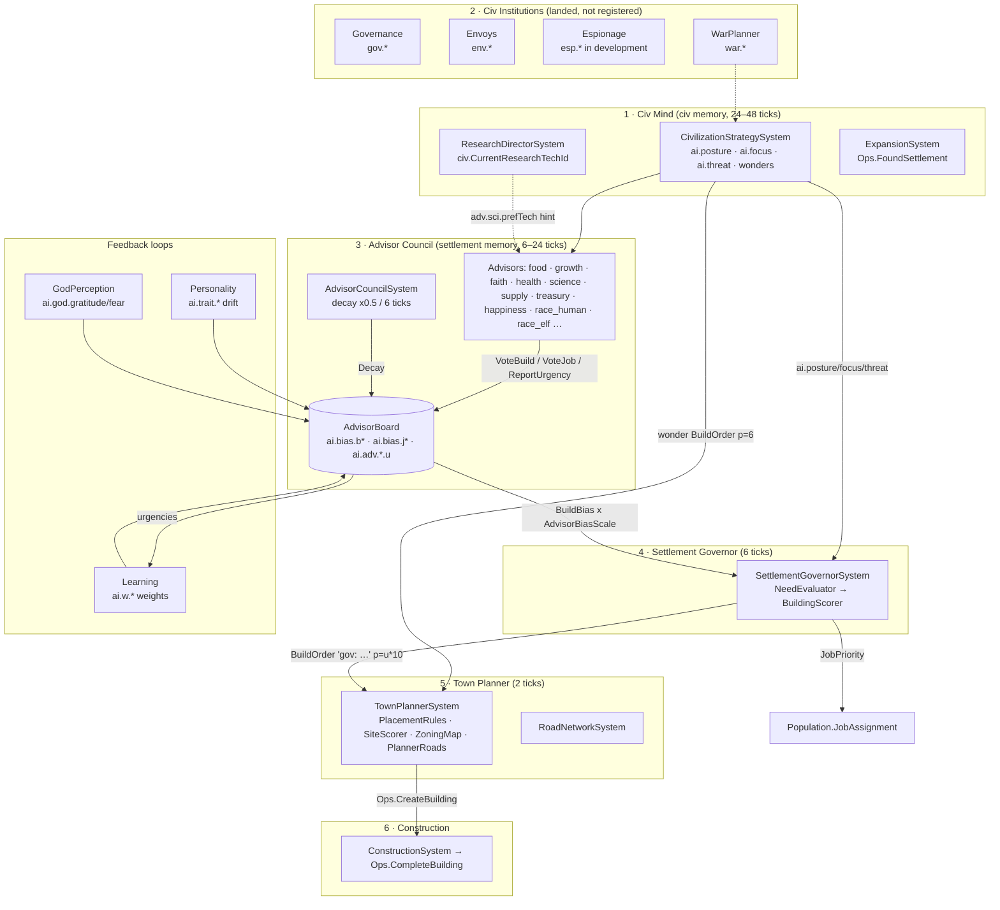
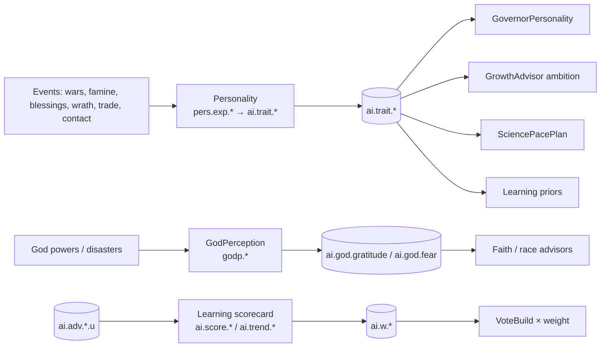

# GodSim — Civilization AI Design

> Owner: AI design / tech writing. Status: **living document**, written while ~35 engineers land the
> 6/10 → 10/10 AI push. Everything below is cited from code under `Assets/GodSim/Core/AI/**`,
> `Core/Diplomacy/**` and `Core/Settlements/Planning/**`. Anything marked **(in development)** has keys,
> tuning or a check project but no running system yet, or is not wired in
> `Core/Composition/DefaultComposition.cs`. Tuning numbers live in [AI_TUNING.md](AI_TUNING.md).
> Related: [ENGINEERING_CONTRACT.md](ENGINEERING_CONTRACT.md), [ADR-0006 utility AI](adr/0006-utility-ai-for-town-building.md),
> [ADR-0008 blackboards](adr/0008-module-boundaries-and-blackboards.md).

---

## 1. Design goals: what "10/10 civilization AI" means

| Pillar | Player-visible test | Mechanism |
|---|---|---|
| **Anticipatory** | Houses go up *before* people are homeless, granaries go up *before* winter, and walls go up *before* the army arrives. | `NeedEvaluator` growth lead (`HousingLeadYears`), `GrowthAdvisor` 1–3 year projections, `FoodSecurityForecaster` 2-year horizon with lean winters, `HealthAdvisor` risk projected 2 seasons out, `SciencePacePlan` ETA to the next age. |
| **Explainable** | Click a town and read *why*: "Build House (u=0.81): homeless 3, free housing 0 …". | Every order carries `BuildOrder.Reason` (`"gov: …"` / `"wonder: …"`). Strong votes write `Settlement.LogAi`. Urgencies go to `ai.adv.{id}.u` and needs to `ai.need.*`. |
| **Personality-driven** | Orcs arm and spread, Elves research and pray, Dwarves dig and fortify. | `RaceDefinition` traits → `AdvisorBoard.Trait` (`ai.trait.*`, which drift through Personality). They shape the race bias in `BuildingScorer.RaceBias`, posture and focus scores, tech scores and advisor gains. |
| **Resilient** | Towns climb out of famine, plague, war and the god's wrath. They never deadlock on an unplaceable order. | Stale orders are dropped (`StaleOrderTicks`), types are blocked after placement failures (`ai.gov.block.*`), stalled queues get evictions, crisis back-off (Science), a food-first labor override, and the Recovery advisor *(in development)*. |
| **Distinct per race** | You can tell a town's race from its skyline and its build order. | Race culture advisors (`race_human`, `race_elf` …), `FavoredBuildings`/`UniqueBuildings`, and planner race style (`Compactness`, `RoadAffinity`, trees/water/hills affinities). |
| **Readable towns** | A market square at the centre, homes clustered around it, industry pushed to the outskirts, farms with fields, roads that connect. | `TownPlannerSystem` + `ZoningMap` + `SiteScorer` + `PlannerRoads` + `RoadNetworkSystem`. |
| **Emergent stories** | "After the Flood the Saurians built a temple in thanks." "Betrayed twice, the Elves turned xenophobic." | Faith/GodPerception gratitude and fear, Personality experiences (`pers.exp.*`), Envoys (gifts, tribute, marriages, betrayal), WarPlanning phases, chronicle lines. |

Non-goals: perfect play, and cheating. The AI never reads hidden state it could not "see". It never bypasses `db.IsBuildingAvailable`, `ctx.Ops`, or the planner.

---

## 2. Layered architecture



**System order.** The Composition order is Divine → Economy → Population → Progression → **AI** → Settlements → Diplomacy.
The AI block in `DefaultComposition.cs` is currently `CivilizationStrategySystem`, `ResearchDirectorSystem`, `SettlementGovernorSystem`
and `ExpansionSystem`. **`AdvisorCouncilSystem` and no advisor are registered yet** (see §12).
`SimulationEngine.Step` staggers systems that share an interval with `(tick + index) % interval == 0`. List order therefore does
**not** guarantee "Council → advisors → Governor" on the same tick (see §10).

**Module boundary.** AI types are never referenced from Settlements, Diplomacy or Population. All coupling goes
through `Settlement.Memory`, `Civilization.Memory`, `WorldState.Memory`, `BuildQueue`, `JobPriority`, `CurrentResearchTechId`
and events. That is why each advisor re-declares foreign keys locally, for example `HumanCultureAdvisor.FoodDaysKey = "econ.foodDays"`.

---

## 3. Layer 1 — Civ Mind (`Core/AI/Strategy`)

### 3.1 CivilizationStrategySystem (`AI.CivilizationStrategy`, every 24 ticks)
This system was rewritten during the final scan. The description below matches the new code.
- **Inputs:** dynamic traits via `StrategyHelpers.Trait` → `AdvisorBoard.Trait`, `ActiveWars`, `EffectivePower` for the civ and its
  contacted rivals, stances, hostile armies within `ArmyThreatRadius` (16), `war.weariness`, `ai.god.gratitude/fear`, and the economy trend
  (`ai.econTrend`, a 3-sample shift register; `ai.econ.n`). Also: food days, homelessness, happiness, `civ.Devotion`, capital gold net, and
  age-tech progress.
- **Posture** (`ai.posture`: 0 peaceful, 1 defensive, 2 militarist) is decided by `Decide()`, which applies hysteresis (+0.1), `MinDwellTicks` (1 year) and an
  `UrgentMargin` (0.5) override. The dwell start is stored in `ai.postureSince`.
  - peaceful `= (1-a)·0.8 + dip·0.2 − war·1.2 − n·0.3 + gratitude·0.15 + weariness·war·0.9 − armyNear·0.4`
  - defensive `= 0.3 + war·(0.75 defending | 0.65) + min(0.7, n·0.35) + 0.35·weaker + armyNear·0.45 + fear·0.2 + weariness·war·0.3`
  - militarist `= a·0.9 + war·(0.3+0.8a) + 0.25a·stronger + 0.15a·(n>0) − weariness − falling·0.5 + rising·0.1a − fear·0.15`
- **Threat** `ai.threat = clamp01(wars·0.5 + n·0.2 + 0.3·weaker + 0.3·armyNear)`. It also writes `ai.powerRatio`, `ai.wars` and `ai.hostileNeighbours`.
- **Focus** (`ai.focus`: 0 growth, 1 research, 2 faith, 3 military, 4 wealth, **5 recovery**; `ai.focusLegacy` maps recovery → growth). Situation terms:
  food crisis +0.5 growth; homeless ratio ×0.8; pop < 30 +0.25; behind on age techs +0.15 research; rising economy +0.15 research;
  devotion < 0.35 / happiness < 0.45 +0.15 each to faith; fear ×0.35 and gratitude ×0.2 to faith; wars ×0.3 and armyNear +0.2 to military, weariness −0.4;
  negative gold net +0.25 and falling economy (≥ 0.15) +0.2 to wealth. Recovery wins after a disaster, famine or population crash (≤ 80% of the recent peak)
  with severity ≥ 0.2, and fades over `RecoveryTicks` (2 years). Keys: `ai.disasterTick`, `ai.disasterSeverity`, `ai.famineTick`, `ai.focusSince`.
- **Wonders.** New wonder orders are paused (`ai.wonderPaused`: 1 war, 2 famine, 3 recovery, 4 economy below `WonderMinTrend` −0.15). Otherwise
  the order is Ascension Gate (Ascension age) → racial `UniqueBuildings` → shared wonders by `FocusFit`. Gates: available, not built or queued anywhere,
  capital big enough, at least `WonderAffordFraction` (50%) of the cost, hard placement feasible (capital features cached in `ai.features*`), and a 3-year retry.
  The order uses `Priority = WonderPriority (6)` and `Reason = "wonder: <name>"`. Its advisor id is `CivStrategyKeys.WonderAdvisorId = "wonder"`.
- **Log examples:** `Posture: peaceful -> defensive (wars 1, hostile neighbours 2, power x0.6)`, `Focus: growth -> research`,
  `Wonder: queued Great Library (focus research)`.

### 3.2 ResearchDirectorSystem (`AI.ResearchDirector`, every 24 ticks)
- It picks `civ.CurrentResearchTechId` only when the current choice is invalid. A valid choice is **never switched**, so no research is wasted.
- **Score** `= (0.5 + Σ effect·trait·focus·need + unlock value + current-age bonus) × 10 / √cost`. A focus doubles its domain (×2), war doubles
  military (×1.3 more if militarist), and a food crisis (< `FoodCrisisDays` = 20) triples food production. A current-age tech adds +1, or +2.5 when the civ is behind on that age's required techs.
- It writes `ai.researchIdle` (log de-dup). Examples: `Research: Bronze Working (score 4.2)`, `Research: nothing left to research`.
- It does **not** read `adv.sci.prefTech` yet (see §12).

### 3.3 ExpansionSystem (`AI.Expansion`, every 48 ticks)
- It runs when the civ is below `SimConfig.MaxSettlementsPerCiv` and `tick ≥ ai.nextExpandTick`.
- **Parent:** the largest settlement with pop ≥ 30 (Orc 22), food days > 25 and happiness > 0.4 that is not blocked by `ai.expandBlockedUntil`.
- **Settlers:** 6–10 family units (couples with their children, singles balanced by sex). Never the leader or soldiers in armies, never more than 25% of the parent, and never fewer than 4.
- **Site:** up to 400 `ctx.Rng` samples in the annulus [spacing, 3·spacing]. Rejected: water, owned tiles, too close to own (< spacing) or foreign (< 0.8·spacing) settlements, fewer than 40 free tiles within r5, average habitability < 0.15. Score = habitability + water + trees + stone/ore + fertility − distance (≤ 0.35). Ties go to the lowest tile index.
- **Found:** `Ops.FoundSettlement` and `Ops.MovePersonToSettlement`, then supplies (Food 40, Wood 30, Stone 10, never below the parent's 15-day reserve).
  The cooldown lerps 14 → 4 years by Expansionism with ±10% `Rng` jitter. A failure blocks the parent for 2 years.
- Examples: `Expansion: founded Oakvale at (41,17) with 8 of 46 settlers (site 2.3, food 40.0, wood 30.0, stone 10.0)`,
  `Expansion: no valid site near Ironhold`.

---

## 4. Layer 2 — Civ Institutions (`Core/AI/{Governance,Envoys,Espionage,WarPlanning}`)

| Module | Exists now | Keys (civ memory) | Intent |
|---|---|---|---|
| **Governance** | `GovernanceSystem` (every 96 ticks), `GovernanceModel`, `GovernmentCatalog`/`GovernmentDefinition`, `GovernanceQueries`, `GovernanceSnapshot` (landed in the final scan; not registered) | `gov.type`, `gov.since`, `gov.stability`, `gov.stabilityTarget`, `gov.tax`, `gov.conscription`, `gov.faithPolicy`, `gov.age`, `gov.revolutions`, `gov.reforms`, `gov.atWar` | Government type, tax, conscription and faith policy per civ. Revolutions under low stability. **(in development)** |
| **Envoys** | `EnvoySystem` + `GiftEnvoy`, `TributeEnvoy`, `PactEnvoy`, `MarriageEnvoy`, `CoalitionEnvoy`, `EnvoyUtil`, `EnvoyTuning` (landed; not registered) | `env.coalition`, `env.cd.gift`, `env.cd.tribute`, `env.cd.pact`, `env.cd.marry`, `env.tributeTo`; reads `dipl.lastWar.*` | Gifts, tribute (bully/appease), non-aggression pacts, royal marriages, coalitions against a hegemon (power ≥ 1.6× the next civ), betrayal memory. Impulses are opinion deltas. **(in development)** |
| **Espionage** | `EspionageSystem`, `EspionageSettings`, `EspionageKeys` (landed in the final scan; not reviewed) | see `EspionageKeys.cs` | Spies, intel and sabotage. **(in development)** |
| **WarPlanning** | `WarPlannerSystem` (advisor id `war`, every 12 ticks), `WarPlanMath`, `WarPlanKeys` (landed; not registered) | `war.phase` (0 peace … 4 demobilizing), `war.target`, `war.objective`, `war.weariness`, `war.tension`, `war.phaseTick`, `war.start`, `war.popStart`, `war.demobUntil`, `war.demobLen`, `war.op.{civ}`, `war.trend.{civ}` | Phased war (tension → mobilize → war → demobilize). Objective is the weakest near settlement. Weariness is meant as a peace input to `WarDecisionSystem`. **(in development)** |

**Diplomacy context (`Core/Diplomacy`, not AI-owned):** `ContactSystem` (24 ticks), `RelationsSystem` (24) and `WarDecisionSystem` (48)
decide opinions, stances, trade pacts and alliances, and start and end wars, using `RelationsTuning`. They read **static race traits**
(`DiplomacyQueries.Trait(race.Aggression)`) and `civ.GodFavor`. `ArmySystem` (decision every 12 ticks, combat every 6) and `MilitarySystem` (6)
handle raising, marching, battles and sieges (`mil.*` keys). Casus belli strings: `border dispute`, `holy war`, `conquest`, `old grudge`, `call to arms`.

---

## 5. Layer 3 — Advisor Council (`Core/AI/Advisors`)

### 5.1 AdvisorBoard contract (`AdvisorBoard.cs`)
- `VoteBuild(s, civ, id, type, strength, reason)` clamps the strength to ±`MaxContribution` (1) and multiplies it by `Weight(civ,id)` (`ai.w.{id}`, 0..3, default 1).
  It accumulates into `ai.bias.b{(int)BuildingType}`, clamped to ±`MaxTotal` (3). If `|v| ≥ 0.5` and a reason is given, it logs `"[id] +0.80 Granary: reason"`.
- `VoteJob` writes `ai.bias.j{(int)JobType}` in [-1, 3]. `ReportUrgency` writes `ai.adv.{id}.u` in [0, 1].
- `Trait(civ, db, t)` returns `ai.trait.{name}` if it is set, else the race default. `GodGratitude/GodFear` return `ai.god.gratitude/fear`.
- `AdvisorCouncilSystem` (`AI.AdvisorCouncil`, every 6 ticks) multiplies every bias key by `DecayPerCouncil` (0.5) and removes keys with |v| < 0.01.
- `AdvisorSystemBase` loops over alive settlements of alive civs and calls `Advise`, then `AfterRun` for civ-level work. Its default interval is 12.

> Note: bias keys use the **numeric** enum index (`ai.bias.b17`). Governor keys use the **name** (`ai.gov.last.House`). See §12.

### 5.2 Advisor roster

| Id | Class | Interval | Status | Learning domain (`AdvisorDomains`) |
|---|---|---|---|---|
| `food` | `FoodSecurityAdvisor` | 12 | landed | Granary-keeper → Food |
| `growth` | `GrowthAdvisor` | 12 | landed | Steward of Hearths → Housing |
| `faith` | `FaithAdvisor` | 12 | landed | High Priest → Happiness (Piety 0.8) |
| `supply` | `SupplyChainAdvisor` | 12 | landed | Quartermaster → Construction |
| `health` | `HealthAdvisor` | 24 | landed | Physician → Health |
| `science` | `ScienceAdvisor` | 24 | landed | Loremaster → Research (Curiosity 0.8) |
| `treasury` | `TreasuryAdvisor` | 24 | landed | Treasurer → Wealth (Mercantilism 0.8) |
| `happiness` | `HappinessAdvisor` | 24 | landed | Master of Revels → Happiness |
| `race_human` | `HumanCultureAdvisor` | 24 | landed | Elder of Men → Overall |
| `race_elf` | `ElfCultureAdvisor` | 24 | landed (final scan) | Elder of the Groves (Xenophobia 0.3) |
| `race_dwarf` | `DwarfCultureAdvisor` | 24 | landed (final scan) | Elder of the Halls |
| `race_orc` | `OrcCultureAdvisor` | 24 | landed (final scan) | Elder of the Clans |
| `race_saurian` | `SaurianCultureAdvisor` | 24 | landed (final scan) | Elder of the Mire |
| `defense` | `DefenseAdvisor` | 12 | landed (final scan) | Marshal → Military |
| `labor` | `LaborAdvisor` | 12 | landed (final scan) | Foreman → Wealth |
| `logistics` | `LogisticsAdvisor` | 12 | landed (final scan) | Roadwarden → Construction |
| `recovery` | `DisasterRecoveryAdvisor` | **6** | landed (final scan) | Restorer → Overall |
| `seasons` | `SeasonalAdvisor` | **6** | landed (final scan) | Almanac-keeper → Food |
| `ages` | `AgeTransitionAdvisor` | 24 | landed (final scan) | Chronicler → Research |
| `frontier` | `FrontierAdvisor` | 24 | landed (final scan) | Pathfinder → Growth |
| `urban` | `UrbanDesignAdvisor` | 24 | landed (final scan) | City Planner → Housing |
| `capital` | `CapitalAdvisor` | 24 | landed (final scan) | Chancellor → Growth |
| `prospect` | `ProspectorAdvisor` | **48** | landed (final scan) | Prospector → Wealth |
| `specialize` | `TradeSpecializationAdvisor` | **48** | landed (final scan) | Guildmaster → Wealth |
| `god` | `GodPerceptionSystem` (AdvisorSystemBase) | 24 | landed (final scan) | Oracle → Overall |
| `war` | `WarPlannerSystem` (AdvisorSystemBase) | 12 | landed (final scan) | Warlord → Military |
| `infra` | folder `Advisors/Infra` (no class at scan time) | — | in development | Master Builder → Construction |
| `wonder` | `CivStrategyKeys.WonderAdvisorId` (strategy votes) | — | — | **no learning domain** |

Advisors marked "landed (final scan)" arrived in the last minutes of this pass. Their per-module sections below are pending, and their keys are in each folder's `*Keys.cs`.

### 5.3 Per-advisor reference (landed advisors)

**Food — `FoodSecurityAdvisor` ("food", 12 ticks)**
- *Purpose:* make sure there is never a famine. It forecasts 2 years ahead (`FoodSecurityForecaster.Horizon = 192`, step 2), including stock, measured net, births and deaths, lean ~0.4× winters, the weather anomaly and storage cap.
- *Inputs:* `Stockpile`, `econ.foodDays`, season and weather, terrain fit (`FoodSecurityTerrain`, radius 4–14), and producer definitions (`FoodSecurityCatalog`).
- *Outputs:* `ai.food.sit` (crisis / winter shortfall / deficit / stable / surplus), `ai.food.cover`, `ai.food.days` and `ai.food.starve` (settlement memory); votes for food producers, storage (prefers Granary) and food jobs (±); negative votes for obsolete huts once a producer at least `1/ObsoleteRatio` better exists.
- *Heuristics:* expansionist civs keep bigger winter buffers, industrious civs redeploy surplus labor, and a famine is remembered for 2 years (`FamineMemoryTicks`).
- *Reasons:* `famine: food runs out in …`, `before winter: need …`, `next winter covered only …`, `surplus spoiling: stores …`, `food stable; winter covered …`.

**Growth — `GrowthAdvisor` ("growth", 12 ticks)**
- *Purpose:* keep housing **ahead** of growth so the "one house per 3–5 people" rhythm is smooth.
- *Inputs:* `GrowthAdvisorCensus` (beds, pending beds, homeless, water), `pop.freeHousing`, `econ.foodDays`, `Trait(Expansionism)`.
- *Outputs:* `adv.growth.*` (`samplePop`, `sampleTick`, `samples`, `trend`, `births`, `losses`, `proj1..3`, `bedDeficit`, `freeBeds`, `yearsToFull`, `waterPerCap`); votes for House (+ Builder job), Well/Aqueduct and TownCenter.
- *Heuristics:* homeless that cannot be absorbed get a strong vote. A projected 1-year bed deficit gets a gentle pre-build, paused while the tier's pending-dwelling budget is used and damped by food. More than 2 empty houses gets a small negative vote. Projected water coverage below 0.9 (at pop ≥ 8) triggers a water vote. Ambition = `0.8 + 0.4·Expansionism`.
- *Reasons:* `no town center: the town has no civic heart`, `one house per 3-5 people`, `growing fast; …`.

**Faith — `FaithAdvisor` ("faith", 12 ticks)**
- *Purpose:* turn the relationship with the player-god into worship buildings and priests.
- *Inputs:* `GodPowerCastEvent`, `DisasterEvent`, building placed and destroyed events, territory change events (subscribed on the `EventBus`), Sacred tiles, Piety, alignment and devotion.
- *Outputs:* `adv.faith.*` (`blessTick`, `blessKind`, `blessMag`, `blessSeen`, `wrathTick`, `wrathKind`, `wrathMag`, `wrathSeen`, `wrathCount`, `resent`, `offered`, `lostTick`, `lostType`, `sacred`, `sacredScan`, `pop`, `motive`); votes for worship buildings climbing `FaithAdvisorLadder` (temple-class ≥ 2.5 faith); Priest job.
- *Heuristics:* gratitude (blessing → sanctuary within `GraceWindowTicks` 144), appeasement or resentment (impious peoples nurse a grudge that votes *against* worship), anticipation (coverage projected from growth), holy ground, rebuilding lost temples (192 ticks), and a pious capital's faith wonder.
- *Reasons (constants):* `Few places of worship`, `Worship must keep pace with a growing town`, `Appease the angry heavens`, `Resentful of the cruel heavens`, `Honor the holy ground`, `Rekindle waning devotion`, `Placate a wrathful god before it strikes`, `Praise a generous god`, `Glorify the god with a wonder`, `In thanks for the <power>`.

**Health — `HealthAdvisor` ("health", 24 ticks)**
- *Purpose:* prevent epidemics before they happen.
- *Inputs:* `HealthRiskModel` (crowding, size, ailing or frail residents, race resistance, epidemic memory, nearby plague and disasters, sick neighbours within 36 tiles, season, drought), `PersonDiedEvent` (Disease).
- *Outputs:* `adv.health.*` (`pend`, `ema`, `last`, `spike`, `plague`, `wdis`, `hdis`, `risk`, `pop`); votes water first (Well → Aqueduct), then healers (Herbalist → Bathhouse → Hospital → MedicalCenter); Healer job.
- *Reasons:* `Epidemic risk …`, `plague reported nearby`, `sickness spreading from a nearby town`, `floodwater fouling the wells`, `residents ailing, …`, `our people sicken easily; …`, `the wounded and the weak after disaster`; disease names such as `the bloody flux` and `the grey wasting`.

**Science — `ScienceAdvisor` ("science", 24 ticks)**
- *Purpose:* pace the climb to the next age (~100 years per age, `BaseYearsPerAge`, scaled by curiosity).
- *Inputs:* `SciencePacePlan` (research gap, missing techs, EMA rate, unmet MinPopulation/MinSettlements), `Trait(Curiosity)`, the `food` and `defense` urgencies, `ai.wars`, `ai.focus`.
- *Outputs:* `adv.sci.*` (`rate`, `years`, `pressure`, `techsLeft`, `prefTech`, `band`, `hintLogged`, `crisis`); votes for research buildings (research/√work, diminishing per copy), a research wonder at the single best settlement, and the Scholar job. Small negative votes when far ahead.
- *Heuristics:* band Ahead (< −0.3) / OnPace / Behind (> 0.05) / FinalAge. Crisis damping starts at urgency 0.3, is full at 0.75 and backs off entirely above 0.6.
- *Reasons:* `Iron Age needs 2 more techs, 600 research; ~31y at current pace (target 45y) (+2.5 research)`, `ahead of pace: …`, `final age reached`.

**Supply — `SupplyChainAdvisor` ("supply", 12 ticks)**
- *Purpose:* keep every production chain flowing.
- *Inputs:* building inputs and outputs, construction and queue costs over a 48-tick income window, the current age's new unlocks, storage fill, terrain (`SupplyChainTerrain`, rescanned every 96 ticks).
- *Outputs:* `ai.supply.worst` (resource + 1) and `ai.supply.sev`; producer votes = need × output share × race modifier × terrain × reachability; negative votes for consumers of starved inputs and for overflowing producers; job shifts toward starved chains.
- *Reasons:* `Blacksmith idle: Metal short 0.9/run`.

**Treasury — `TreasuryAdvisor` ("treasury", 24 ticks)**
- *Purpose:* stay solvent and get rich.
- *Inputs:* `TreasuryLedger` (gold, income, upkeep incl. pending, `econ.upkeepShortfall`, commerce coverage) → runway in years.
- *Outputs:* `ai.treasury.*` (`runway`, `cover`, `stress`, `wealth`, `mode`, `income`, `upkeep`, `pendingUpkeep`, `lastGold`, `richest`); gold-producer votes (Market → Guildhall → Bank, Harbor, GoldMine …), Merchant job; negative votes for upkeep-heavy luxuries and peacetime garrisons. It funds a queued wonder.
- *Reasons:* `annual deficit …`, `upkeep unpaid …`, `peacetime, upkeep …`, `richest town (gold …`, `funding wonder …`.

**Happiness — `HappinessAdvisor` ("happiness", 24 ticks)** — landed while this document was written. Its keys are `adv.happy.*` (`n`, `lastH`, `lastU`, `lastPop`, `hEma`, `uEma`, `hTrend`, `uTrend`, `popTrend`, `deaths`, `risk`, `cause`, `remote`). It uses `HappinessDiagnosis`, `HappinessCatalog` and `HappinessTaste` (racial taste). It subscribes to `PersonDiedEvent`.

**Race culture — `HumanCultureAdvisor` ("race_human", 24 ticks)**
- *Purpose:* give Human towns their soul: a market square first, farms over foraging, a Mill in the Medieval age, Guild and Bank, a cathedral line that peaks in the Grand Cathedral (the capital stockpiles for it), castles as status, and early industry. After a war it builds walls and barracks.
- *Inputs:* `econ.foodDays` (famine < 30 days, remembered for 1 year), `ai.wars` (4-year post-war window), god events, age, tier.
- *Reasons:* `the market square comes first: every human town grows around its stalls`, `foraging is for the desperate; plough the plains instead`, `a miller's wheel to turn the plains' grain into bread`, `raise a cathedral to the heavens; the guilds will pay for the glass`, `never again: wall the town after the war`, `trust in stone, not in heaven`, `the god smites us; we will not grovel at its altars`.
- `ElfCultureAdvisor` ("race_elf", 24 ticks) landed during the final scan. It remembers wildfires and god powers through the `EventBus`.

---

## 6. Layer 4 — Settlement Governor (`Core/AI/Governor`)

`SettlementGovernorSystem` (`AI.SettlementGovernor`, every 6 ticks, for each alive settlement):

1. `TerritoryScanner.GetOrScan` caches features in `ai.terr.*` and refreshes every `TerritoryRefreshTicks`.
2. `UpdateGrowth` keeps an EMA (α 0.35) of people per year, sampled at most once per season (`ai.gov.growth`, `ai.gov.popPrev`, `ai.gov.popTick`).
3. `SettlementSurvey.Collect`, then `CleanQueue`: it drops null, undefined, stale (> 3 years), unavailable and over-limit orders. It never touches wonders. If a governor order has failed placement ≥ 2 times, its type is blocked for 1 year (`ai.gov.block.{Type}`).
4. `CollectCandidates` keeps types that are available, meet tier and population, are under MaxPerSettlement, have feasible placement in the scan, are not blocked, are not unique-per-civ duplicates and are not wonders.
5. `NeedEvaluator.Evaluate` builds the 0..1 need vector `SettlementNeeds` with slots Housing, Storage, Defense, one per resource and one per service. Inputs: housing (target free = max(2, 8% pop) + growth lead − pending), food (Logistic curve on reserve days and net ratio), resource reserves for upcoming costs (with bootstrap), production chains plus 2-level upstream propagation, services (coverage < 0.7, weighted by traits and focus), storage (> 85% fill, anti-spam damping), defense (threat from war, hostile neighbours, posture and `ai.threat`) and commerce (upkeep above income).
6. `WriteDiagnostics` writes `ai.need.housing/food/defense/storage` and `ai.gov.threat`.
7. `PlanOrders`: a missing TownCenter comes first (it can force-evict). Then up to `MaxOrdersPerRun` (2) best candidates, with thresholds 0.2 (first), 0.12 (idle town) and 0.35 (second). A full queue can be evicted if the candidate has u ≥ 0.7 and its priority exceeds the victim's by more than 3. An order is `BuildOrder{Priority = u×10, Reason = "gov: <explanation> (u=0.81)"}`.
8. `WriteJobPriorities`: food jobs 2–3 below 20 food days and 1.5 below 40; Builder 1.5 while work exists; Soldier 0.5 / 1.5 / 2 / 2.5 (peace / defensive or threatened / militarist / war); Scholar and Priest `0.75 + trait + 0.5·service need`; Merchant by gold need; Healer, Entertainer and Administrator by their service need. Traits come from `GovernorPersonality`. Then `+ AdvisorBoard.JobBias`, clamped to [`MinJobPriority` 0.1, `MaxJobPriority` 5].
9. `BreakStall`: if no building has been added for `StallTicks` while unaffordable governor orders wait, the least urgent one is dropped.

**Utility (current `BuildingScorer`):**

```
u = (Σ need_k·contribution_k · RaceBias · Modernity + AdvisorBiasScale·councilBias)
    · Labor · Repeat · Saturation · Inputs · Affordability − Redundancy
```
- Council veto: `councilBias ≤ AdvisorVetoBias (−1)` returns 0 unless a need served is ≥ `CriticalNeed` (0.8). Negative bias is ignored when that need is critical.
- `RaceBias`: Favored ×1.3, Unique ×1.15, category × (0.85 + 0.3·trait) from `GovernorPersonality` (which reads `AdvisorBoard.Trait`).
- `Labor`: 1 / 0.75 / 0.3 by spare workers (food under critical need → 1; soldier buildings at war ≥ 0.85).
- `Affordability`: 1 now / 0.6 within a year of net / 0.25, counting stock reserved by higher-priority orders.
- `Repeat` ×0.7 within 0.5 years. `Saturation` ×0.25 beyond `2 + pop/5` copies. `Inputs` ×0.5 when an input is unsupplied. `Redundancy` −0.25 per queued and −0.12 per under-construction copy (dwellings −0.05 / −0.03).

Explanation strings (from `Explain`):
`homeless 3, free housing 0, pending 4, target 2, pop 38` · `food 14 days, net -0.21/day (est.), pop 22` ·
`Smithy lacks metal (0 in stock)` · `gold upkeep 0.40 > income 0.10/day` · `faith coverage 0.31, pop 40` ·
`at war, defense 3.0/7.5, threat 1.00` · `wood at 92% of storage 200` · `general development`.
Drops: `Dropped order Market: stale (3.0y old)` / `no longer available` / `limit of 1 reached` /
`Dropped order House (p=2.4) for a more urgent need (p=9.1)`.

---

## 7. Layer 5 — Town Planner (`Core/Settlements/Planning`)

`TownPlannerSystem` runs every 2 ticks with a round-robin cursor (`plan.cursor`) and a work budget of 1500 per run.
- It sorts `BuildQueue` by Priority descending, then RequestedTick ascending (stable). It drops invalid orders (unavailable, MaxPerSettlement, UniquePerCivilization, MinTier/MinPopulation, building cap).
- Concurrent site cap = `min(6, 1 + pop/12)`. Houses may exceed it by 1 while people are homeless. It places at most 2 orders per settlement per run.
- Candidates: 96–300 sites in deterministic rings, passed through `PlacementRules` (hard: `NearWater`, `Coastal`, `OnHills`, `Near*` deposits, `Fertile ≥ 0.45`, forest ≥ 3 trees, access ≤ 32 tiles) and then `SiteScorer` (soft, ~0..2): Central/Outskirts/Isolated location, `ZoningMap` desirability (dwellings cluster, negative-desirability industry is pushed out), road adjacency, race style (`Compactness`; Elves near trees, Saurians near water, Dwarves near hills, Humans on a 4-tile `GridSpacing` lane grid via `RoadAffinity`), resource proximity, fertility, and a ±0.05 deterministic jitter. `PreferredSite` gets +0.25.
- After placement, `PlannerRoads` adds an access road (A* with `RoadCost` 0.3) and up to 8 field tiles for farms (fertility ≥ 0.3). The plaza is stored in `plan.plaza`.
- An order is dropped after 4 failed attempts. If space was the problem, the territory grows by 1 tile (radius cap 24). Logs: `Gave up on Harbor after 4 attempts (no suitable site)`.
- `RoadNetworkSystem` links settlements up to 60 tiles apart, 2 per run, retrying after 96 ticks and giving up after 3 failures (`plan.road.*`, `plan.roadtry.*`, `plan.roadfail.*`).

Construction (`Core/Settlements/ConstructionSystem`) pays `Cost`, accrues `BuildWork` from builders, writes `DesiredBuilders` and calls `Ops.CompleteBuilding`.

---

## 8. Feedback loops



Status at the final scan: `PersonalityDriftSystem`, `GodPerceptionSystem` (+ `GodMood`, `GodPerceptionLore`, `GodPerceptionQueries`) and
`AdvisorLearningSystem` (+ `AIScorecard`, `AdvisorUrgencySampler`, `AILearningModule`, `AILearningQueries`) have all landed, but none is registered in `DefaultComposition`.

- **Personality drift (`PersonalityModel`, `PersonalityKeys`, `PersonalityQueries`, `PersonalityText`).** Twelve experience causes
  (`victory`, `defeat`, `peace`, `trade`, `hardship`, `blessing`, `wrath`, `learning`, `expansion`, `crowding`, `contact`, `invaded`) accumulate in
  `pers.exp.*` with a 30-year half-life. Traits move at most 0.02 per run and at most ±0.35 from the race default. Bands are stored in `pers.band.*`, and chronicle lines are written every 50 years at most.
- **God perception (`GodPerceptionKeys/Tuning`, `DivineActKind`).** Civ keys `godp.*` (resentment, uncertainty, bless/wrath/shape/blame counts, streaks, flips, epithets, adore and erratic flags, pending devotion and favor nudges). It writes `ai.god.gratitude/fear` (`GratitudeGain` 0.22, `FearGain` 0.28, retention 0.97 / 0.94 per 24 ticks). Nudges to devotion and favor are capped at 0.02 per run. Settlement keys: `godp.s.thx`, `godp.s.app`, `godp.s.ep`.
- **Learning (`AdvisorDomains`, `AILearningKeys`, check project `AILearning`).** A scorecard `ai.score.{food,housing,health,happiness,growth,research,military,wealth,construction,overall}`
  is compared with `ai.learn.prev.*`, and urgency samples are summed in `ai.learn.us.*` / `ai.learn.uw.*`. Weight-change reasons: listen more (domain poor and advisor worried), listen less (advisor screamed while the domain was fine), relax to prior, small raise (early warning), regularise. The prior comes from traits through `AdvisorDomain.GainA/B`. Writes `ai.w.{id}`, `ai.learn.d.{id}`, `ai.learn.r.{id}`, `ai.learn.evals`, `ai.learn.tick`, `ai.learn.init`.

---

## 9. Decision flow for one settlement (sequence)

```mermaid
sequenceDiagram
  autonumber
  participant ENG as SimulationEngine
  participant CS as CivStrategy (24)
  participant AC as AdvisorCouncil (6)
  participant ADV as Advisors (12/24)
  participant AB as AdvisorBoard (Memory)
  participant SG as SettlementGovernor (6)
  participant TP as TownPlanner (2)
  participant CON as Construction
  participant POP as JobAssignment
  ENG->>CS: Tick (phase = (tick+idx)%24)
  CS->>AB: civ ai.posture / ai.focus / ai.threat
  CS->>TP: BuildQueue += wonder (p=6)
  ENG->>AC: Tick
  AC->>AB: Decay all ai.bias.* ×0.5
  ENG->>ADV: Tick
  ADV->>AB: VoteBuild/VoteJob ×ai.w.{id}; ReportUrgency
  ADV-->>SG: s.LogAi("[food] +0.80 Granary: before winter…")
  ENG->>SG: Tick
  SG->>SG: Scan territory · growth EMA · Survey · CleanQueue
  SG->>SG: NeedEvaluator → SettlementNeeds (ai.need.*)
  SG->>AB: read BuildBias(type)
  SG->>SG: BuildingScorer per candidate · pick ≤2 · evict?
  SG->>TP: BuildQueue += "gov: …" (p=u×10)
  SG->>POP: JobPriority[]
  ENG->>TP: Tick (round-robin, budget)
  TP->>TP: sort by priority · PlacementRules · SiteScorer · ZoningMap
  TP->>CON: Ops.CreateBuilding + access road / fields
  CON->>CON: pay Cost · BuildWork · Ops.CompleteBuilding
```

---

## 10. Determinism & performance rules (AI-specific)

1. **No randomness in decisions** except `ctx.Rng` in `ExpansionSystem` (site sampling and cooldown jitter). Governor, advisors and strategy are pure functions of state. Ties go to the lowest id or index.
2. Iterate `EntityStore.Items` and `db.Buildings` by index. **Never iterate `Memory`** (it is a `Dictionary`) for decisions. `AdvisorBoard.Decay` walks the precomputed key tables.
3. **Key strings are precomputed** (`AdvisorBoard` tables, `GovernorKeys.LastOrderedByType`, `Cached()` bounded at 4096). Do not concatenate keys per tick.
4. **Reason strings allocate.** Build them only when they will be logged (`|v|·weight ≥ 0.5`) or cache them in a static constructor (Faith, Human).
5. Reuse lists and arrays stored in fields (`_candidates`, `_survey`, `_needs`). No LINQ.
6. Mind **staggering**: `(tick + systemIndex) % interval`. Inserting a system into `DefaultComposition` shifts the phases of every later system. The result stays deterministic but changes the balance (see AI_TUNING §2).
7. Budgets: planner `WorkBudgetPerRun = 1500`, territory scans cached for 1 year, `SupplyChainTerrain.RescanTicks = 96`, `FaithAdvisor.SacredRescanTicks = 96`, expansion ≤ 400 samples.
8. Everything persistent lives in `Memory` (floats). `AiLog` is **not** serialized. Ticks are stored as floats and are exact up to 2^24.
9. Sanitize every read (`MathUtil.Sanitize/Clamp`), and never throw from `Tick`.

## 11. Adding a new advisor (checklist)

1. Folder `Core/AI/Advisors/<Name>/`, namespace `GodSim.Core.AI`. Subclass `AdvisorSystemBase`. Add `public const string Id = "<id>"` ([a-z0-9_]).
2. Choose `TickInterval` (12 for fast domains, 24 for slow ones) and read §2 of AI_TUNING on decay versus interval.
3. Add an `AdvisorDomain` entry in `Learning/AdvisorDomains.cs` (metric, title, trait gains) so the learner can weight you.
4. Put keys in a `<Name>Keys` static class. Use the `adv.<id>.*` prefix for private state and re-declare foreign keys as constants (never reference other modules' types).
5. Vote only through `VoteBuild/VoteJob/Urgency`. **Gate every vote with `db.IsBuildingAvailable(civ, type)`**, `MaxPerSettlement` and queued counts. Keep strengths in ±1 and scale them by urgency.
6. Report urgency every run, even when it is 0, so learning and the HUD see calm.
7. Write a short, human reason for strong votes, as a constant or cached string.
8. Use traits through `AdvisorBoard.Trait`, **never** `RaceDefinition` directly.
9. Check overlap: which existing advisor or governor need already covers this building? (housing: Governor + Growth; water: Growth + Health; storage: Governor + Food + Ages; gold: Governor + Treasury + Human.) Prefer a negative vote or a damped vote over a second positive one.
10. Tests in `Tests/EditMode/AI/<Name>/`. Check project `build/checks/AIAdvisor<Name>` from `_template` (+ `AdvisorBoard.cs`).
11. Ask the lead to register it in `DefaultComposition` **after** `AdvisorCouncilSystem`, and list it in §5.2.

## 12. Debugging

- **AiLog:** `Settlement.LogAi` keeps a ring of the **16** most recent lines. `Unity/Runtime/UI/HudInspector.cs` shows the last **6**. Prefixes: `[advisorId]` for votes, `Build …`, `Dropped order …`, `Posture:`, `Focus:`, `Wonder:`, `Research:`, `Expansion:`, `Gave up on …`.
- **Urgencies:** `ai.adv.{id}.u` per settlement. **Needs:** `ai.need.*`, `ai.gov.threat`. **Biases:** `ai.bias.b{n}` where n = `(int)BuildingType`.
- **Order provenance:** `BuildOrder.Reason` starts with `gov: ` (governor) or `wonder: ` (strategy). Only `gov:` orders are evictable or blockable.
- `SettlementGovernorSystem.GovernSettlement(ctx, s)` and `LastNeeds` can be called from tests or tools. `ResearchDirectorSystem.ScoreTech`/`ChooseTech` are public. `BuildingScorer` factors are public static.
- Headless: `tools/GodSim.Headless` writes JSON snapshots, and `tools/WebViewer` renders them. The arena is **in development** (AI_TUNING §7).

## 13. Memory-key reference

Scope: **C** = `Civilization.Memory`, **S** = `Settlement.Memory`, **W** = `WorldState.Memory`. "R" means AI only reads the key.

| Key | Scope | Writer | Readers | Meaning |
|---|---|---|---|---|
| `ai.posture` | C | CivStrategy | Governor (`GovernorKeys.Posture`), ResearchDirector | 0 peaceful / 1 defensive / 2 militarist |
| `ai.focus` | C | CivStrategy | Governor, ResearchDirector, Science | 0 growth … 4 wealth |
| `ai.threat` | C | CivStrategy | Governor (×0.6), Labor, Learning | perceived threat 0..1 |
| `ai.powerRatio` | C | CivStrategy | Learning | (own+1)/(rival+1), 0..100 |
| `ai.wars` | C | CivStrategy | Science, Human, Labor | active wars |
| `ai.hostileNeighbours` | C | CivStrategy | — | hostile civs near |
| `ai.nextExpandTick` / `ai.lastExpandTick` | C | Expansion | — | expansion cooldown |
| `ai.wonderType` / `ai.wonderTick` / `ai.wonderTry.{n}` | C | CivStrategy | — | last wonder and per-wonder retry |
| `ai.researchIdle` | C | ResearchDirector | — | log de-dup |
| `ai.expandBlockedUntil` / `ai.lastSettlersTick` | S | Expansion | Personality | parent cooldown |
| `ai.w.{id}` | C | Learning | AdvisorBoard | advisor weight 0..3 (default 1) |
| `ai.trait.{trait}` | C | Personality | AdvisorBoard.Trait | 0..1 dynamic trait |
| `ai.god.gratitude` / `ai.god.fear` | C | GodPerception | AdvisorBoard | feelings 0..1 |
| `ai.bias.b{int}` | S | advisors | Governor (BuildingScorer) | build bias ±3 |
| `ai.bias.j{int}` | S | advisors | Governor (pending) | job bias [-1, 3] |
| `ai.adv.{id}.u` | S | advisors | Science, Learning, HUD | urgency 0..1 |
| `ai.need.housing/food/defense/storage` | S | Governor | HUD | need 0..1 |
| `ai.gov.threat`, `ai.gov.growth`, `ai.gov.popPrev`, `ai.gov.popTick` | S | Governor | — | diagnostics and growth EMA |
| `ai.gov.storeTick`, `ai.gov.storeCap`, `ai.gov.lastOrder` | S | Governor | — | storage anti-spam, last order |
| `ai.gov.last.{Type}`, `ai.gov.block.{Type}` | S | Governor | — | repeat cooldown, placement block |
| `ai.terr.{water,coast,river,ore,stone,gold,coal,oil,trees,fertile,hills,mountain,free,land,tick,…}` | S | TerritoryScanner | Governor | territory feature cache |
| `ai.food.sit/cover/days/starve` | S | Food | UI, others | food outlook |
| `ai.supply.worst/sev` | S | Supply | UI | worst bottleneck |
| `ai.treasury.*` | S | Treasury | UI | runway, stress, mode … |
| `ai.score.*`, `ai.learn.*`, `ai.trend.*` | C | Learning | — | scorecard and learner state |
| `adv.growth.*`, `adv.faith.*`, `adv.health.*`, `adv.sci.*`, `adv.happy.*` | S/C | respective advisor | UI | private advisor state |
| `adv.def.*`, `adv.labor.*`, `adv.ages.*`, `adv.front.*`, `adv.spec.*` | S/C | in development | — | private advisor state |
| `pers.*` | C | Personality | — | experience, bands, chronicle |
| `godp.*`, `godp.s.*` | C / S | GodPerception | Faith (planned) | divine history |
| `gov.*` | C | Governance | — | government (in development) |
| `env.*` | C | Envoys | — | diplomacy actions (in development) |
| `war.*` | C | WarPlanner | Military/Relations (proposed) | war phases (in development) |
| `econ.foodDays`, `econ.netFood`, `econ.upkeepShortfall`, `econ.upkeepDue/Paid`, `econ.foodSpoiled`, `econ.storageOverflow`, `econ.commerceGold`, `econ.tradeIn/Out/Income` | S | Economy | R: Governor, Strategy, Food, Treasury, Human, Labor | economy facts |
| `pop.freeHousing`, `pop.housingCapacity`, `pop.dwellings`, `pop.workforce`, `pop.openJobs`, `pop.foodEmergency`, `pop.lastEpidemicTick`, `pop.epidemicDeaths`, `pop.leaderId` … | S | Population | R: Governor, Growth, Science | population facts |
| `mil.siegeDamage`, `mil.armyId`, `mil.restUntil` … | S/C | Military | R: Defense | military state |
| `dipl.lastWar.{lo}.{hi}`, `dipl.war.{id}.initialPower` | W | Relations | R: Envoys | war history |
| `plan.cursor`, `plan.plaza`, `plan.road.*`, `plan.roadtry.*`, `plan.roadfail.*`, `plan.roadnet.cursor` | W/S | Planner, Roads | — | planner state |

## 14. Known gaps and inconsistencies (snapshot 2026-11-19)

1. **Almost nothing new is wired.** `DefaultComposition` still registers only the 4 original AI systems. There is no `AdvisorCouncilSystem`, none of the ~25 advisors, and no Personality, GodPerception, Learning, Governance, Envoys, Espionage or WarPlanner. `ai.bias.*`, `ai.trait.*`, `ai.w.*`, `ai.god.*` and `war.*` therefore stay empty in real games. Advisors only run in their own tests, so the arena will measure none of them until they are registered.
1a. **NEW bug from the strategy rewrite: `ai.focus` can now be 5 (Recovery).** `NeedEvaluator.cs:71` clamps focus to 0..4, so Recovery is read as **Wealth** (commerce ×1.15) during disaster recovery. Fix: the governor should read `ai.focusLegacy`, or handle 5. `ScienceKeys.Focus` compares only against 1, so it is unaffected.
2. **No AIModule.** The contract table requires `AI.AIModule.CreateSystems()`, but it does not exist. Composition news up AI systems directly.
3. **Ordering assumption is false.** The `AdvisorCouncilSystem` doc says "AdvisorCouncil → advisors → SettlementGovernor", but the engine staggers systems by `(tick+index)%interval`. Advisors and Governor run on different phases, so which decayed fraction of a vote the governor sees depends on list position.
4. **Decay versus interval asymmetry.** Decay is ×0.5 every 6 ticks. A 12-tick advisor peaks at ≈1.33v and troughs at ≈0.33v. A 24-tick advisor (science, treasury, health, happiness, race_*) peaks at ≈1.07v and spends 3 of its 4 governor runs at ≤ 0.53v. Slow advisors are systematically weaker no matter what `ai.w` says.
5. *(Fixed during this pass.)* `WriteJobPriorities` now adds `AdvisorBoard.JobBias` and clamps to [0.1, 5], where it was previously [0.25, 3] with no bias. Job priorities can now reach 5, so check how JobAssignment scales them.
6. *(Fixed during this pass.)* The governor calls the full `BuildingScorer.Score(…, _personality, …, ageCount, …)` with `GovernorPersonality` built from `AdvisorBoard.Trait`, and it has a `BreakStall` stall breaker (log `Stall: dropped order …`). Remaining issue: the legacy `Score` overload (personality null, `currentAgeBuildings = 0` → ×1.25 modernity) is still public, and tests that use it see different numbers.
7. **Static and dynamic traits are still mixed.** The governor, Growth, Science, Learning and (after its rewrite) `CivilizationStrategySystem` use `AdvisorBoard.Trait`. These still read `RaceDefinition` directly: `ResearchDirectorSystem.cs:136–141` (every tech score), `ExpansionSystem.cs:153` (cooldown), and Diplomacy (`RelationsSystem`, `WarDecisionSystem.cs:260` aggression). Personality drift will not change research or expansion pacing, or war declarations.
8. **Wonder definition differs.** Strategy's `IsWonder` includes the race's `UniqueBuildings`, but the governor's `BuildingProfile.IsWonder` does not. The governor can therefore order racial uniques itself (RaceBias ×1.15). A strategy-queued unique (`"wonder: …"`, p=6) is not exempt from the governor's `CleanQueue` stale and limit checks.
9. **Wonder priority is too low.** `WonderPriority = 6` equals a governor order of u=0.6. The planner sorts by priority, so almost every governor order outranks wonders under the site cap. This compounds with the governor reserving stock "ahead" for higher-priority orders.
10. **Placement give-up thresholds disagree.** The governor blocks a type after 2 planner attempts (`PlacementFailureAttempts`). The planner drops an order after 4 (`MaxAttemptsPerOrder`). The stale timeout is 3 years. These three overlapping rules interact in ways that are hard to predict.
11. **Duplicate coverage will double-count** once the Council is wired: housing (Governor housing need + Growth House votes), TownCenter (Governor forced order + Growth +1 vote), water (Growth + Health both vote Well/Aqueduct), storage (Governor + Food Granary + Ages storage pressure), gold (Governor commerce + Treasury + Human Market/Guild/Bank).
12. **Two god-perception models.** `FaithAdvisor` keeps per-settlement `adv.faith.bless*/wrath*` from events. `GodPerception` keeps civ-level `godp.*` and `ai.god.gratitude/fear`. Diplomacy uses `civ.GodFavor`. Nothing reads `AdvisorBoard.GodGratitude/GodFear` yet.
13. **Unconsumed outputs.** `adv.sci.prefTech` is not read by `ResearchDirectorSystem`. `war.weariness` is now read by CivStrategy, but neither it nor `war.objective` is read by `WarDecisionSystem` or `ArmySystem`, so war *ending* ignores weariness. `CivStrategyKeys.WarWeariness`'s doc says "published by diplomacy", but the writer is the AI `WarPlannerSystem`. The `"wonder"` advisor id has no `AdvisorDomain`, so it can never be learned.
14. **Key namespace drift.** Private advisor state uses `adv.*` (growth, faith, health, sci, happy, def, labor, ages, front, spec). Food, Supply and Treasury use `ai.food.*`, `ai.supply.*` and `ai.treasury.*`. Institutions use `gov.*`, `env.*`, `war.*`, `pers.*` and `godp.*`. Bias keys use numeric enum ids (`ai.bias.b17`), but governor keys use names (`ai.gov.last.House`). Reordering the `BuildingType` enum silently remaps saved biases. Recommendation: `ai.` for shared AI outputs and `adv.<id>.` for private state.
15. **Food-crisis thresholds vary:** 20 days (Strategy, ResearchDirector, governor job priority), 25 (Expansion parent), 30 (Human famine), forecast-based (Food). The "no consumption" sentinel is 999 in `StrategyHelpers` and 9999 in `NeedEvaluator`.
16. **AiLog flooding.** The ring holds 16 lines and the HUD shows 6. With 10+ advisors each logging every vote with |v| ≥ 0.5, governor decisions get pushed out within one cycle. A per-settlement log budget or an advisor log channel is needed.
17. **Cadence spread is widening.** New advisors run every 6 ticks (`recovery`, `seasons`) or every 48 (`prospect`, `specialize`). Under ×0.5 decay every 6 ticks, a 6-tick advisor has about 2× the steady-state bias of a 12-tick one, and a 48-tick advisor is effectively absent 3/4 of the time (AI_TUNING §2).
18. **The arena is not yet runnable:** `tools/GodSim.AIArena` has `SimRunner`, `Scoring`, `ArenaResults` and `ReportWriter`, but no CLI entry point at the time of the scan.

**Requested contract changes (for the lead):** an `AIModule.CreateSystems()` entry point with a fixed internal order and phase alignment; optionally a `Settlement.AiLog` channel or severity per entry.
