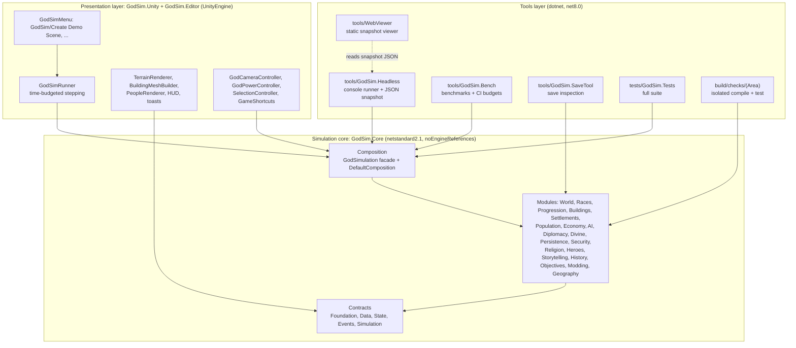
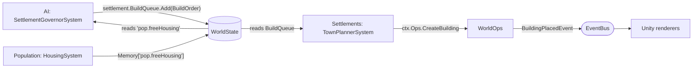
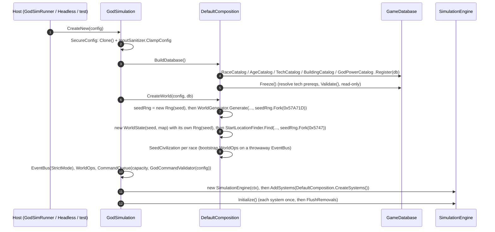
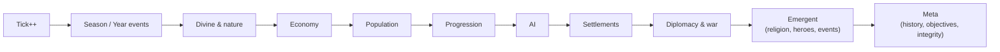
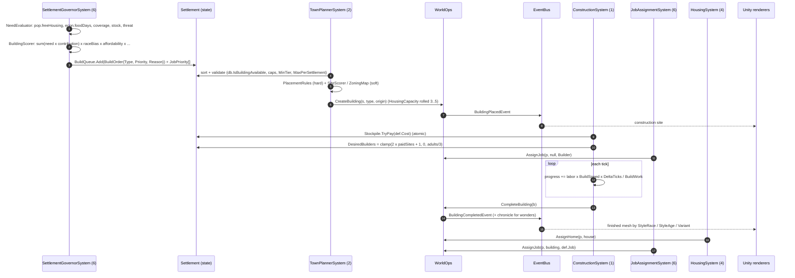
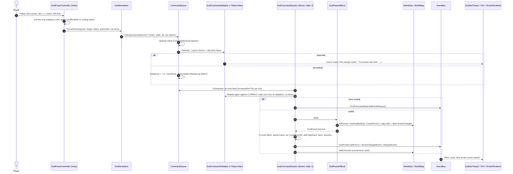
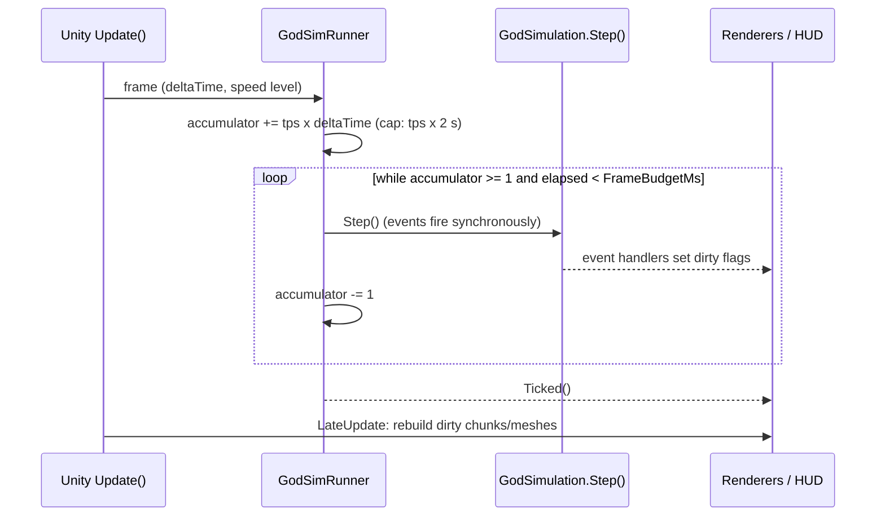

# GodSim Architecture

This document explains how GodSim is built: the layers, the dependency rule, every module, the
tick pipeline, the main data flows, and the rules that keep the simulation deterministic, safe and
fast. The binding rules are in [`ENGINEERING_CONTRACT.md`](ENGINEERING_CONTRACT.md). This document
explains them and shows how the code applies them. If the two disagree, the contract wins; please
report the mismatch.

> **Status markers.** Many modules are being written in parallel. Types and files that exist on
> disk are named directly. *(planned)* or *(in progress)* marks anything that is referenced or
> required but had not landed, or was incomplete, when this document was last checked
> (2026-11-19). The [changelog](../CHANGELOG.md) tracks what has landed.

Contents

1. [Layers](#1-layers)
2. [The dependency rule](#2-the-dependency-rule)
3. [Shared contracts](#3-shared-contracts-corecontracts)
4. [Module catalog](#4-module-catalog)
5. [The tick pipeline](#5-the-tick-pipeline)
6. [Data flow: the build pipeline](#6-data-flow-the-build-pipeline)
7. [Data flow: the god command pipeline](#7-data-flow-the-god-command-pipeline)
8. [Determinism model](#8-determinism-model)
9. [Deferred removal and WorldOps invariants](#9-deferred-removal-and-worldops-invariants)
10. [Event bus semantics and fault isolation](#10-event-bus-semantics-and-fault-isolation)
11. [Persistence and integrity](#11-persistence-and-integrity)
12. [Performance budgets and profiling](#12-performance-budgets-and-profiling)
13. [Threading model](#13-threading-model)
14. [Extension guides](#14-extension-guides)
15. [Architecture decision records](#15-architecture-decision-records)

---

## 1. Layers

GodSim has three layers. Dependencies point only downward.



| Layer | Assembly / project | Location | May reference | Must not reference |
|---|---|---|---|---|
| Simulation core | `GodSim.Core` (`noEngineReferences: true`); dotnet mirror `build/GodSim.Core.csproj` (`netstandard2.1`, C# 9) | `Assets/GodSim/Core/` | BCL subset only (contract rule 1) | `UnityEngine`, threads, wall-clock time |
| Presentation | `GodSim.Unity` (refs `GodSim.Core`, `Unity.InputSystem`) | `Assets/GodSim/Unity/` | Core, UnityEngine | Module internals: use Contracts and the `GodSimulation` facade |
| Editor tooling | `GodSim.Editor` | `Assets/GodSim/Editor/` | Unity, Core, UnityEditor | Runtime code paths |
| EditMode tests | `GodSim.Tests.EditMode` (refs `GodSim.Core`, `nunit.framework.dll`) | `Assets/GodSim/Tests/EditMode/` | Core | UnityEngine APIs (the same files run under dotnet) |
| Tools and suites | `GodSim.sln`: `build/GodSim.Core.csproj`, `tests/GodSim.Tests`, `tools/GodSim.Headless`, `tools/GodSim.Bench` (+ standalone `tools/GodSim.SaveTool`, `tools/GodSim.ContentReport`) | `tools/`, `tests/`, `build/` | Core | Unity |

The core has no Unity dependency. The same simulation therefore runs in the Unity player, in the
Unity Test Runner, under `dotnet test`, in the headless runner and in the benchmark harness. See
[ADR-0001](adr/0001-pure-csharp-simulation-core.md).

**Presentation code on disk** (`Assets/GodSim/Unity/Runtime/`):

| Folder | Types |
|---|---|
| `Core/` | `GodSimRunner`, `GodSimSettings`, `UnityLogSink`, `GodSimCoords`, `GodSimPalette`, `MaterialLibrary` |
| `Terrain/` | `TerrainRenderer`, `TerrainChunk`, `TerrainMeshBuilder`, `TreeMeshFactory`, `MinimapTexture` |
| `Buildings/` | `BuildingMeshBuilder` (a building renderer component is *planned*) |
| `Units/` | `PeopleRenderer`, `InstanceBuffer`, `UnitMeshes`, `SimulationBoundBehaviour` |
| `Interaction/` | `GodCameraController`, `GodPowerController`, `SelectionController`, `GameShortcuts`, `InputAdapter` |
| `UI/` | `GodSimHUD`, `GodSimToasts`, `HudLineChart`, `PopulationHistory`, `HudSkin` |

Shaders are in `Assets/GodSim/Unity/Shaders/` (`GodSimVertexColorLit`, `GodSimWater`).

**Editor menu** (`Assets/GodSim/Editor/GodSimMenu.cs`, `WorldPreviewWindow.cs`):

- `GodSim/Create Demo Scene`
- `GodSim/Create Settings Asset`
- `GodSim/World Preview`
- `GodSim/Simulate 100 Years (Headless)`
- `GodSim/Validate Content`
- `GodSim/Determinism Check`

## 2. The dependency rule

> Every module depends **only** on `Core/Contracts`. Modules never reference each other's types.
> Only `Composition/` knows every module.

| Channel | Type | Direction | Use for |
|---|---|---|---|
| Shared state | `WorldState` (+ `WorldMap`, `EntityStore<T>`) | read: anyone; structural writes: `ctx.Ops` | The single source of truth |
| Shared database | `GameDatabase` (frozen at startup) | read-only at runtime | Races, ages, techs, buildings, god powers |
| Events | `EventBus` (struct events) | publish: owner; subscribe: anyone (mostly presentation and meta systems) | Incremental notification |
| Blackboards | `Settlement.Memory`, `Civilization.Memory`, `WorldState.Memory` (`Dictionary<string,float>`, ordinal comparer, serialized) | write: the owning module; read: anyone | Small cross-module values that are not contract fields |



Consequences:

- A module compiles and tests alone against Contracts plus stub definitions (`build/checks/<Area>`,
  `TestDb.CreateStub()`).
- Cross-module values that are not contract fields use namespaced **blackboard keys**. The reader
  repeats the literal string. Every key a module writes is declared in its `*Keys` class and listed
  in the [module catalog](#4-module-catalog). See
  [ADR-0008](adr/0008-module-boundaries-and-blackboards.md).
- Only the lead changes contracts. Modules propose changes in their PR summary.

## 3. Shared contracts (`Core/Contracts`)

| Folder | Files | Key types |
|---|---|---|
| `Foundation/` | `Rng.cs`, `Vec2i.cs`, `MathUtil.cs`, `Guard.cs`, `SimLog.cs`, `GridPathfinder.cs` | `Rng` (PCG32), `Hashing` (`Fnv1a64`, `Mix64`, `Combine`, `Coord`), `Vec2i`, `MathUtil` (`Clamp`, `Sanitize`, `Logistic`), `Guard`, `SimValidationException`, `ISimLogger`/`NullLogger`/`ConsoleLogger`, `GridPathfinder` (bounded A*) |
| `Data/` | `Enums.cs`, `Definitions.cs`, `GameDatabase.cs` | All enums (`RaceId` 5, `AgeId` 10, `ResourceType` 13, `ServiceType` 9, `Biome` 16, `BuildingType` 75, `JobType` 22, `GodPowerType` 19, ...), `Counts`, `EnumUtil`, `BuildingDefinition`, `RaceDefinition`, `ArchitectureStyle`, `AgeDefinition`, `TechDefinition`/`TechEffect`, `GodPowerDefinition`, `GameDatabase` (`Register`, `Freeze`, `Validate`, `IsBuildingAvailable`, `CanResearch`) |
| `State/` | `WorldState.cs`, `WorldMap.cs`, `Entities.cs`, `EntityStore.cs`, `Stockpile.cs`, `WorldOps.cs`, `NameGenerator.cs` | `WorldState` (root; `SchemaVersion = 1`), `SimTime`, `WorldMap` (struct-of-arrays tiles), `Person`, `Building`, `BuildOrder`, `Settlement`, `Civilization`, `ModifierSet`, `Army`, `DiplomacyState`/`Relation`/`War`, `GodState`, `WeatherState`, `Chronicle`, `WorldStats`, `EntityStore<T>`, `IdAllocator`, `Stockpile`, `WorldOps` |
| `Events/` | `EventBus.cs`, `SimEvents.cs` | `EventBus`; 31 struct events (`PersonBornEvent` ... `ChronicleAddedEvent`) |
| `Simulation/` | `SimulationEngine.cs`, `SimConfig.cs`, `Commands.cs` | `ISimSystem`, `SimContext`, `SimulationEngine`, `SystemProfile`, `SimConfig` (+ `Sanitize`), `WorldPreset`, `GodCommand`, `ICommandValidator`, `PermissiveCommandValidator`, `CommandQueue` |

**Time and units.** One tick is one day. `SimTime.TicksPerYear = 96`, which is 4 seasons of 24 days.
A "PerTick" rate is per day. A system with `TickInterval = N` receives `ctx.DeltaTicks = N` and
scales its rates by it. Per-year probabilities become per-interval chances via
`Rng.PerYearToPerTicks(p, ctx.DeltaTicks)`.

## 4. Module catalog

Each module lives in `Assets/GodSim/Core/<Module>/`, namespace `GodSim.Core.<Module>`. Large
modules are split into **sub-areas** (such as `Economy/Production` and `Economy/Services`). Each
sub-area is owned by one team and has its own `build/checks/<ModuleSubArea>` project.

*Interval* is the system's `TickInterval` in days. Values come from the source and may change
during balancing.

> **Entry points vs. composition.** Contract §6 lists `<Module>Module.CreateSystems()` per module.
> `DefaultComposition.CreateSystems()` instead instantiates every system **directly** in canonical
> order (see [§5](#5-the-tick-pipeline)). Of the per-module factories, only `ProgressionModule`,
> `ObjectivesModule`, `LifecycleModule` and `EconomyServicesModule` exist, and Composition uses none
> of them. Content registration does follow §6: `RaceCatalog`, `AgeCatalog`, `TechCatalog`,
> `BuildingCatalog` and `GodPowerCatalog` each `.Register(db)`.

### World (`Core/World/`)

World generation. No per-tick systems.

- **Entry points:** `WorldGenerator.Generate(WorldGenSettings, Rng) : WorldMap`,
  `WorldGenSettings.FromConfig(SimConfig)`, `StartLocationFinder.Find(map, db, races, rng) : Vec2i[]`.
- **Pipeline:**
  1. Elevation: domain-warped fBm, then a preset continent mask, ridged mountain ranges and border
     falloff.
  2. Sea level by percentile, which gives an exact ocean ratio.
  3. Rank remap of land onto `TerrainLevels`, then the ocean/lake split.
  4. Temperature from latitude and altitude, then moisture.
  5. Biomes, rivers, deposits and flags.
- **Key types:** `GradientNoise`/`FractalNoise` (bit-identical output for a given generator state),
  `TerrainLevels`, `MapStatistics`, `WorldHash` (64-bit map hash).

### Geography (`Core/Geography/`) *(in progress)*

A named-region atlas: continents, islands, oceans, seas, lakes, bays, rivers and biome features.
Types: `GeographyIndex`, `GeoRegion`, `RegionKind`/`RegionLayer`. No systems are composed.

### Races (`Core/Races/`)

The five race definitions: habitat, lifespan, aptitudes, AI personality, architecture and names.

- **Entry point:** `RaceCatalog.Register(GameDatabase)`, which registers in fixed `RaceId` order.
- **Files:** `HumanRace`, `ElfRace`, `DwarfRace`, `OrcRace`, `SaurianRace`, `RaceLore` (summaries,
  backstories, creation myths, the name each race gives the god), `RaceQueries`.

| Race | Habitat | Lifespan | Strengths | Architecture |
|---|---|---|---|---|
| Human | grassland, forest, hills | ~70 | balanced, fertile, trade | timber, then stone, brick and glass; gable roofs |
| Elf | forest, jungle | ~350 | research, faith, wood, health | organic, tree platforms, leaf/dome roofs |
| Dwarf | hills, mountain | ~200 | ore, metal, tools, stone, defense | carved stone, half-sunk halls, flat/tiered roofs |
| Orc | savanna, tundra, desert, hills | ~50 | military, fertility, hardiness | hide and timber, spiked cone roofs |
| Saurian | swamp, jungle, beach | ~90 | fishing, faith, clutches | stilts, stepped pyramids |

### Progression (`Core/Progression/`)

- **Entry points:** `AgeCatalog.Register`, `TechCatalog.Register`, `ProgressionModule.CreateSystems()`.
- **Content:** `AgeCatalog` holds the 10 ages: thresholds, requirements, bonuses and soldier
  strength. `TechCatalog` holds 94 techs, 8 to 10 per age. These include two racial techs per race
  and a capstone. Tech keys have the form `"age.name"`. `TechTreeReport`/`AgeTechSummary` report
  balancing statistics and are never called per tick.

| System | Name | Interval | Does |
|---|---|---|---|
| `ModifierSystem` | `Progression.Modifiers` | 1 (full recompute every 12, or on `prog.dirty`) | Rebuilds `civ.Modifiers` from race × age × techs, applies `UnlockBuilding`, refreshes `civ.Population` |
| `ResearchSystem` | `Progression.Research` | 4 | Research = sum over settlements of (`ServiceOutput[Research]` + 0.004 × pop) × `Modifiers.Research` × `Config.ResearchMultiplier`. Learns techs. Publishes `TechResearchedEvent`. |
| `AgeProgressionSystem` | `Progression.Ages` | 24 | Advances when research, previous-age techs, population and settlement count all meet the next `AgeDefinition`. Publishes `AgeAdvancedEvent`. |

- **Helpers:** `TechQueries`, `AgeAdvanceCheck`.
- **Keys (Civilization):** `prog.dirty`, `prog.ageProgress`, `prog.researchTarget`, `prog.researchPerTick`.

### Buildings (`Core/Buildings/`)

Data only: one `BuildingDefinition` per `BuildingType`.

- **Entry point:** `BuildingCatalog.Register(GameDatabase)`, which aggregates three teams' tables:

| Sub-area | Ages | Types |
|---|---|---|
| `Early/` (`BuildingsEarly.Dawn/.Bronze/.Iron`) | Dawn to Iron | 0 to 27 |
| `Middle/` (`BuildingsMiddle`, `Middle*Buildings`) | Classical to Renaissance, plus the shared wonders | 28 to 47 and 72 to 74 |
| `Late/` (`BuildingsLate.Eras`, `.Racial`) | Industrial to Ascension, plus racial wonders | 48 to 71 |

- **Rules enforced by `GameDatabase.Validate()`:** footprint 1 to 8 tiles, `BuildWork > 0`,
  `MinAge <= MaxAge`, a `Job` requires `JobSlots > 0`, and **`House` holds 3 to 5**.

### Settlements (`Core/Settlements/`)

| System | Name | Interval | Does |
|---|---|---|---|
| `TownPlannerSystem` (`Planning/`) | `TownPlanner` | 2 | See below. |
| `RoadNetworkSystem` (`Planning/`) | `RoadNetwork` | 24 | Links each Hamlet+ settlement to its nearest same-civ settlement within 60 tiles (bounded A*, 20,000 expansions) |
| `ConstructionSystem` (`Construction/`) | `Construction` | 1 | Pays `Cost` atomically (`Stockpile.TryPay`), turns builder labor into progress, calls `Ops.CompleteBuilding`, writes `DesiredBuilders`. Abandons a site left unpaid for more than 3 years. |
| `SettlementGrowthSystem` (`Construction/`) | `SettlementGrowth` | 24 | Tiers with hysteresis (Hamlet 10, Village 30, Town 80, City 200, Metropolis 500, Megalopolis 1200). Territory radius by tier. Rebuilds the Town Center. Abandons settlements left empty for 2 years. |
| `MaintenanceSystem` (`Construction/`) | `Maintenance` | 12 | Decay, repair, renovation to the current `StyleAge`/`StyleRace` (`BuildingUpgradedEvent`), demolition after `MaxAge` |

`TownPlannerSystem` runs these steps for each settlement:

1. Sorts the AI's `BuildQueue` by priority (descending), then by requested tick.
2. Drops invalid orders.
3. Caps concurrent construction sites at 1 + pop/12, with a maximum of 6.
4. Places at most 2 orders.
5. Samples candidate sites in deterministic rings and filters them with `PlacementRules`.
6. Ranks the remaining sites with `SiteScorer` and `ZoningMap`.
7. Calls `Ops.CreateBuilding`, then lays an access road (and fields for farms).

An order is dropped after 4 failed attempts. If lack of space was the cause, the territory grows.

- **Helpers:** `PlacementRules`, `SiteProbe`, `SiteScorer`, `ZoningMap`, `PlannerRoads`,
  `TerrainDirtyRect`, `ConstructionShared`.
- **Keys (Settlement):** `build.wait.<buildingId>`, `build.sitesActive`, `build.sitesWaiting`.

### Population (`Core/Population/`)

| System | Name | Interval | Does |
|---|---|---|---|
| `NeedsSystem` (`Lifecycle/`) | `Population.Needs` | 1 | Feeds residents (children eat 0.6×, elders 0.8×). Starvation costs health. Publishes `FamineEvent`. |
| `HousingSystem` (`Society/`) | `Population.Housing` | 4 | Repairs home links, assigns households to dwellings (3 to 5 per House), counts `Homeless` |
| `JobAssignmentSystem` (`Society/`) | `Population.Jobs` | 6 | Staffs workplaces by `JobPriority`, supplies builders, counts `Unemployed`/`Soldiers` |
| `AgingSystem` (`Lifecycle/`) | `Population.Aging` | 8 | Ages people, updates `LifeStage`, rolls natural mortality |
| `BirthSystem` (`Lifecycle/`) | `Population.Births` | 8 | Births from `FertilityPerYear` × `Modifiers.Growth` |
| `FamilySystem` (`Lifecycle/`) | `Population.Families` | 12 | Deterministic, RNG-free marriages |
| `WellbeingSystem` (`Society/`) | `Population.Wellbeing` | 6 | Happiness, health and faith targets, settlement averages, unrest, epidemics |
| `MigrationSystem` (`Society/`) | `Population.Migration` | 48 | Moves people between settlements |
| `LeadershipSystem` (`Society/`) | `Population.Leadership` | 48 | Picks civilization leaders |

- **Keys (Settlement):** `lifecycle.foodNeedPerTick`, `lifecycle.foodRatio`,
  `lifecycle.lastFamineChronicleTick`, `lifecycle.totalBirths`, `pop.freeHousing`,
  `pop.housingCapacity`, `pop.dwellings`, `pop.workforce`, `pop.openJobs`, `pop.foodEmergency`,
  `pop.lastEpidemicTick`, `pop.epidemicDeaths`, `pop.emigrated`, `pop.immigrated`.
- **Keys (Civilization):** `pop.leaderId`, `pop.leaderSinceTick`, `pop.leaderCount`.

### Economy (`Core/Economy/`)

| System | Name | Interval | Does |
|---|---|---|---|
| `StorageSystem` (`Services/`) | `Economy.Storage` | 12 | Capacity = 150 + storage buildings × condition × `Modifiers.Storage`. Spoilage and overflow. |
| `ServiceSystem` (`Services/`) | `Economy.Services` | 6 | `ServiceOutput[]`, `ServiceCoverage[]` (0 to 3). Commerce turns into gold. |
| `ProductionSystem` (`Production/`) | `Economy.Production` | 2 | Staffed production from inputs and outputs per worker × staffing × skill × condition × modifiers, plus terrain extraction |
| `UpkeepSystem` (`Services/`) | `Economy.Upkeep` | 24 | `UpkeepGold`. Any unpaid share causes decay. |
| `TradeSystem` (`Services/`) | `Economy.Trade` | 24 | Intra-civ redistribution, inter-civ trade under agreements |
| `ResourceRegrowthSystem` (`Production/`) | `Economy.ResourceRegrowth` | 48 | Slow land recovery, one map window per run |
| `EconomyStatsSystem` (`Services/`) | `Economy.Stats` | 1 | `Stockpile.RollStatistics(0.05)` and food indicators |

- **Keys (Settlement):** `econ.foodDays`, `econ.netFood`, `econ.upkeepShortfall`, `econ.upkeepDue`,
  `econ.upkeepPaid`, `econ.foodSpoiled`, `econ.storageOverflow`, `econ.commerceGold`,
  `econ.tradeIn`, `econ.tradeOut`.
- **Keys (Civilization):** `econ.tradeIncome`.
- **Keys (World):** `trade.first.<lo>.<hi>`.

### AI (`Core/AI/`)

| System | Name | Interval | Does |
|---|---|---|---|
| `CivilizationStrategySystem` (`Strategy/`) | `AI.CivilizationStrategy` | 24 | Posture (peaceful, defensive, militarist), focus (growth, research, faith, military, wealth), threat and power ratio. Queues wonders. |
| `ResearchDirectorSystem` (`Strategy/`) | `AI.ResearchDirector` | 24 | Scores researchable techs and sets `CurrentResearchTechId` (ties go to the lowest id) |
| `SettlementGovernorSystem` (`Governor/`) | `AI.SettlementGovernor` | 6 | Utility AI. Needs come from `NeedEvaluator` (as `SettlementNeeds`). Candidates are scored by `BuildingScorer` using `BuildingProfile` and terrain from `TerritoryScanner`. Appends `BuildOrder`s and writes `JobPriority`. |
| `ExpansionSystem` (`Strategy/`) | `AI.Expansion` | 48 | Founds colonies (`Ops.FoundSettlement`) |

- **Types:** `ResponseCurve`, `Consideration`, `GovernorSettings`, `SettlementSurvey`,
  `TerritoryFeatures`, `GovernorText`.
- **Keys (Civilization):** `ai.posture`, `ai.focus`, `ai.threat`, `ai.powerRatio`, `ai.wars`,
  `ai.hostileNeighbours`, `ai.nextExpandTick`, `ai.lastExpandTick`, `ai.wonderType`,
  `ai.wonderTick`, `ai.wonderTry.<type>`, `ai.researchIdle`.
- **Keys (Settlement):** `ai.expandBlockedUntil`, `ai.lastSettlersTick`, `ai.gov.*`
  (`growth`, `popPrev`, `popTick`, `lastOrder`, `threat`), `ai.need.*` (`housing`, `food`,
  `storage`, `defense`), `ai.terr.*` (territory cache).
- **Reads:** `pop.freeHousing`, `econ.foodDays`.
- See [ADR-0006](adr/0006-utility-ai-for-town-building.md).

### Diplomacy (`Core/Diplomacy/`)

| System | Name | Interval | Does |
|---|---|---|---|
| `ContactSystem` (`Relations/`) | `Diplomacy.Contact` | 24 | Contact when settlements are within range |
| `RelationsSystem` (`Relations/`) | `Diplomacy.Relations` | 24 | Opinion drift, stances with hysteresis, trade pacts (`StanceChangedEvent`) |
| `WarDecisionSystem` (`Relations/`) | `Diplomacy.WarDecision` | 48 | Declares war and makes peace (`WarDeclaredEvent`, `PeaceSignedEvent`) |
| `MilitarySystem` (`Military/`) | `Diplomacy.Military` | 6 | `Settlement.DefenseStrength`, `civ.MilitaryPower`, siege damage |
| `ArmySystem` (`Military/`) | `Diplomacy.Armies` | 1 | Raising armies (`Ops.CreateArmy`), marching (`GridPathfinder`), combat (`BattleEvent`), sieges, conquest (`Ops.TransferSettlement`), disbanding |

- **Helpers:** `DiplomacyQueries` (read-only, null-safe), `RelationsTuning`,
  `RelationsSettlementIndex`, `MilitaryMath`.
- **Keys (World):** `dipl.lastWar.<lo>.<hi>`, `dipl.war.<id>.initialPower`.
- **Keys (military):** `mil.armyId`, `mil.armyInit`, `mil.siegeDamage`, `mil.restUntil`,
  `mil.noPathTarget`, `mil.noPathUntil`, `mil.lastBattleChronicle`.

### Divine (`Core/Divine/`)

| System | Name | Interval | Does |
|---|---|---|---|
| `SeasonWeatherSystem` (`Nature/`) | `Divine.SeasonWeather` | 1 | Season, rainfall random walk, temperature, `FoodYieldMultiplier`, drought and rain timers |
| `GodCommandSystem` (`Powers/`) | `Divine.GodCommands` | 1 | Drains and re-validates commands, applies `GodPowerEffects`, charges mana and starts cooldowns, publishes events. See [§7](#7-data-flow-the-god-command-pipeline). |
| `FaithSystem` (`Powers/`) | `Divine.Faith` | 6 | Mana regeneration from `ServiceOutput[Faith]` × `Devotion` × `Modifiers.Faith` (+ population term). Devotion and favor drift. |
| `DisasterSystem` (`Nature/`) | `Divine.Disasters` | 24 | Natural disasters per civ "region" (`DisasterEvent`). Gated by `EnableDisasters`/`DisasterFrequency`. |
| `FireSystem` (`Nature/`) | `Divine.Fire` | 2 | Spreads and burns out `TileFlags.Burning`, damages buildings, marks `Scorched` |

- **Entry point:** `GodPowerCatalog.Register(db)` registers all 19 powers.
- **Effects:** `GodPowerEffects` (`.Blessings`, `.Shaping`, `.Wrath`), `GodPowerTerrain`,
  `GodPowerArea` (radius- and map-bounded queries), `GodPowerOutcome`, `NaturalEffects`,
  `NatureDirtyRect`.
- **Keys:** `nature.climateEra`, `nature.disasterCount`, `nature.lastDisasterTick`, `nature.fireHint`.

| Category | Powers |
|---|---|
| Blessing | Bless, Rain, Fertility, Inspire, Heal, BountifulHarvest, Prophet |
| Shaping | RaiseLand, LowerLand, PlantForest, RevealOre |
| Creation | SpawnTribe (`Parameter` = `RaceId`) |
| Wrath | Lightning, Wildfire, Earthquake, Meteor, Plague, Flood, Drought |

### Religion (`Core/Religion/`)

`ReligionSystem` (`Religion`, interval 48) founds mortal faiths and handles their doctrines, holy
sites, conversion pressure, schisms, reformations, heresy and holy wars. There are 16 doctrines in
`DoctrineCatalog` (4 axes × 4), chosen deterministically by `DoctrineSelector` (scores plus a
seed-hashed jitter). Tuning lives in `ReligionTuning`. **Keys:** `rel.*`, for example
`rel.doctrine.<axis>`, `rel.founded`, `rel.holySite`, `rel.schisms`, `rel.heresy`,
`rel.holyWarTarget`.

### Heroes (`Core/Heroes/`)

`HeroSystem` (`Heroes`, interval 24) raises notable individuals (`HeroRole`, `HeroRules`) and
applies their small effects. Its helpers are `HeroChronicle`, `HeroQueries` and `HeroInfo`. The
registry lives entirely in `WorldState.Memory` under `hero.<personId>.*`, where the `.role` key
marks a hero, plus `hero.raised`. Heroes survive save/load with no contract change.

### Storytelling (`Core/Storytelling/`)

`WorldEventSystem` (`Storytelling.WorldEvents`, interval 48) gives each alive civilization a small
chance per run (6% × √settlements, capped at ×3) of drawing one weighted-random event from
`WorldEventCatalog`. The catalog covers calamities, faith, politics and prosperity, and includes
`Secession`. **Keys:** cooldowns in `story.cd.<key>` (civilization or world), plus `story.lastTick`,
`story.total`, `story.parentCiv` and `story.secededTick`.

### History (`Core/History/`)

`HistoryRecorder` (`History`, interval 24 = one season) samples world and civilization metrics and
an era timeline for HUD charts, the headless exporter and the chronicle UI. **It is read-only:** it
never mutates `WorldState` or touches `ctx.Rng`, so it cannot affect hashes. Also:
`ChronicleNarrator` (prose eras), `WorldStatistics` (allocation-free queries), `LifespanTracker`.

### Objectives (`Core/Objectives/`)

`ObjectiveSystem` (`Objectives`, interval 24) tracks divine quests, milestones and achievements
from `ObjectiveCatalog`, grants rewards, and detects the Ascension victory. Its event handlers only
tally counters. Entry point: `ObjectivesModule`. **Keys:** `obj.count.*`, `obj.best.*`,
`obj.<key>.progress`, `obj.phoenix.*`, `obj.peace.lastWarTick`, `obj.spawnedByGod`,
`game.ascended`, `game.ascendedCiv`, `game.ascendedTick`.

### Modding (`Core/Modding/`)

A pipeline for data mods, with no systems:

- `SafeJson`: a strict RFC 8259 parser with `JsonLimits`.
- `ModManifest`: `mod.json`, with ids matching `^[a-z0-9_.-]{3,48}$`.
- `ModPack` and `ModPatchDocument`.
- `ModHardCaps`: absolute value bounds.
- `ModText`: strips control, bidi and invisible characters.
- `SemVersion` and `SemVersionRange`.

Mods patch definitions **before** `GameDatabase.Freeze()`. The whitelist is meant to be documented
in `docs/MODDING.md` *(planned)*.

### Persistence (`Core/Persistence/`)

| Area | Types |
|---|---|
| `Format/` | `SaveSerializer` (`Serialize`, `Deserialize`, `ReadHeader`), `SaveOptions`, `SaveHeader`/`SaveFormatFlags`, `PayloadCodec`, `BoundedReader`, `StateValidator` (post-load referential integrity and repair), `SaveMigrator` (per-schema upgrades), `SaveCorruptException` |
| `Storage/` | `SaveFileStore` (slots `<Root>/<slot>.gsav`), `SaveSlotInfo`, `StateHasher`, `IKeyProvider`/`StaticKeyProvider`/`DerivedKeyProvider` (PBKDF2), `InstallKeyFile` (per-install random 32-byte secret), `ReplayLog`/`ReplayHeader`/`ReplayEntry`/`ReplayCheckpoint`, `StorageIo` |

See [§11](#11-persistence-and-integrity) and [ADR-0005](adr/0005-save-format-and-integrity.md).

### Security (`Core/Security/`)

- **`GodCommandValidator : ICommandValidator`** (ctor `(SimConfig)`) is the production validator.
  Its rules are listed in [§7](#7-data-flow-the-god-command-pipeline).
- **`RateLimiter`:** a deterministic token bucket per source plus a global per-tick cap. It measures
  time in ticks only and bounds memory with LRU eviction.
- **`InputSanitizer`:** text and config sanitizers. `GodSimulation` uses `ClampConfig`.
- **`ContentValidator`:** `Validate(db) : List<string>` (contract §6) and `Analyze(db) : ContentReport`.
  It goes deeper than `GameDatabase.Validate`:
  - every building can be reached by some race in some age;
  - production chains close;
  - every race has Dawn-age food, wood, stone and a dwelling;
  - numbers are finite and within bounds;
  - enum and flag values are defined;
  - text is bounded and free of control, bidi and invisible characters.

  It never echoes content text. Exposed in the Editor as **GodSim > Validate Content** and as the
  standalone tool `tools/GodSim.ContentReport`. `DefaultComposition.BuildDatabase()` does **not**
  call it yet.
- **`IntegritySystem`** (`Security.Integrity`, interval 96 = yearly) is composed last. It also runs
  once in `Initialize`, so a corrupted save is caught on load. It runs `IntegrityChecker.Check`,
  logs a bounded number of issues, applies `IntegrityChecker.Repair`, and accumulates the counts in
  `sec.integrityIssues` and `sec.integrityRepairs`.

See [`SECURITY.md`](SECURITY.md), which is maintained by the security team.

### Composition (`Core/Composition/`) *(owner: lead)*

- `DefaultComposition`:
  - `BuildDatabase()` registers all five catalogs and calls `Freeze()`.
  - `CreateSystems()` returns the canonical system list.
  - `CreateWorld(config, db, log)` generates terrain and seeds one civilization per starting race.
  - `SeedCivilization(...)` creates founders, the first couples, children and starter Houses (one
    per ~4 founders).
- `GodSimulation` is the facade used by Unity, the headless runner and tests:
  - `CreateNew(config)` and `Load(bytes, config, log, hmacKey)`.
  - `Save(hmacKey, createdUnixSeconds)`, `ComputeHash()`.
  - `Step()`/`StepMany(n)`.
  - `TryCastPower(power, target, radius, parameter, out error)`.
  - The properties `Engine`, `State`, `Db`, `Events`, `Commands` and `Ops`.

## 5. The tick pipeline

### Startup



`GodSimulation.Load` follows the same path, except that `SaveSerializer.Deserialize` supplies the
state. Seed and map size come from the save, and `RequireSignature` is set when a key is given.

### One `Step()`

1. `state.Tick++`.
2. Publish `SeasonChangedEvent` and/or `YearPassedEvent` if a boundary was crossed.
3. For each system `i` in registration order:
   1. Skip it if `interval > 1 && (Tick + i) % interval != 0`.
   2. Otherwise set `ctx.DeltaTicks = interval` and run `Tick(ctx)` inside a fault boundary.
   3. Then **`Ops.FlushRemovals()`**.
4. Record `LastStepMs`.



Removals are flushed after **every** system.

### Canonical system order (`DefaultComposition.CreateSystems()`)

`#` is the registration index, which also sets each system's stagger phase.

| # | System | Interval | # | System | Interval |
|---|---|---|---|---|---|
| | **Divine & nature** | | | **AI** | |
| 0 | `SeasonWeatherSystem` | 1 | 24 | `CivilizationStrategySystem` | 24 |
| 1 | `GodCommandSystem` | 1 | 25 | `ResearchDirectorSystem` | 24 |
| 2 | `FaithSystem` | 6 | 26 | `SettlementGovernorSystem` | 6 |
| 3 | `DisasterSystem` | 24 | 27 | `ExpansionSystem` | 48 |
| 4 | `FireSystem` | 2 | | **Settlements** | |
| | **Economy** | | 28 | `TownPlannerSystem` | 2 |
| 5 | `StorageSystem` | 12 | 29 | `RoadNetworkSystem` | 24 |
| 6 | `ServiceSystem` | 6 | 30 | `ConstructionSystem` | 1 |
| 7 | `ProductionSystem` | 2 | 31 | `SettlementGrowthSystem` | 24 |
| 8 | `UpkeepSystem` | 24 | 32 | `MaintenanceSystem` | 12 |
| 9 | `TradeSystem` | 24 | | **Diplomacy & war** | |
| 10 | `ResourceRegrowthSystem` | 48 | 33 | `ContactSystem` | 24 |
| 11 | `EconomyStatsSystem` | 1 | 34 | `RelationsSystem` | 24 |
| | **Population** | | 35 | `WarDecisionSystem` | 48 |
| 12 | `NeedsSystem` | 1 | 36 | `MilitarySystem` | 6 |
| 13 | `HousingSystem` | 4 | 37 | `ArmySystem` | 1 |
| 14 | `JobAssignmentSystem` | 6 | | **Emergent** | |
| 15 | `AgingSystem` | 8 | 38 | `ReligionSystem` | 48 |
| 16 | `BirthSystem` | 8 | 39 | `HeroSystem` | 24 |
| 17 | `FamilySystem` | 12 | 40 | `WorldEventSystem` | 48 |
| 18 | `WellbeingSystem` | 6 | | **Meta** | |
| 19 | `MigrationSystem` | 48 | 41 | `HistoryRecorder` | 24 |
| 20 | `LeadershipSystem` | 48 | 42 | `ObjectiveSystem` | 24 |
| | **Progression** | | 43 | `IntegritySystem` (Security) | 96 |
| 21 | `ModifierSystem` | 1 | | | |
| 22 | `ResearchSystem` | 4 | | | |
| 23 | `AgeProgressionSystem` | 24 | | | |

Why this order:

| Group | Reason |
|---|---|
| Divine & nature | Weather comes first, so yields and fire use this tick's conditions. Player commands land before every other system, so the rest of the tick sees their effects. |
| Economy | Capacity and services come before production. `EconomyStatsSystem` rolls the economy's flows into averages last in its group. |
| Population | Eats what was produced, then housing, jobs, life events. |
| Progression | Fresh modifiers, then research and ages. |
| AI | Decides on fresh data and writes `BuildOrder`s, `JobPriority` and research choices. |
| Settlements | The planner consumes the AI's orders in the same tick, construction advances, then tiers. |
| Diplomacy & war | Reacts to the settled world state of this tick. |
| Emergent | Religion, heroes and world events build on all of the above. |
| Meta | Observes the settled tick: history sampling, objectives, integrity checks (security). |

### Staggering

`(Tick + i) % interval` spreads systems with the same interval across different ticks, so that
yearly-ish work does not pile onto one tick.

> **Important.** The phase depends on the **registration index**. Adding, removing or reordering a
> system shifts the phase of every system after it. That changes every seed's history and
> invalidates golden hashes and replays. `DefaultComposition` documents this: "Order is part of
> determinism". The test helpers `TestWorlds.Run`/`RunAll` schedule by `Tick % interval` without the
> `+ i` offset, so unit tests run systems in a different phase than the engine.

## 6. Data flow: the build pipeline



- **Availability** has one source of truth: `db.IsBuildingAvailable(civ, type)`. It checks race,
  `MaxAge`, and either `MinAge` or a tech unlock.
- **Housing rule:** the governor keeps free housing at or above `max(2, 8% of population)`. Towns
  therefore grow by **one dwelling per 3 to 5 people**
  ([ADR-0007](adr/0007-housing-rule-3-to-5.md)).
- **Style:** `StyleRace` and `StyleAge` are stamped at placement. `MaintenanceSystem` renovates
  buildings later (`BuildingUpgradedEvent`).
- **Failure paths:** the planner drops an order after 4 failed attempts. A site left unpaid for
  more than 3 years is destroyed (`DestroyCause.Abandoned`).

## 7. Data flow: the god command pipeline



`GodCommandValidator` applies its checks in this order:

1. The command is not null.
2. `Source` is non-empty, at most 64 characters, printable ASCII.
3. `Power` is defined, with a registered, sane definition.
4. `Target` is in bounds.
5. `Radius` is within `[MinRadius, MaxRadius]` and at most `AbsoluteMaxRadius`.
6. `Parameter == 0`, unless the power uses a race parameter. In that case it must be a defined,
   registered `RaceId`.
7. The world age gate (`MinWorldAge`) is met.
8. There is enough mana.
9. The cooldown has expired.
10. The target is land, if the power requires it.
11. An alive settlement is within `radius + SettlementReachSlack`, if the power requires it.
12. **`RateLimiter`**: a global per-tick cap plus a per-source token bucket.

**Two-phase validation.** Only the enqueue call may consume a rate-limit token. A command object
that was admitted gets **one** free re-validation at execution, which protects against TOCTOU
changes. A forged `Sequence` cannot bypass the limiter. `ValidateForExecution` runs the pure
checks without touching the limiter and is meant for UI previews. `GodPowerController` does not
use it yet: its preview ring reflects only mana and cooldown. Rejection reasons are short
user-facing sentences and never echo untrusted text.

## 8. Determinism model

**Goal:** the same seed, `SimConfig`, content, system order and command log give the same
`WorldState` on the same build and runtime, tick for tick. See
[ADR-0002](adr/0002-deterministic-simulation.md).

**Verification:**

- `StateHasher.Compute(state)` hashes all of `WorldState` with FNV-1a 64 over a canonical
  little-endian encoding. `ComputeSections` gives one hash per section (14 sections) to locate a
  divergence.
- `WorldHash` covers the map only.
- `tests/GodSim.Tests/Integration/DeterminismTests.cs` and `SaveLoadContinuityTests.cs`.
- Headless `--hash`.
- The Editor menu item **GodSim/Determinism Check**.

| Source of nondeterminism | Rule | Mechanism |
|---|---|---|
| Random numbers | Only `ctx.Rng` | One PCG32 in `WorldState` (serialized). `Rng.Fork(salt)` for sub-streams. World generation uses forks of a separate `Rng(config.Seed)`. |
| Iteration order | `EntityStore.Items` by index. Never `Dictionary`/`HashSet` order for decisions. | Insertion order with swap-remove. `SortedDictionary` relations, `SortedSet` techs. `StateHasher` sorts `Memory` keys. |
| String hashing | Never `string.GetHashCode()` | `Hashing.Fnv1a64`/`Mix64`/`Combine` |
| Time | No clocks in decisions | `Stopwatch` for profiling only. `RateLimiter` counts ticks. Save timestamps are supplied by the caller (`SaveOptions.CreatedUnixSeconds`). |
| Identity | No `Guid.NewGuid` | `IdAllocator`: monotonic ids, never reused |
| Concurrency | No threads or async in Core | Single-threaded `Step()` |
| Frame rate | The simulation never reads frame time | `GodSimRunner` chooses *how many* ticks run per frame, never *what* a tick does |
| Player input | Applied at tick boundaries in `Sequence` order | `CommandQueue` stamps `Sequence`/`IssuedTick`. `ReplayLog` records accepted commands plus hash checkpoints. |
| Enum sizes | Arrays sized by `Counts.*` | Append-only enums |

**Known limits and risks:**

- **Floating point across runtimes.** `+ - * /` and `Math.Sqrt` are IEEE-exact. `Math.Pow`
  (`PerYearToPerTicks`), `Math.Exp` (`Logistic`) and `Math.Log`/`Math.Cos` (`Gaussian`) are not
  guaranteed bit-identical across CoreCLR, Mono and IL2CPP or across CPUs. Determinism is guaranteed
  for the same build on the same platform.
- **Stockpile period counters are not persisted.** `Stockpile`'s per-period flow counters are
  private, with no contract accessor, so `PayloadCodec` and `StateHasher` cannot see them.
  `EconomyStatsSystem` (#11) rolls them mid-tick, and later systems (`NeedsSystem`,
  `ConstructionSystem`, ...) keep adding to them. They are therefore **non-zero between ticks**, and
  a world resumed from a save sees different `AvgIncome`/`AvgExpense` on its first roll.
  `SaveLoadContinuityTests.SaveLoadMidRunMatchesStraightRun` is expected to catch this. Fix by
  adding period accessors to the contract, or by rolling statistics as the very last system of the
  tick.
- **Validator state lives outside `WorldState`.** `RateLimiter` buckets and the validator's
  free-revalidation bookkeeping are not saved, so they reset on load. This does not affect
  simulation state, only which commands are accepted right after a load.
- **Swap-remove** reorders stores after a flush. This is deterministic, but ids are not sorted.

## 9. Deferred removal and WorldOps invariants

`WorldOps` (`ctx.Ops`) is the only sanctioned way to create or destroy entities and change links.
See [ADR-0004](adr/0004-worldops-mutation-gateway.md).

**Deferred removal.** `KillPerson`, `DestroyBuilding`, `DestroySettlement` and `DisbandArmy` each:

1. flag the entity (`IsAlive = false` / `IsDestroyed = true`);
2. unlink it from its neighbors;
3. publish the matching event;
4. enqueue its id in `WorldState.Pending*Removals`.

The engine calls `FlushRemovals()` after every system and after `Initialize`. When iterating, **skip
`!IsAlive` / `IsDestroyed`**. Pending lists are always empty between ticks and are never
serialized. Civilizations are never removed from the store: `CollapseCivilization` only sets
`IsAlive = false`.

| Link | Kept in sync by |
|---|---|
| `Person.HomeId` and `Building.Residents` | `AssignHome`, `ClearHome`, `KillPerson`, `DestroyBuilding`, `MovePersonToSettlement` |
| `Person.WorkplaceId`/`Job` and `Building.Workers` | `AssignJob`, `ClearJob`, `KillPerson`, `DestroyBuilding` |
| `Person.SettlementId` and `Settlement.ResidentIds` | `CreatePerson`, `KillPerson`, `MovePersonToSettlement`, `DestroySettlement` |
| `Building.SettlementId` and `Settlement.BuildingIds`/`TownCenterId` | `CreateBuilding`, `DestroyBuilding` |
| `Settlement.CivilizationId` and `Civilization.SettlementIds`/`CapitalId` | `CreateSettlement`, `TransferSettlement`, `DestroySettlement` (reassigns the capital, collapses an empty civ) |
| `Person.ArmyId` and `Army.SoldierIds` | `CreateArmy`, `DisbandArmy`, `KillPerson`, `TransferSettlement` |
| `Person.SpouseId` (symmetric) | `KillPerson` clears the partner. `FamilySystem` pairs people. |
| `WorldMap.BuildingAt[]` and the footprint | `CreateBuilding`, `DestroyBuilding` (`Ruins` unless demolished) |
| `WorldMap.Owner[]` | `ClaimTerritory` (never steals), `ReleaseTerritory` |
| `Relation.WarId` and `War.IsActive` | `CollapseCivilization`. `WarDecisionSystem` repairs stale links. |

Further guarantees:

- Ids are monotonic and never reused.
- `Stockpile.TryPay` is atomic.
- Chronicle text is capped at 300 characters and the chronicle at 2000 entries.
- After a load, `StateValidator` re-checks these links. Fatal problems reject the save; repairable
  ones are fixed and reported.

**Not covered by WorldOps** (systems must tolerate these):

- `DestroySettlement` leaves armies with that `HomeSettlementId`/`TargetSettlementId` untouched.
- `CreateBuilding` claims unowned footprint tiles without `TerritoryChangedEvent`.
- `MovePersonToSettlement` keeps `ArmyId`.
- `DefaultComposition.SeedCivilization` sets founder `SpouseId`s directly, which is acceptable at
  bootstrap.

## 10. Event bus semantics and fault isolation

See [ADR-0003](adr/0003-struct-event-bus.md).

| Property | Behavior |
|---|---|
| Payload | `struct` only. No boxing, no per-publish allocation. `tools/GodSim.Bench` enforces 0 B for 0 and 5 subscribers. |
| Dispatch | **Synchronous**, inside the publishing system's `Tick`, in subscription order |
| Re-entrancy | Handlers may publish. Dispatch is depth-first. |
| (Un)subscribe during publish | Safe, through copy-on-write handler arrays |
| Handler exceptions | Caught, logged and counted in `HandlerFaults`. Rethrown only under `StrictMode`. |
| Diagnostics | `PublishedCount`, `HandlerFaults`, `HandlerCount<T>()` |

**Subscribers:**

- Presentation **must not mutate simulation state**. It sets dirty flags and does the work in
  `Update`/`LateUpdate`.
- Simulation-side subscribers (such as `ObjectiveSystem` and `LifespanTracker`) subscribe in
  `Initialize` and only tally into `Memory` or private counters.
- Handler time counts toward the publisher's `SystemProfile`.
- Unsubscribe symmetrically.
- During world bootstrap, `DefaultComposition.CreateWorld` publishes into a throwaway bus. Events
  from world seeding are therefore not observable.

**System fault isolation.**

- Each `Initialize`/`Tick` runs in try/catch. A fault increments `ConsecutiveFaults`/`TotalFaults`,
  records `LastError` and logs an error.
- After `SimConfig.MaxSystemFaults` (default 25) consecutive faults the system is
  **disabled**.
- Removals are still flushed after a faulting system.
- `StrictMode` (tests, CI, headless `--strict`) rethrows instead.
- `GodSimRunner` pauses the game if `Step()` throws.

Isolation keeps a world running. It does not undo a partial mutation, so contract rule 5 still
applies.

## 11. Persistence and integrity

See [ADR-0005](adr/0005-save-format-and-integrity.md). The byte-level layout is in
[`SAVE_FORMAT.md`](SAVE_FORMAT.md).

```mermaid
flowchart LR
    WS[("WorldState")] --> Ser["SaveSerializer.Serialize(state, SaveOptions)"]
    Ser --> P["PayloadCodec: map arrays, stores, Rng, Ids,<br/>diplomacy, god, weather, chronicle, stats, Memory"]
    P --> Z["GZip (SaveOptions.Compress, default on)"]
    Ser --> H["SaveHeader: magic, format/schema version, flags,<br/>GameVersion, CreatedUnixSeconds"]
    H --> Tag["32-byte tag over header || payload:<br/>HMAC-SHA256 (key) or SHA-256 (unsigned)"]
    Z --> Tag
    Tag --> File["header | tag | payload"]
    File --> Store["SaveFileStore: Root/slot.gsav, atomic write"]
    Store --> D["SaveSerializer.Deserialize(bytes, db, options)"]
    D --> C1["size caps before any work"] --> C2["verify tag (constant time) before decompression"] --> C3["decompress capped at MaxUncompressedBytes"] --> C4["count / enum / float validation"] --> C5["StateValidator + SaveMigrator"]
    C5 --> WS2[("WorldState")]
```



- **Limits** (`SaveOptions`): `MaxCompressedBytes` = 64 MiB, `MaxUncompressedBytes` = 512 MiB.
  Only `SaveCorruptException` escapes `Deserialize`/`ReadHeader`.
- **Signing:** when `SaveOptions.HmacKey` is set, the tag is HMAC-SHA256. Otherwise it is a plain
  SHA-256 checksum, which detects corruption but not tampering. `GodSimulation.Load` requires a
  signature only when a key is passed. Keys come from `IKeyProvider`: `StaticKeyProvider`,
  `DerivedKeyProvider` (PBKDF2-HMAC-SHA256), or `InstallKeyFile` (a random per-install 32-byte
  `install.key`, created atomically). A per-install key detects edits and files copied from another
  installation. It does not stop a local user who reads `install.key`.
- **Slots:** names match `^[A-Za-z0-9_-]{1,48}$` (Windows reserved names excluded), files are
  `<slot>.gsav`, and writes are atomic. `SaveSlotInfo` timestamps come from the file system and are
  never read by the simulation.
- **Not saved:** the `GameDatabase` (rebuilt from code), `Settlement.AiLog`, pending removals,
  profiles, `WorldMap.TerrainVersion`, and the Stockpile period counters (see
  [§8](#8-determinism-model)).
- **Compatibility:**
  - Enums are append-only.
  - `WorldState.SchemaVersion` drives `SaveMigrator`. Fields added in schema N are read only from
    files of schema N or later.
  - **Tech references are saved as registration indices** (`KnownTechs`, `CurrentResearchTechId`).
    Inserting a tech anywhere but the end of `TechCatalog` silently remaps techs in old saves.
    `StateValidator` only drops ids that no longer exist. Append techs, or move saves to tech keys.
- **Replays:** `ReplayLog.Attach` chains onto `CommandQueue.OnAccepted`. It records each accepted
  command and its tick, plus a `ReplayHeader` (seed, map, preset, outcome-relevant config) and
  optional `ReplayCheckpoint` state hashes.
- **Tooling:** `tools/GodSim.SaveTool` inspects save files (`info`, `verify`, `stats`, `diff`).

## 12. Performance budgets and profiling

| Budget | Target | Enforced by |
|---|---|---|
| Full tick, 5,000 people | **< 3 ms mean** | `tools/GodSim.Bench --budget` (`stress/people5000`) |
| `EventBus.Publish`, 0 and 5 subscribers | **0 B** allocated | Bench budget |
| `GridPathfinder`, 128-tile path (open / 22% obstacles) | **< 0.5 ms median** | Bench budget |
| Steady-state per-tick allocations | 0 in hot loops | Review, Unity Profiler GC Alloc |
| Heavy systems | Interval 4 to 48 plus staggering | Review |
| Hard caps (`SimConfig`) | `MaxPopulation` 40,000; `MaxSettlementsPerCiv` 24; `MaxBuildingsPerSettlement` 600; `MaxArmies` 256 | `SimConfig.Sanitize` / `InputSanitizer.ClampConfig` |

**Profiling data.** `SimulationEngine.Profiles` has one `SystemProfile` per system: `LastMs`,
`AvgMs` (EMA, α = 0.05), `Runs`, `ConsecutiveFaults`, `TotalFaults`, `Disabled` and `LastError`.
`LastStepMs` is the wall time of the last step. `AvgMs` is **per run**, so per-tick cost is
`AvgMs / TickInterval`. Systems with a long interval spike on the tick they run.

```csharp
var sim = GodSimulation.CreateNew(new SimConfig { Seed = 42 });
sim.StepMany(SimTime.TicksPerYear * 50);
foreach (var p in sim.Engine.Profiles)
    sim.Log.Info(p.Name + ": avg " + p.AvgMs.ToString("0.000") + " ms/run" + (p.Disabled ? " DISABLED: " + p.LastError : ""));
```

Where to look:

- `tools/GodSim.Bench` (`--quick`, `--filter`, `--json`, `--budget`).
- Headless `--benchmark`.
- The in-game performance overlay (`F3`): FPS, sim ms per tick, per-system timings and faults.
- `GodSimRunner.LastFrameSteps` and `LastFrameStepMs`.

Recipes are in [CONTRIBUTING](CONTRIBUTING.md#profiling).

Patterns in the code:

- buffers reused through fields (`SocietyHouseholdBuffer`, `InstanceBuffer`);
- key string caches (`RelationsKeyCache`);
- per-run spatial snapshots (`RelationsSettlementIndex`);
- windowed map sweeps (`ResourceRegrowthSystem`);
- dirty rectangles (`TerrainDirtyRect`, `NatureDirtyRect`) and dirty flags (`prog.dirty`);
- terrain chunks (`TerrainChunk`).

## 13. Threading model

- **The simulation is single-threaded.** Core has no threads, tasks, async or locks. The
  analyzer and the compat script both reject them. `GridPathfinder`, `EventBus`, `CommandQueue`,
  `GodCommandValidator` and `RateLimiter` are not thread-safe.
- **The main thread only.** `GodSimRunner` (`[DefaultExecutionOrder(-1000)]`, a scene singleton)
  steps the engine in `Update`. Input enqueues on the main thread.
- **Time-budgeted stepping.**
  1. Each frame: `accumulator += ticksPerSecond × Time.deltaTime`.
  2. The accumulator is capped at `MaxBacklogSeconds` (2 s) worth of ticks, so slow frames cannot
     spiral.
  3. The runner steps while `accumulator >= 1` and the frame's `FrameBudgetMs` is not used up. The
     default is 8 ms, clamped to the range 0.5 to 100 ms.
  4. It then raises `Ticked` once.

  Speeds (`SpeedLevels`) are 1, 4, 16, 64 and 240 ticks per second. Every tick is a complete,
  deterministic `Step()`.
- **Rendering** reads `WorldState` after stepping. Renderers rebuild on `SimulationCreated`,
  refresh on `Ticked`, and react to events. They never write simulation state.
- **Headless, bench and tests** call `StepMany(n)`.



## 14. Extension guides

### Add a building

1. Ask the lead to **append** to `BuildingType` (`Data/Enums.cs`). Never reorder.
2. Add its `BuildingDefinition` in the right `Buildings/` sub-area. Fill in:
   - `Category`, `Shape`, `MinAge`/`MaxAge`, `AllowedRaces`;
   - `Width`/`Height` (1 to 8), `Cost`, `BuildWork > 0`;
   - `Job`/`JobSlots`, inputs and outputs per worker, `Services`, `StorageCapacity`, `UpkeepGold`;
   - `Placement`, `Desirability`, `VisualHeight`.
3. Optional: unlock it early with `TechEffect.Unlock(type)` in `TechCatalog`.
4. Make sure the governor can value it: `BuildingProfile` contributions come from its data.
5. Map its `BuildingShape`/`RoofStyle` in `BuildingMeshBuilder`.
6. Add tests: `GameDatabase.Validate()` passes, the definition values hold, and the governor picks
   it in a scenario.

### Add a technology

1. Add a `TechDefinition` in `TechCatalog`:
   - a unique lowercase key `"age.name"`;
   - `Age` and `Cost > 0`;
   - `PrerequisiteKeys` from the same or earlier ages, with no cycles;
   - `Effects`.
2. **Append it at the end of the catalog.** Saves store tech ids, which are registration indices.
   See [§11](#11-persistence-and-integrity).
3. Check the age's cost-to-research-window ratio with `TechTreeReport`.

### Add a race

A race touches the contract and every content module, so plan it with the lead.

1. Append to `RaceId`. `RaceMask` is a `byte` with `All = 31` hard-coded: it must become `63`, and
   at most 8 races fit.
2. Write `<Name>Race.cs`, with arrays sized by `Counts.*`, and register it in `RaceCatalog`.
   Update **every** race's `RaceAffinity`.
3. Add racial techs, unique buildings, `RaceLore`, names, `ArchitectureStyle`, and Unity styles.
4. Check `StartLocationFinder` habitability, the `SimConfig.StartingRaces` defaults, the headless
   `--races` parser, and the race cycle in `GodPowerController` for Spawn Tribe.

### Add a god power

1. Append to `GodPowerType`. This changes `Counts.GodPowers` and the length of
   `GodState.CooldownUntil`, which is a save-format change.
2. Add its `GodPowerDefinition` in `GodPowerCatalog`.
3. Implement the effect in the matching `GodPowerEffects.<Category>.cs` partial:
   - mutate only through `ctx.Ops`, plus map writes followed by `MarkTerrainChanged()` and a
     `TerrainChangedEvent`;
   - keep it bounded with `GodPowerArea`;
   - return a `GodPowerOutcome`.
4. Extend `GodCommandValidator` for any new preconditions.
5. Update the Unity side: hotkey and power bar (`GodPowerController`), VFX on `GodPowerCastEvent`,
   and [`CONTROLS.md`](CONTROLS.md).

### Add a system

1. Implement `ISimSystem` in the owning module: `Name = "<Module>.<Thing>"`, `TickInterval >= 1`,
   `Initialize` and `Tick`.
2. In `Tick`:
   - scale by `ctx.DeltaTicks`;
   - use `ctx.Rng` and `ctx.Ops`;
   - skip dead and destroyed entities;
   - clamp with `MathUtil`;
   - never throw on bad data;
   - reuse buffers.
3. Keep persistent state in `WorldState` or a blackboard. Declare the keys in the module's `*Keys`
   class.
4. Ask the lead to add it to `DefaultComposition.CreateSystems()`. That file is lead-owned. Insert
   the system **at the end of its group** if possible. Every system after it shifts phase, so
   golden hashes must be regenerated and the PR must say so.
5. Add tests in `Tests/EditMode/<Module>/`, including a same-seed determinism test.

## 15. Architecture decision records

| ADR | Title |
|---|---|
| [0001](adr/0001-pure-csharp-simulation-core.md) | Pure C# simulation core |
| [0002](adr/0002-deterministic-simulation.md) | Deterministic simulation |
| [0003](adr/0003-struct-event-bus.md) | Struct event bus |
| [0004](adr/0004-worldops-mutation-gateway.md) | WorldOps mutation gateway |
| [0005](adr/0005-save-format-and-integrity.md) | Save format and integrity |
| [0006](adr/0006-utility-ai-for-town-building.md) | Utility AI for town building |
| [0007](adr/0007-housing-rule-3-to-5.md) | Housing rule: 3 to 5 residents per dwelling |
| [0008](adr/0008-module-boundaries-and-blackboards.md) | Module boundaries and blackboards |
