<!--
  AUTO-GENERATED FILE. DO NOT EDIT BY HAND.
  Generated by tools/GodSim.ContentReport from the content catalogs in Assets/GodSim/Core/.
  Regenerate: dotnet run --project tools/GodSim.ContentReport -c Release
-->

# GodSim Content Reference

> **Auto-generated, do not edit by hand.** This file is rebuilt from the content catalogs
> (`RaceCatalog`, `AgeCatalog`, `TechCatalog`, `BuildingCatalog`, `GodPowerCatalog`). Change the data, then regenerate:
>
> ```bash
> dotnet run --project tools/GodSim.ContentReport -c Release
> # if a systems module does not compile yet, use the content-only check build:
> build/checks/ContentReport/run.sh
> ```
>
> CI gate: add `--check` (exit 1 on content errors). JSON dump for the web viewer: `--json <file>`.

| Content                   |     Count |
| ------------------------- | --------: |
| Races                     |         5 |
| Ages                      |        10 |
| Technologies              |        94 |
| Buildings                 |        75 |
| God powers                |        19 |
| Errors / warnings / notes | 0 / 1 / 8 |

Database frozen successfully. Catalogs loaded: Races, Ages, Techs, Buildings, God powers. Content fingerprint `fnv1a64:5f1d369346635d23`.

Units: 1 tick = 1 day, 96 ticks per year. Rates marked *per worker* are per staffed worker per tick; services are per fully staffed building per tick. Shading uses five dots: ●●●●● = 1.0, ○○○○○ = 0.


## Contents

1. [Races](#races)
2. [Ages](#ages)
3. [Technologies](#technologies)
4. [Buildings](#buildings)
5. [God powers](#god-powers)
6. [Balance sanity](#balance-sanity)
   - [Warnings](#warnings)


## Races


### Comparison

| Race        | Lifespan | Adult | Elder | Fertility/yr | Max kids | Food/tick | Food/yr | Health | Disease res. | Build | Research | Faith | Military | Trade | Move |
| ----------- | -------: | ----: | ----: | -----------: | -------: | --------: | ------: | -----: | -----------: | ----: | -------: | ----: | -------: | ----: | ---: |
| **Human**   |       70 |    16 |    55 |         0.21 |        4 |     0.050 |     4.8 |   1.00 |         0.95 |  1.05 |     1.00 |  1.00 |     1.00 |  1.25 | 1.00 |
| **Elf**     |      350 |    30 |   280 |         0.09 |        5 |     0.040 |     3.8 |   1.20 |         1.30 |  0.85 |     1.30 |  1.25 |     0.90 |  0.85 | 1.10 |
| **Dwarf**   |      200 |    30 |   150 |         0.14 |        6 |     0.050 |     4.8 |   1.15 |         1.15 |  1.30 |     0.95 |  0.90 |     1.15 |  1.05 | 0.85 |
| **Orc**     |       50 |    12 |    38 |         0.22 |        5 |     0.060 |     5.8 |   1.25 |         1.25 |  0.95 |     0.75 |  0.90 |     1.40 |  0.70 | 1.10 |
| **Saurian** |       90 |    10 |    70 |         0.09 |        4 |     0.045 |     4.3 |   1.05 |         1.10 |  1.00 |     1.05 |  1.35 |     1.05 |  0.95 | 0.95 |

Ages in years. Aptitudes are multipliers (1.00 = baseline).


### Personality and layout

| Race        | Aggression | Expansion  |   Piety    |  Industry  | Curiosity  | Diplomacy  | Xenophobia | Mercantile | Spacing | Compact | Roads |
| ----------- | :--------: | :--------: | :--------: | :--------: | :--------: | :--------: | :--------: | :--------: | ------: | ------: | ----: |
| **Human**   | ●●○○○ 0.45 | ●●●○○ 0.65 | ●●●○○ 0.50 | ●●●○○ 0.60 | ●●●○○ 0.60 | ●●●○○ 0.70 | ●○○○○ 0.20 | ●●●●○ 0.80 |      14 |    0.55 |  0.80 |
| **Elf**     | ●○○○○ 0.20 | ●●○○○ 0.30 | ●●●●○ 0.75 | ●●○○○ 0.45 | ●●●●○ 0.85 | ●●●○○ 0.50 | ●●●●○ 0.75 | ●●○○○ 0.30 |      18 |    0.25 |  0.10 |
| **Dwarf**   | ●●○○○ 0.40 | ●●○○○ 0.35 | ●●○○○ 0.45 | ●●●●● 0.95 | ●●●○○ 0.50 | ●●○○○ 0.40 | ●●●○○ 0.55 | ●●●○○ 0.65 |      16 |    0.85 |  0.60 |
| **Orc**     | ●●●●○ 0.90 | ●●●●○ 0.85 | ●●○○○ 0.40 | ●●●○○ 0.50 | ●●○○○ 0.30 | ●○○○○ 0.20 | ●●●○○ 0.60 | ●○○○○ 0.25 |      12 |    0.20 |  0.20 |
| **Saurian** | ●●○○○ 0.35 | ●●○○○ 0.45 | ●●●●○ 0.90 | ●●●○○ 0.60 | ●●●○○ 0.55 | ●●●○○ 0.55 | ●●○○○ 0.35 | ●●●○○ 0.55 |      15 |    0.50 |  0.50 |


### Habitability by biome

| Biome        |   Human    |    Elf     |   Dwarf    |    Orc     |  Saurian   | Best for |
| ------------ | :--------: | :--------: | :--------: | :--------: | :--------: | :------: |
| DeepOcean    | ○○○○○ 0.00 | ○○○○○ 0.00 | ○○○○○ 0.00 | ○○○○○ 0.00 | ○○○○○ 0.00 |    —     |
| ShallowWater | ○○○○○ 0.00 | ○○○○○ 0.00 | ○○○○○ 0.00 | ○○○○○ 0.00 | ○○○○○ 0.00 |    —     |
| Lake         | ○○○○○ 0.00 | ○○○○○ 0.00 | ○○○○○ 0.00 | ○○○○○ 0.00 | ○○○○○ 0.00 |    —     |
| Beach        | ●●●○○ 0.60 | ●●○○○ 0.30 | ●○○○○ 0.15 | ●●○○○ 0.30 | ●●●●○ 0.80 | Saurian  |
| Grassland    | ●●●●● 1.00 | ●●●○○ 0.70 | ●●○○○ 0.45 | ●●●○○ 0.65 | ●●○○○ 0.45 |  Human   |
| Savanna      | ●●●○○ 0.60 | ●●○○○ 0.30 | ●●○○○ 0.30 | ●●●●● 1.00 | ●●●○○ 0.50 |   Orc    |
| Forest       | ●●●●○ 0.80 | ●●●●● 1.00 | ●●○○○ 0.40 | ●●○○○ 0.40 | ●●●○○ 0.50 |   Elf    |
| Jungle       | ●●○○○ 0.35 | ●●●●○ 0.80 | ●○○○○ 0.10 | ●●○○○ 0.30 | ●●●●○ 0.90 | Saurian  |
| Desert       | ●○○○○ 0.25 | ○○○○○ 0.05 | ●●○○○ 0.30 | ●●●○○ 0.60 | ●●○○○ 0.35 |   Orc    |
| Swamp        | ●○○○○ 0.25 | ●●○○○ 0.40 | ○○○○○ 0.05 | ●●○○○ 0.35 | ●●●●● 1.00 | Saurian  |
| Taiga        | ●●○○○ 0.45 | ●●●○○ 0.60 | ●●●○○ 0.70 | ●●●○○ 0.50 | ○○○○○ 0.05 |  Dwarf   |
| Tundra       | ●○○○○ 0.20 | ●○○○○ 0.15 | ●●●○○ 0.50 | ●●●○○ 0.70 | ○○○○○ 0.02 |   Orc    |
| Hills        | ●●●○○ 0.70 | ●●○○○ 0.45 | ●●●●● 1.00 | ●●●●○ 0.80 | ●●○○○ 0.30 |  Dwarf   |
| Mountain     | ●○○○○ 0.20 | ●○○○○ 0.15 | ●●●●○ 0.90 | ●●○○○ 0.35 | ●○○○○ 0.10 |  Dwarf   |
| Snow         | ○○○○○ 0.05 | ○○○○○ 0.05 | ●●○○○ 0.35 | ●○○○○ 0.20 | ○○○○○ 0.00 |  Dwarf   |
| Volcanic     | ○○○○○ 0.05 | ○○○○○ 0.02 | ●●○○○ 0.45 | ●●○○○ 0.40 | ●●○○○ 0.30 |  Dwarf   |


### Production multipliers

| Resource    |     Human |       Elf |     Dwarf |       Orc |   Saurian |
| ----------- | --------: | --------: | --------: | --------: | --------: |
| Food        | **×1.05** | **×1.10** |   *×0.90* |   *×0.90* | **×1.20** |
| Wood        |     ×1.00 | **×1.30** |   *×0.80* | **×1.05** |   *×0.95* |
| Stone       |     ×1.00 |   *×0.85* | **×1.40** |     ×1.00 | **×1.10** |
| Ore         |     ×1.00 |   *×0.70* | **×1.50** | **×1.10** |   *×0.85* |
| Metal       |     ×1.00 |   *×0.80* | **×1.40** |     ×1.00 |   *×0.90* |
| Gold        | **×1.15** |   *×0.90* | **×1.20** |   *×0.85* | **×1.20** |
| Tools       |     ×1.00 |   *×0.90* | **×1.35** |   *×0.95* |   *×0.95* |
| Cloth       | **×1.10** | **×1.20** |   *×0.90* |   *×0.85* |     ×1.00 |
| Goods       | **×1.15** | **×1.05** |     ×1.00 |   *×0.80* |     ×1.00 |
| Weapons     |     ×1.00 |   *×0.85* | **×1.20** | **×1.40** |   *×0.95* |
| Fuel        |     ×1.00 |   *×0.80* | **×1.15** | **×1.05** |   *×0.90* |
| Machinery   | **×1.05** |   *×0.80* | **×1.20** |   *×0.90* |   *×0.85* |
| Electronics | **×1.05** | **×1.10** |   *×0.95* |   *×0.75* |   *×0.95* |

**Bold** = above baseline, *italic* = below.


### Affinity matrix

| Feels about → | Human |  Elf | Dwarf |   Orc | Saurian |
| ------------- | ----: | ---: | ----: | ----: | ------: |
| **Human**     |    +1 | +0.2 | +0.35 |  −0.3 |    +0.1 |
| **Elf**       | +0.15 |   +1 |  −0.3 |  −0.6 |   +0.05 |
| **Dwarf**     | +0.35 | −0.3 |    +1 | −0.45 |   +0.05 |
| **Orc**       | −0.25 | −0.6 |  −0.4 |    +1 |    −0.1 |
| **Saurian**   |  +0.1 | +0.1 |     0 |  −0.1 |      +1 |

Rows are the race that feels, columns the race it feels about (−1 hatred … +1 kinship).


### Architecture

| Race        | Style tag        | Roof    | Height | Width | Round | Special     | Wall      | Roof color | Trim      | Accent    |
| ----------- | ---------------- | ------- | -----: | ----: | ----: | ----------- | --------- | ---------- | --------- | --------- |
| **Human**   | timber-frame     | Gable   |   1.00 |  1.00 |  0.10 | —           | `#D8C7A1` | `#8C3B2A`  | `#5A3A1E` | `#3B6FD8` |
| **Elf**     | living-wood      | Leaf    |   1.30 |  0.85 |  0.85 | in trees    | `#E9E4CF` | `#4E8F3A`  | `#A8894A` | `#BFD8E6` |
| **Dwarf**   | carved-stone     | Flat    |   0.75 |  1.25 |  0.10 | underground | `#7A7268` | `#45403B`  | `#B87333` | `#C8741E` |
| **Orc**     | hide-and-timber  | Cone    |   0.90 |  1.10 |  0.60 | —           | `#8A6A48` | `#5B4530`  | `#E6D9BC` | `#B3261E` |
| **Saurian** | stilts-and-steps | Pyramid |   1.10 |  1.00 |  0.30 | on stilts   | `#C8B07A` | `#3D7A57`  | `#5C4A2E` | `#E3A82B` |


### Unique and favored buildings

| Race        | Unique buildings            | Favored buildings (AI bias)                                | Racial techs                   |
| ----------- | --------------------------- | ---------------------------------------------------------- | ------------------------------ |
| **Human**   | Grand Cathedral (Classical) | Farm, Market, Guildhall, Cathedral, Harbor                 | Chivalric Orders, Great Guilds |
| **Elf**     | World Tree (Bronze)         | Library, Temple, Herbalist, Woodcutter's Camp, Observatory | Sylvan Lore, Grove Wardens     |
| **Dwarf**   | Deep Forge (Bronze)         | Mine, Stone Quarry, Smelter, Blacksmith, Stone Wall        | Deep Delving, Runesmithing     |
| **Orc**     | War Idol (Dawn)             | Barracks, Armory, Hunting Lodge, Watchtower, Arena         | Warbands, Blood Rites          |
| **Saurian** | Sun Pyramid (Bronze)        | Fishing Hut, Shrine, Temple, Harbor, Bathhouse             | Star Charts, Clutch Rites      |


### Descriptions

- **Human** (`#3B6FD8`): Short-lived, adaptable and endlessly fertile, Humans spread across grassland, forest and hill country, raising timber halls that become stone towns, brick cities and at last towers of glass. Balanced in all things, they excel at trade and at turning strangers into partners.
- **Elf** (`#2FA84F`): Ancient, contemplative and slow to multiply, Elves dwell in deep forest and jungle canopy, weaving living wood into platforms and leaf-domed halls among the branches. They are gifted scholars, devout and rarely sick, but wary of outsiders and quick to close their borders.
- **Dwarf** (`#C8741E`): Stubborn, tireless and fiercely loyal to clan, Dwarves carve their halls into hills and mountains, half-sunk beneath flat roofs of stone. Unmatched miners, smiths and masons, they build slowly and defend what they build without mercy.
- **Orc** (`#B3261E`): Hardy, short-lived and astonishingly fertile, Orcs roam savanna, tundra, desert and broken hills in sprawling clan-camps of hide and timber under spiked cone roofs. Fearsome warriors and relentless expanders, they live fast, fight often and are never fewer for long.
- **Saurian** (`#8E44AD`): Patient, pious and cold-blooded, Saurians thrive in hot swamps, jungles and sunlit beaches, raising stilted villages over the water and stepped pyramids to the sun. Skilled fishers and devout astronomers, they lay large clutches and outlast their enemies rather than outfight them.


## Ages

|   # | Age                 | Research threshold | Δ from previous | Prev-age techs | Min pop. | Min settl. | Production | Research | Lifespan | Health | Soldier str. | Techs |
| --: | ------------------- | -----------------: | --------------: | -------------: | -------: | ---------: | ---------: | -------: | -------: | -----: | -----------: | ----: |
|   0 | **Dawn Age**        |                  0 |               — |              — |        0 |          1 |        +0% |      +0% |     +0 y |      0 |        ×1.00 |    10 |
|   1 | **Bronze Age**      |                800 |            +800 |        5 of 10 |       25 |          1 |        +5% |      +4% |     +1 y |  +0.02 |        ×1.40 |    10 |
|   2 | **Iron Age**        |              3,800 |          +3,000 |        5 of 10 |       50 |          1 |       +10% |      +9% |     +2 y |  +0.04 |        ×2.00 |    10 |
|   3 | **Classical Age**   |             12,800 |          +9,000 |        5 of 10 |       90 |          2 |       +16% |     +15% |     +4 y |  +0.07 |        ×2.60 |    10 |
|   4 | **Medieval Age**    |             36,800 |         +24,000 |        5 of 10 |      160 |          2 |       +23% |     +22% |     +6 y |  +0.09 |        ×3.50 |    10 |
|   5 | **Renaissance Age** |             88,400 |         +51,600 |        5 of 10 |      260 |          3 |       +31% |     +30% |     +8 y |  +0.12 |        ×5.00 |     9 |
|   6 | **Industrial Age**  |            184,400 |         +96,000 |         5 of 9 |      400 |          3 |       +42% |     +40% |    +11 y |  +0.16 |        ×8.00 |     9 |
|   7 | **Modern Age**      |            354,400 |        +170,000 |         5 of 9 |      600 |          4 |       +55% |     +53% |    +15 y |  +0.21 |       ×14.00 |     9 |
|   8 | **Information Age** |            618,400 |        +264,000 |         5 of 9 |      850 |          4 |       +70% |     +68% |    +20 y |  +0.26 |       ×22.00 |     9 |
|   9 | **Ascension Age**   |          1,010,400 |        +392,000 |         5 of 9 |     1200 |          5 |       +90% |     +88% |    +25 y |   +0.3 |       ×35.00 |     8 |

Research threshold = cumulative `Civilization.TotalResearch` needed to enter the age; *Prev-age techs* = `RequiredTechsFromPreviousAge` of the techs registered for the previous age. Bonuses are additive while in the age.


### Timeline

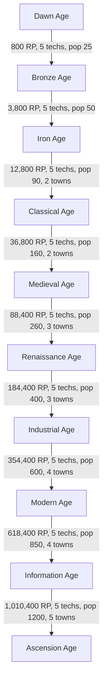

```text
Dawn                 0 RP  ········································  pop    0
Bronze             800 RP  ███████████████████·····················  pop   25
Iron             3,800 RP  ████████████████████████················  pop   50
Classical       12,800 RP  ███████████████████████████·············  pop   90
Medieval        36,800 RP  ██████████████████████████████··········  pop  160
Renaissance     88,400 RP  █████████████████████████████████·······  pop  260
Industrial     184,400 RP  ███████████████████████████████████·····  pop  400
Modern         354,400 RP  █████████████████████████████████████···  pop  600
Information    618,400 RP  ███████████████████████████████████████·  pop  850
Ascension    1,010,400 RP  ████████████████████████████████████████  pop 1200
(bar = research threshold, log scale)
```


### Age descriptions

- **Dawn Age** (`#C9A66B`): Small bands of foragers and hunters huddle around the first fires. Stone tools, spoken lore and the spirits of the land are all they know.
  - *Architecture:* Thatch, hide and bent saplings: round huts, lean-tos and hide tents around a central fire pit; rough timber totems.
- **Bronze Age** (`#CD7F32`): Fields are sown, herds are kept and the first villages put down roots. Copper and tin are cast into bronze, and writing begins to record the harvest.
  - *Architecture:* Sun-dried mudbrick walls with flat reed roofs, plastered in ochre; timber lintels, low granaries and wattle fences.
- **Iron Age** (`#6E7377`): Iron tools and weapons spread through every village. Organized faiths raise the first temples, and settlements ring themselves with walls.
  - *Architecture:* Dry-laid fieldstone foundations under timber frames and thatch or slate; stone temples and wooden watchtowers.
- **Classical Age** (`#E8E2D0`): Philosophers, engineers and lawgivers shape the first great cities. Aqueducts carry water, theaters and forums fill with citizens, and trade crosses the seas.
  - *Architecture:* Dressed marble and limestone with colonnades and columns, pediments and terracotta roof tiles; arches and paved plazas.
- **Medieval Age** (`#5B6E8C`): Lords raise castles while guilds and monasteries order daily life. Cathedrals climb toward the heavens over crowded market towns.
  - *Architecture:* Mortared stone and half-timbered upper floors with steep timber roofs; keeps, curtain walls and pointed gothic arches.
- **Renaissance Age** (`#C0623B`): Printing presses, universities and banks spread knowledge and wealth. Gunpowder and navigation redraw the map of power.
  - *Architecture:* Warm terracotta, stucco and cut stone with domes, loggias and symmetrical facades; clay tile roofs and courtyards.
- **Industrial Age** (`#8E3B2E`): Steam engines, coal and rail transform work and cities alike. Factories pull people from the fields into crowded, smoky towns.
  - *Architecture:* Red brick mills and row houses, iron girders and tall smokestacks; slate roofs, rail sheds and soot-stained walls.
- **Modern Age** (`#9AA5B1`): Electricity, oil and mass production reshape everyday life. Hospitals, stadiums and highways serve cities of millions.
  - *Architecture:* Reinforced concrete and structural steel with large windows and flat roofs; apartment blocks, plants and broad avenues.
- **Information Age** (`#3FA9F5`): Computers and global networks connect every corner of the world. Knowledge, goods and people move faster than ever before.
  - *Architecture:* Glass curtain-wall towers on steel frames, solar panels and illuminated signage; sleek data centers and airports.
- **Ascension Age** (`#F5E6A8`): Scarcity is a memory and minds reach beyond flesh. The civilization prepares to transcend the mortal world through the Ascension Gate.
  - *Architecture:* Luminous white and gold surfaces, floating terraces and organic arcologies; glowing seams of light and crystalline spires.


## Technologies


### Totals

| Age             |  Techs | General | Racial |  Total cost | General cost |    Min |    Max |    Avg | Unlocks |
| --------------- | -----: | ------: | -----: | ----------: | -----------: | -----: | -----: | -----: | ------: |
| **Dawn**        |     10 |       8 |      2 |         420 |          324 |     28 |     60 |     42 |       4 |
| **Bronze**      |     10 |       8 |      2 |       1,725 |        1,365 |    135 |    225 |    173 |       3 |
| **Iron**        |     10 |       8 |      2 |       4,900 |        3,900 |    425 |    550 |    490 |       2 |
| **Classical**   |     10 |       8 |      2 |      12,640 |       10,080 |  1,120 |  1,400 |  1,264 |       2 |
| **Medieval**    |     10 |       8 |      2 |      27,000 |       21,480 |  2,400 |  3,000 |  2,700 |       2 |
| **Renaissance** |      9 |       9 |      0 |      46,880 |       46,880 |  4,800 |  5,760 |  5,209 |       1 |
| **Industrial**  |      9 |       9 |      0 |      84,400 |       84,400 |  8,600 | 10,400 |  9,378 |       1 |
| **Modern**      |      9 |       9 |      0 |     131,040 |      131,040 | 13,440 | 16,320 | 14,560 |       1 |
| **Information** |      9 |       9 |      0 |     194,600 |      194,600 | 20,160 | 23,800 | 21,622 |       2 |
| **Ascension**   |      8 |       8 |      0 |     281,400 |      281,400 | 28,000 | 67,200 | 35,175 |       0 |
| **Total**       | **94** |      84 |     10 | **785,005** |      775,469 |        |        |  8,351 |      18 |


### Dawn Age technologies

| Key                   | Name              | Cost | Prerequisites         | Effects                                                                | Races |
| --------------------- | ----------------- | ---: | --------------------- | ---------------------------------------------------------------------- | ----- |
| `dawn.fire`           | Mastery of Fire   |   32 | —                     | +0.03 health; +0.02 happiness                                          | All   |
| `dawn.stone_tools`    | Stone Tools       |   32 | —                     | +10% Wood; +10% Stone; +10% build speed                                | All   |
| `dawn.foraging`       | Foraging          |   28 | —                     | +12% Food                                                              | All   |
| `dawn.hunting`        | Organized Hunting |   40 | Stone Tools           | +10% Food; +10% military                                               | All   |
| `dawn.animism`        | Animism           |   40 | Mastery of Fire       | +15% faith; +10% Faith service                                         | All   |
| `dawn.agriculture`    | Agriculture       |   60 | Foraging, Stone Tools | +15% Food; unlocks **Farm** (normally Bronze)                          | All   |
| `dawn.oral_tradition` | Oral Tradition    |   48 | Animism               | +12% research; +0.02 happiness                                         | All   |
| `dawn.herbal_lore`    | Herbal Lore       |   44 | Foraging              | +0.04 health; unlocks **Herbalist** (normally Bronze)                  | All   |
| `dawn.deep_delving`   | Deep Delving      |   48 | Stone Tools           | +20% Stone; +20% Ore; unlocks **Mine** (normally Bronze)               | Dwarf |
| `dawn.warbands`       | Warbands          |   48 | Organized Hunting     | +20% military; +10% move speed; unlocks **War Idol** (normally Bronze) | Orc   |

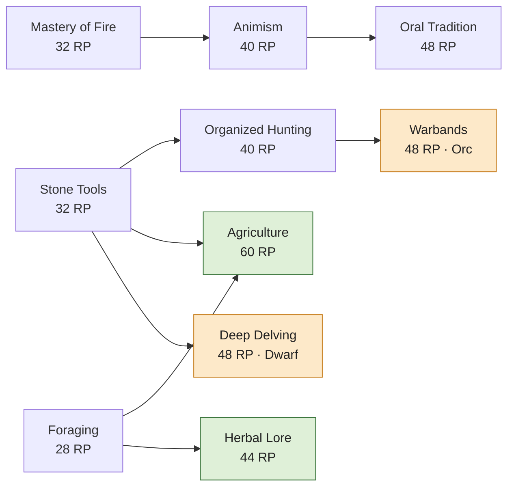


### Bronze Age technologies

| Key                       | Name             | Cost | Prerequisites                                | Effects                                                            | Races   |
| ------------------------- | ---------------- | ---: | -------------------------------------------- | ------------------------------------------------------------------ | ------- |
| `bronze.pottery`          | Pottery          |  135 | Agriculture (Dawn)                           | +20% storage                                                       | All     |
| `bronze.copper_smelting`  | Copper Smelting  |  150 | Stone Tools (Dawn)                           | +15% Ore; +15% Metal                                               | All     |
| `bronze.animal_husbandry` | Animal Husbandry |  150 | Organized Hunting (Dawn), Agriculture (Dawn) | +10% Food; +15% Cloth                                              | All     |
| `bronze.casting`          | Bronze Casting   |  180 | Copper Smelting                              | +20% Metal; +15% Tools                                             | All     |
| `bronze.weaving`          | Weaving          |  150 | Animal Husbandry                             | +20% Cloth; +0.02 happiness                                        | All     |
| `bronze.writing`          | Writing          |  195 | Pottery, Oral Tradition (Dawn)               | +15% research                                                      | All     |
| `bronze.iron_working`     | Iron Working     |  225 | Bronze Casting                               | +10% Metal; +10% military; unlocks **Blacksmith** (normally Iron)  | All     |
| `bronze.priesthood`       | Priesthood       |  180 | Writing, Animism (Dawn)                      | +20% faith; +15% Faith service                                     | All     |
| `bronze.sylvan_lore`      | Sylvan Lore      |  180 | Writing                                      | +25% Wood; +0.05 health; unlocks **World Tree** (normally Iron)    | Elf     |
| `bronze.star_charts`      | Star Charts      |  180 | Writing                                      | +15% research; +15% faith; unlocks **Sun Pyramid** (normally Iron) | Saurian |

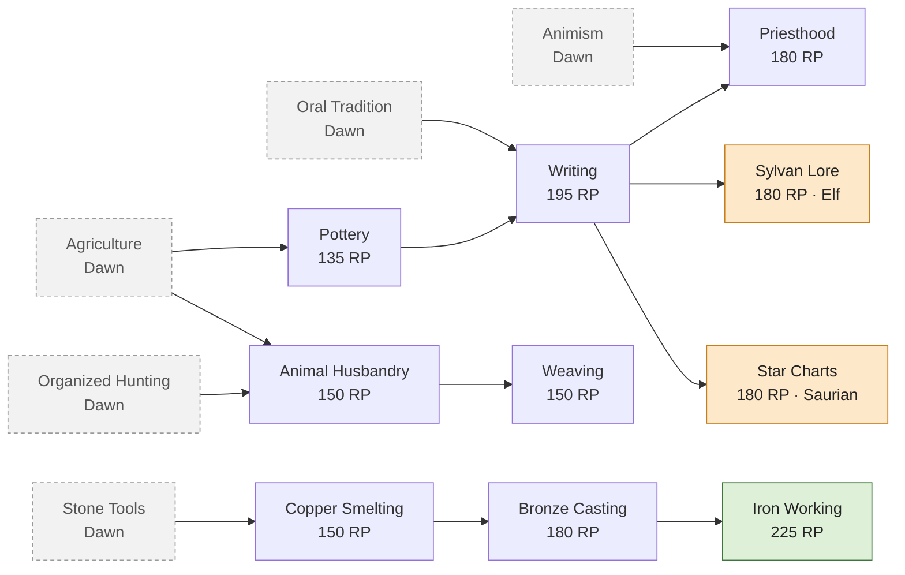


### Iron Age technologies

| Key                       | Name               | Cost | Prerequisites                   | Effects                                                     | Races   |
| ------------------------- | ------------------ | ---: | ------------------------------- | ----------------------------------------------------------- | ------- |
| `iron.bloomery`           | Iron Smelting      |  450 | Iron Working (Bronze)           | +20% Metal; +10% Ore                                        | All     |
| `iron.masonry`            | Masonry            |  425 | Bronze Casting (Bronze)         | +20% Stone; +10% build speed                                | All     |
| `iron.organized_religion` | Organized Religion |  450 | Priesthood (Bronze)             | +20% faith; +0.03 happiness                                 | All     |
| `iron.fortification`      | Fortification      |  500 | Masonry                         | +20% Defense service; +5% military                          | All     |
| `iron.coinage`            | Coinage            |  500 | Iron Smelting, Writing (Bronze) | +20% trade; +15% Gold                                       | All     |
| `iron.philosophy`         | Philosophy         |  550 | Organized Religion              | +15% research; unlocks **Library** (normally Classical)     | All     |
| `iron.iron_plows`         | Iron Plows         |  475 | Iron Smelting                   | +20% Food                                                   | All     |
| `iron.engineering`        | Engineering        |  550 | Masonry                         | +15% build speed; unlocks **Aqueduct** (normally Classical) | All     |
| `iron.blood_rites`        | Blood Rites        |  500 | Organized Religion              | +20% military; +10% growth                                  | Orc     |
| `iron.clutch_rites`       | Clutch Rites       |  500 | Organized Religion              | +20% growth; +10% faith                                     | Saurian |

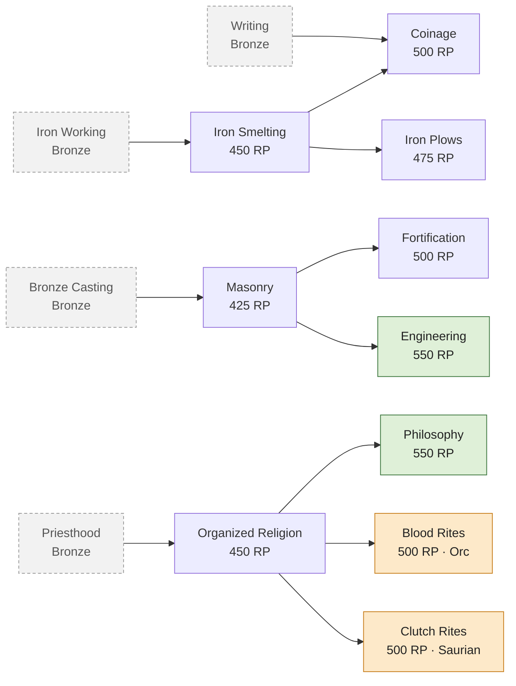


### Classical Age technologies

| Key                          | Name             |  Cost | Prerequisites                          | Effects                                                                         | Races |
| ---------------------------- | ---------------- | ----: | -------------------------------------- | ------------------------------------------------------------------------------- | ----- |
| `classical.mathematics`      | Mathematics      | 1,120 | Philosophy (Iron)                      | +15% research; +5% build speed                                                  | All   |
| `classical.civil_service`    | Civil Service    | 1,200 | Coinage (Iron)                         | +25% Administration service; +10% storage                                       | All   |
| `classical.hydraulics`       | Hydraulics       | 1,120 | Engineering (Iron)                     | +25% Water service; +0.04 health                                                | All   |
| `classical.drama`            | Drama            | 1,200 | Civil Service                          | +25% Entertainment service; +0.04 happiness                                     | All   |
| `classical.astronomy`        | Astronomy        | 1,360 | Mathematics                            | +15% research; +10% Research service                                            | All   |
| `classical.seafaring`        | Seafaring        | 1,360 | Astronomy                              | +10% Food; +15% trade; +10% move speed                                          | All   |
| `classical.medicine`         | Medicine         | 1,320 | Hydraulics                             | +20% Health service; +2 yrs lifespan                                            | All   |
| `classical.monasticism`      | Monasticism      | 1,400 | Mathematics, Organized Religion (Iron) | +15% faith; +5% Research service; unlocks **Monastery** (normally Medieval)     | All   |
| `classical.chivalric_orders` | Chivalric Orders | 1,280 | Civil Service                          | +15% military; +0.03 happiness; unlocks **Grand Cathedral** (normally Medieval) | Human |
| `classical.grove_wardens`    | Grove Wardens    | 1,280 | Medicine                               | +0.05 health; +15% Wood; +10% faith                                             | Elf   |

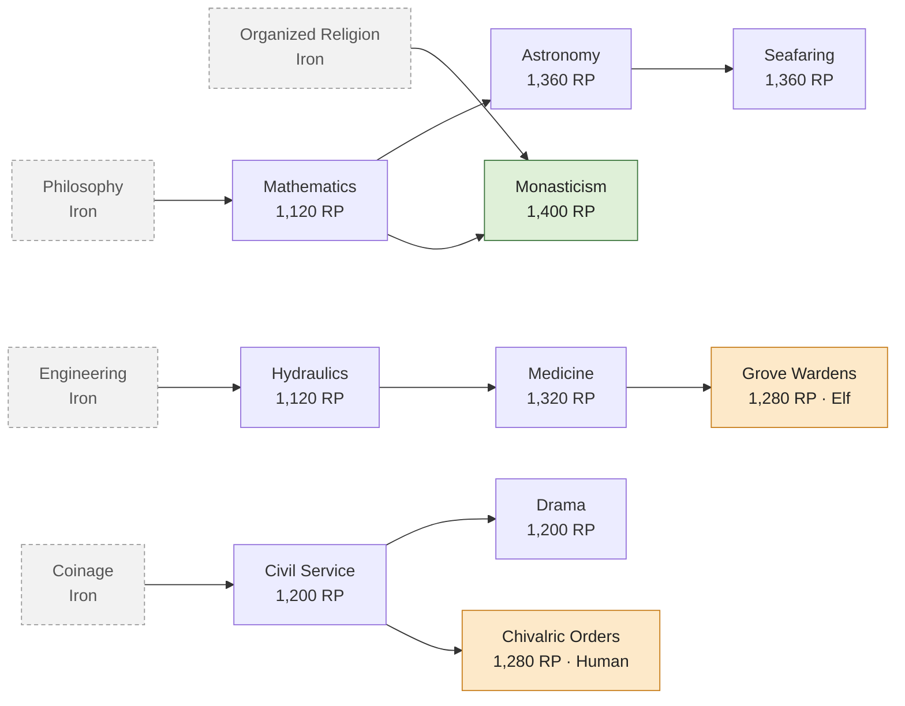


### Medieval Age technologies

| Key                            | Name                |  Cost | Prerequisites             | Effects                                                        | Races |
| ------------------------------ | ------------------- | ----: | ------------------------- | -------------------------------------------------------------- | ----- |
| `medieval.feudalism`           | Feudalism           | 2,400 | Civil Service (Classical) | +15% military; +10% Food                                       | All   |
| `medieval.crop_rotation`       | Crop Rotation       | 2,400 | Hydraulics (Classical)    | +25% Food; +5% growth                                          | All   |
| `medieval.scholasticism`       | Scholasticism       | 2,640 | Monasticism (Classical)   | +15% research; unlocks **University** (normally Renaissance)   | All   |
| `medieval.castle_building`     | Castle Building     | 2,760 | Feudalism                 | +25% Defense service; +5% build speed                          | All   |
| `medieval.gothic_architecture` | Gothic Architecture | 2,880 | Castle Building           | +15% faith; +15% Stone                                         | All   |
| `medieval.windmills`           | Windmills           | 2,640 | Crop Rotation             | +15% Food; +10% Goods; +10% storage                            | All   |
| `medieval.banking`             | Banking             | 3,000 | Feudalism, Scholasticism  | +20% Gold; +10% trade; unlocks **Bank** (normally Renaissance) | All   |
| `medieval.crossbows`           | Crossbows           | 2,760 | Castle Building           | +20% military; +15% Weapons                                    | All   |
| `medieval.runesmithing`        | Runesmithing        | 2,760 | Castle Building           | +25% Tools; +20% Weapons; +10% Defense service                 | Dwarf |
| `medieval.great_guilds`        | Great Guilds        | 2,760 | Windmills                 | +20% Goods; +15% trade                                         | Human |

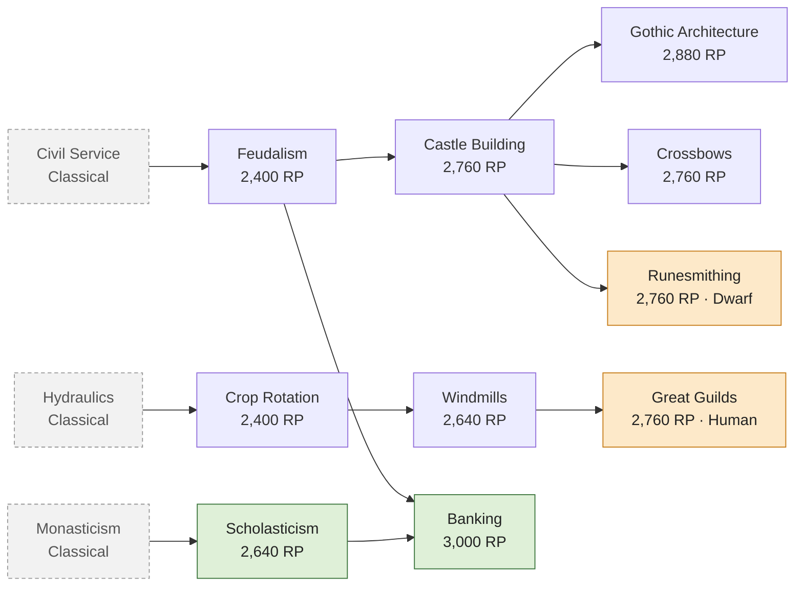


### Renaissance Age technologies

| Key                              | Name               |  Cost | Prerequisites            | Effects                                                                    | Races |
| -------------------------------- | ------------------ | ----: | ------------------------ | -------------------------------------------------------------------------- | ----- |
| `renaissance.printing_press`     | Printing Press     | 4,800 | Scholasticism (Medieval) | +20% research                                                              | All   |
| `renaissance.gunpowder`          | Gunpowder          | 5,120 | Crossbows (Medieval)     | +25% military; +10% Weapons                                                | All   |
| `renaissance.mercantilism`       | Mercantilism       | 4,960 | Banking (Medieval)       | +20% trade; +10% Gold                                                      | All   |
| `renaissance.optics`             | Optics             | 5,120 | Printing Press           | +15% research                                                              | All   |
| `renaissance.navigation`         | Navigation         | 5,440 | Optics, Mercantilism     | +15% trade; +10% move speed                                                | All   |
| `renaissance.anatomy`            | Anatomy            | 5,280 | Printing Press           | +20% Health service; +3 yrs lifespan                                       | All   |
| `renaissance.humanism`           | Humanism           | 5,120 | Printing Press           | +0.05 happiness; +15% Entertainment service                                | All   |
| `renaissance.domed_architecture` | Domed Architecture | 5,280 | Humanism                 | +15% build speed; +10% Stone                                               | All   |
| `renaissance.steam_power`        | Steam Power        | 5,760 | Optics, Gunpowder        | +15% Fuel; +5% all production; unlocks **Coal Mine** (normally Industrial) | All   |

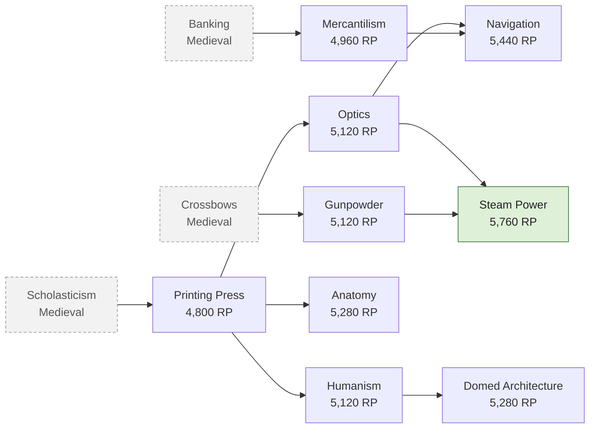


### Industrial Age technologies

| Key                            | Name              |   Cost | Prerequisites              | Effects                                                                           | Races |
| ------------------------------ | ----------------- | -----: | -------------------------- | --------------------------------------------------------------------------------- | ----- |
| `industrial.coal_mining`       | Coal Mining       |  8,600 | Steam Power (Renaissance)  | +25% Fuel; +10% Ore                                                               | All   |
| `industrial.textile_mills`     | Textile Mills     |  8,800 | Mercantilism (Renaissance) | +25% Cloth; +15% Goods                                                            | All   |
| `industrial.scientific_method` | Scientific Method |  9,000 | Optics (Renaissance)       | +20% research                                                                     | All   |
| `industrial.steel`             | Steel             |  9,400 | Coal Mining                | +25% Metal; +15% Machinery                                                        | All   |
| `industrial.railways`          | Railways          | 10,000 | Steel                      | +20% trade; +15% move speed                                                       | All   |
| `industrial.sanitation`        | Sanitation        |  9,200 | Scientific Method          | +0.06 health; +20% Water service                                                  | All   |
| `industrial.electricity`       | Electricity       | 10,400 | Scientific Method, Steel   | +5% all production; +20% Power service; unlocks **Power Plant** (normally Modern) | All   |
| `industrial.vaccination`       | Vaccination       |  9,600 | Sanitation                 | +4 yrs lifespan; +10% growth                                                      | All   |
| `industrial.rifled_firearms`   | Rifled Firearms   |  9,400 | Steel                      | +30% military                                                                     | All   |

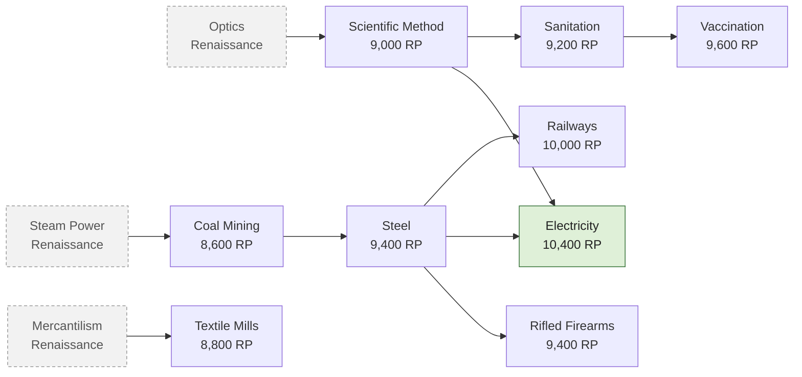


### Modern Age technologies

| Key                             | Name                   |   Cost | Prerequisites                      | Effects                                                             | Races |
| ------------------------------- | ---------------------- | -----: | ---------------------------------- | ------------------------------------------------------------------- | ----- |
| `modern.combustion_engine`      | Combustion Engine      | 13,440 | Railways (Industrial)              | +20% Fuel; +15% move speed                                          | All   |
| `modern.mass_production`        | Mass Production        | 13,920 | Electricity (Industrial)           | +10% all production; +10% build speed                               | All   |
| `modern.antibiotics`            | Antibiotics            | 13,680 | Vaccination (Industrial)           | +25% Health service; +4 yrs lifespan                                | All   |
| `modern.petroleum_refining`     | Petroleum Refining     | 14,400 | Combustion Engine                  | +25% Fuel; +10% Machinery                                           | All   |
| `modern.mechanized_agriculture` | Mechanized Agriculture | 14,640 | Mass Production, Combustion Engine | +30% Food                                                           | All   |
| `modern.radio`                  | Radio                  | 14,400 | Mass Production                    | +0.04 happiness; +20% Entertainment service                         | All   |
| `modern.flight`                 | Powered Flight         | 14,880 | Combustion Engine                  | +15% move speed; +15% trade                                         | All   |
| `modern.computing`              | Computing              | 16,320 | Radio                              | +25% research; unlocks **Electronics Plant** (normally Information) | All   |
| `modern.combined_arms`          | Combined Arms          | 15,360 | Powered Flight                     | +30% military; +15% Defense service                                 | All   |

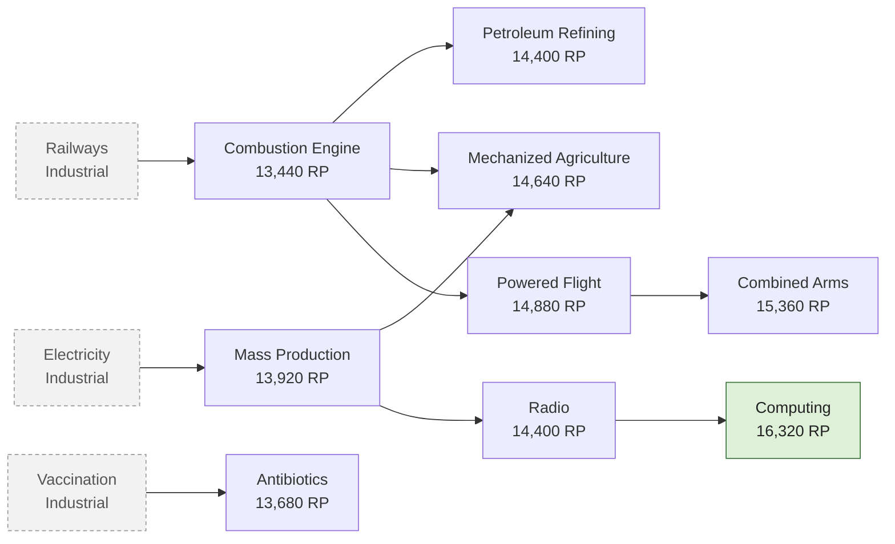


### Information Age technologies

| Key                            | Name             |   Cost | Prerequisites           | Effects                                                             | Races |
| ------------------------------ | ---------------- | -----: | ----------------------- | ------------------------------------------------------------------- | ----- |
| `information.microprocessors`  | Microprocessors  | 20,160 | Computing (Modern)      | +25% Electronics; +10% research                                     | All   |
| `information.globalization`    | Globalization    | 20,440 | Powered Flight (Modern) | +25% trade; +10% Gold                                               | All   |
| `information.genetics`         | Genetics         | 20,720 | Antibiotics (Modern)    | +0.05 health; +5 yrs lifespan                                       | All   |
| `information.internet`         | The Internet     | 22,400 | Microprocessors         | +20% research; +15% Commerce service                                | All   |
| `information.robotics`         | Robotics         | 22,120 | Microprocessors         | +10% all production; +15% build speed                               | All   |
| `information.renewable_energy` | Renewable Energy | 21,560 | Microprocessors         | +25% Power service; +10% Fuel                                       | All   |
| `information.vertical_farming` | Vertical Farming | 22,120 | Genetics, Robotics      | +25% Food; unlocks **Hydroponics Tower** (normally Ascension)       | All   |
| `information.fusion_power`     | Fusion Power     | 23,800 | Renewable Energy        | +20% Power service; unlocks **Fusion Reactor** (normally Ascension) | All   |
| `information.social_networks`  | Social Networks  | 21,280 | The Internet            | +0.05 happiness; +15% Administration service                        | All   |

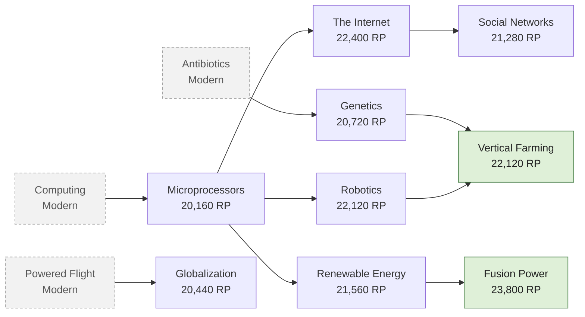


### Ascension Age technologies

| Key                                  | Name                     |   Cost | Prerequisites                                   | Effects                                        | Races |
| ------------------------------------ | ------------------------ | -----: | ----------------------------------------------- | ---------------------------------------------- | ----- |
| `ascension.nanotechnology`           | Nanotechnology           | 28,000 | Robotics (Information)                          | +15% all production; +20% Machinery            | All   |
| `ascension.synthetic_minds`          | Synthetic Minds          | 29,400 | The Internet (Information)                      | +30% research                                  | All   |
| `ascension.longevity`                | Longevity Therapies      | 28,000 | Genetics (Information)                          | +8 yrs lifespan; +0.06 health                  | All   |
| `ascension.post_scarcity`            | Post-Scarcity Economy    | 32,200 | Nanotechnology, Vertical Farming (Information)  | +15% all production; +0.06 happiness           | All   |
| `ascension.arcology_design`          | Arcology Design          | 32,200 | Post-Scarcity Economy                           | +20% build speed; +20% Administration service  | All   |
| `ascension.aegis_fields`             | Aegis Fields             | 30,800 | Synthetic Minds                                 | +30% Defense service; +20% military            | All   |
| `ascension.collective_consciousness` | Collective Consciousness | 33,600 | Synthetic Minds, Longevity Therapies            | +25% faith; +0.05 happiness                    | All   |
| `ascension.transcendence`            | Transcendence            | 67,200 | Collective Consciousness, Post-Scarcity Economy | +10% all production; +20% research; +30% faith | All   |

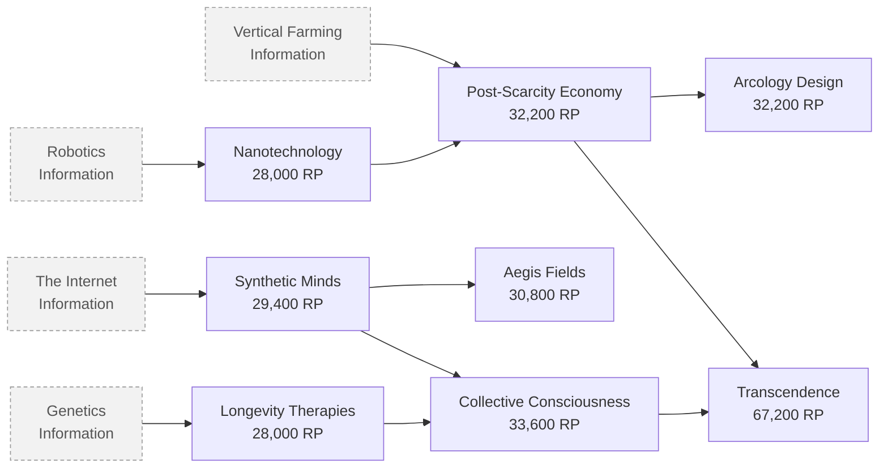


### Racial technologies

| Race        | Age       | Key                          | Name             |  Cost | Effects                                                                         |
| ----------- | --------- | ---------------------------- | ---------------- | ----: | ------------------------------------------------------------------------------- |
| **Human**   | Classical | `classical.chivalric_orders` | Chivalric Orders | 1,280 | +15% military; +0.03 happiness; unlocks **Grand Cathedral** (normally Medieval) |
| **Human**   | Medieval  | `medieval.great_guilds`      | Great Guilds     | 2,760 | +20% Goods; +15% trade                                                          |
| **Elf**     | Bronze    | `bronze.sylvan_lore`         | Sylvan Lore      |   180 | +25% Wood; +0.05 health; unlocks **World Tree** (normally Iron)                 |
| **Elf**     | Classical | `classical.grove_wardens`    | Grove Wardens    | 1,280 | +0.05 health; +15% Wood; +10% faith                                             |
| **Dwarf**   | Dawn      | `dawn.deep_delving`          | Deep Delving     |    48 | +20% Stone; +20% Ore; unlocks **Mine** (normally Bronze)                        |
| **Dwarf**   | Medieval  | `medieval.runesmithing`      | Runesmithing     | 2,760 | +25% Tools; +20% Weapons; +10% Defense service                                  |
| **Orc**     | Dawn      | `dawn.warbands`              | Warbands         |    48 | +20% military; +10% move speed; unlocks **War Idol** (normally Bronze)          |
| **Orc**     | Iron      | `iron.blood_rites`           | Blood Rites      |   500 | +20% military; +10% growth                                                      |
| **Saurian** | Bronze    | `bronze.star_charts`         | Star Charts      |   180 | +15% research; +15% faith; unlocks **Sun Pyramid** (normally Iron)              |
| **Saurian** | Iron      | `iron.clutch_rites`          | Clutch Rites     |   500 | +20% growth; +10% faith                                                         |


### Descriptions

- `dawn.fire` **Mastery of Fire**: Taming flame brings warmth, cooked food and the first gatherings around the hearth.
- `dawn.stone_tools` **Stone Tools**: Knapped flint blades and hand axes make felling trees and shaping stone far easier.
- `dawn.foraging` **Foraging**: Knowing which roots, berries and nuts are safe to eat keeps the band fed through lean seasons.
- `dawn.hunting` **Organized Hunting**: Spears and coordinated drives bring down large game and train the first warriors.
- `dawn.animism` **Animism**: Offerings to the spirits of river, beast and stone give the people their first sense of the divine.
- `dawn.agriculture` **Agriculture**: Planting the seeds of wild grasses lets a band settle beside its fields and build the first farms.
- `dawn.oral_tradition` **Oral Tradition**: Elders pass down songs, stories and hard-won knowledge from one generation to the next.
- `dawn.herbal_lore` **Herbal Lore**: Poultices and bitter teas from wild plants soothe wounds and fevers.
- `dawn.deep_delving` **Deep Delving**: Dwarven clans follow veins of stone and ore deep beneath the mountains and sink the first true mine shafts.
- `dawn.warbands` **Warbands**: Orc hunters band together under the strongest fighter and raise a crude war idol to their victories.
- `bronze.pottery` **Pottery**: Fired clay jars keep grain dry and safe from vermin through the winter.
- `bronze.copper_smelting` **Copper Smelting**: Charcoal kilns hot enough to melt copper from green ore open the age of metal.
- `bronze.animal_husbandry` **Animal Husbandry**: Penning sheep, goats and cattle provides milk, meat and wool without the risk of the hunt.
- `bronze.casting` **Bronze Casting**: Alloying copper with tin and pouring it into molds yields hard, sharp tools.
- `bronze.weaving` **Weaving**: Looms turn wool and flax into warm cloth for clothing, sails and trade.
- `bronze.writing` **Writing**: Marks pressed into clay tablets record harvests, debts and the words of the wise.
- `bronze.iron_working` **Iron Working**: Hot bloomery fires wring iron from bog ore, and the first blacksmiths learn to hammer it into shape.
- `bronze.priesthood` **Priesthood**: A caste of priests keeps the rites, the calendar and the offerings of the village shrines.
- `bronze.sylvan_lore` **Sylvan Lore**: Elven loremasters learn the songs of the old forest and coax the first World Tree from a sacred seed.
- `bronze.star_charts` **Star Charts**: Saurian sky-priests map the wandering stars and align a great stepped pyramid to the sun.
- `iron.bloomery` **Iron Smelting**: Larger bloomeries and bellows make iron plentiful enough for every household.
- `iron.masonry` **Masonry**: Iron chisels square fieldstone into blocks that stack into lasting walls.
- `iron.organized_religion` **Organized Religion**: Shared scripture and a hierarchy of clergy bind many villages into one faith.
- `iron.fortification` **Fortification**: Ditches, ramparts and stone gatehouses make settlements hard to take by force.
- `iron.coinage` **Coinage**: Stamped coins of standard weight replace barter and make trade far simpler.
- `iron.philosophy` **Philosophy**: Thinkers question the nature of the world and gather scrolls into the first libraries.
- `iron.iron_plows` **Iron Plows**: Iron-shod plows cut heavy soils that wooden ards could never turn.
- `iron.engineering` **Engineering**: Arches, levers and surveying let builders span rivers and carry water across valleys.
- `iron.blood_rites` **Blood Rites**: Orc shamans bind warriors with oaths sealed in blood, and the clans grow fierce and numerous.
- `iron.clutch_rites` **Clutch Rites**: Saurian priests bless the warm nesting grounds, and more clutches hatch with every season.
- `classical.mathematics` **Mathematics**: Geometry and arithmetic give scholars and builders a precise language of number and form.
- `classical.civil_service` **Civil Service**: Salaried officials collect taxes, keep records and administer distant towns.
- `classical.hydraulics` **Hydraulics**: Siphons, cisterns and channels bring clean water to fountains, baths and fields.
- `classical.drama` **Drama**: Tragedies and comedies staged in grand theaters entertain and unite the citizenry.
- `classical.astronomy` **Astronomy**: Careful observation of the heavens yields calendars, predictions and new questions.
- `classical.seafaring` **Seafaring**: Navigating by the stars, galleys carry fishermen and merchants beyond sight of land.
- `classical.medicine` **Medicine**: Physicians catalogue diseases and remedies and teach the virtue of clean living.
- `classical.monasticism` **Monasticism**: Devout communities withdraw to pray, copy manuscripts and found the first monasteries.
- `classical.chivalric_orders` **Chivalric Orders**: Human knights swear oaths of service and piety, and their orders endow a grand cathedral.
- `classical.grove_wardens` **Grove Wardens**: Elven wardens tend the sacred groves, where healing waters and old magic restore body and spirit.
- `medieval.feudalism` **Feudalism**: Land is granted in return for service, binding lords, knights and peasants in a web of duty.
- `medieval.crop_rotation` **Crop Rotation**: Rotating grain, legumes and fallow across three fields keeps the soil rich year after year.
- `medieval.scholasticism` **Scholasticism**: Cathedral schools reconcile faith and reason and grow into the first universities.
- `medieval.castle_building` **Castle Building**: Concentric walls, keeps and towers turn every lordly seat into a fortress.
- `medieval.gothic_architecture` **Gothic Architecture**: Pointed arches and flying buttresses lift cathedral vaults toward the heavens.
- `medieval.windmills` **Windmills**: Sails catch the wind to grind grain and saw timber without the toil of beasts.
- `medieval.banking` **Banking**: Letters of credit and money-changers let wealth flow safely between distant cities.
- `medieval.crossbows` **Crossbows**: Mechanical bows let a lightly trained levy pierce the armor of a knight.
- `medieval.runesmithing` **Runesmithing**: Dwarven runesmiths etch binding runes into anvil, axe and gate, and their work never fails.
- `medieval.great_guilds` **Great Guilds**: Human craft and merchant guilds set standards, train apprentices and dominate the markets of every town.
- `renaissance.printing_press` **Printing Press**: Movable type puts books in the hands of thousands and spreads ideas like wildfire.
- `renaissance.gunpowder` **Gunpowder**: Saltpeter, charcoal and sulfur power cannon and arquebus, ending the reign of the castle.
- `renaissance.mercantilism` **Mercantilism**: Chartered trading companies and double-entry ledgers make commerce a pillar of the state.
- `renaissance.optics` **Optics**: Ground lenses reveal the very small and the very far, from cells to the moons of other worlds.
- `renaissance.navigation` **Navigation**: Compass, astrolabe and accurate charts open ocean routes to distant markets.
- `renaissance.anatomy` **Anatomy**: Careful dissection and illustrated texts reveal how the body truly works.
- `renaissance.humanism` **Humanism**: A renewed love of art, letters and human potential fills the cities with painters and poets.
- `renaissance.domed_architecture` **Domed Architecture**: Rediscovered proportion and herringbone brickwork crown cities with soaring domes.
- `renaissance.steam_power` **Steam Power**: Pressure vessels and pistons harness boiling water to pump flooded shafts dry, opening the first deep coal mines.
- `industrial.coal_mining` **Coal Mining**: Steam pumps drain deep shafts, and coal fuels furnaces and engines across the land.
- `industrial.textile_mills` **Textile Mills**: Spinning jennies and power looms produce cloth by the mile.
- `industrial.scientific_method` **Scientific Method**: Hypothesis, experiment and peer review turn natural philosophy into modern science.
- `industrial.steel` **Steel**: Bessemer converters turn pig iron into strong, cheap steel for rails, bridges and machines.
- `industrial.railways` **Railways**: Locomotives on iron rails carry goods and passengers faster than any horse.
- `industrial.sanitation` **Sanitation**: Sewers, clean water mains and public health laws tame the diseases of crowded cities.
- `industrial.electricity` **Electricity**: Dynamos and copper wire carry power to lamps and motors, heralding the first power plants.
- `industrial.vaccination` **Vaccination**: Inoculation against smallpox and other plagues lets far more children reach adulthood.
- `industrial.rifled_firearms` **Rifled Firearms**: Mass-produced rifles with spiral-grooved barrels strike accurately at long range.
- `modern.combustion_engine` **Combustion Engine**: Compact engines burning refined fuel power cars, trucks and tractors.
- `modern.mass_production` **Mass Production**: Assembly lines and interchangeable parts multiply the output of every factory.
- `modern.antibiotics` **Antibiotics**: Penicillin and its successors cure infections that were once a death sentence.
- `modern.petroleum_refining` **Petroleum Refining**: Cracking towers split crude oil into fuels, lubricants and plastics.
- `modern.mechanized_agriculture` **Mechanized Agriculture**: Tractors, combine harvesters and fertilizer let a few farmers feed a whole city.
- `modern.radio` **Radio**: Broadcasts carry news, music and voices into every home at once.
- `modern.flight` **Powered Flight**: Aircraft shrink continents, carrying mail, cargo and passengers across oceans in hours.
- `modern.computing` **Computing**: Vacuum tubes and then transistors perform millions of calculations, and the first electronics plants rise to build them.
- `modern.combined_arms` **Combined Arms**: Tanks, artillery and aircraft fight as one coordinated force.
- `information.microprocessors` **Microprocessors**: An entire computer etched onto a sliver of silicon puts computation everywhere.
- `information.globalization` **Globalization**: Container ships and open markets weave every economy into one.
- `information.genetics` **Genetics**: Reading the genome reveals the roots of inherited disease and how to cure it.
- `information.internet` **The Internet**: A global network links every computer, putting all knowledge a moment away.
- `information.robotics` **Robotics**: Tireless robotic arms assemble, weld and build with superhuman precision.
- `information.renewable_energy` **Renewable Energy**: Smart grids of wind turbines and solar panels harvest clean power from sky and sun.
- `information.vertical_farming` **Vertical Farming**: Engineered crops grown under artificial light in stacked towers point the way to hydroponic arcologies.
- `information.fusion_power` **Fusion Power**: Magnetic bottles finally contain a miniature star, promising nearly limitless energy.
- `information.social_networks` **Social Networks**: Everyone can speak to everyone, and governments learn to listen.
- `ascension.nanotechnology` **Nanotechnology**: Swarms of molecular machines assemble matter atom by atom.
- `ascension.synthetic_minds` **Synthetic Minds**: Artificial intellects join their makers as partners in discovery.
- `ascension.longevity` **Longevity Therapies**: Cellular repair halts aging, and lifespans stretch far beyond their natural span.
- `ascension.post_scarcity` **Post-Scarcity Economy**: When anything can be made from sunlight and dust, want itself becomes obsolete.
- `ascension.arcology_design` **Arcology Design**: Self-contained city-structures house, feed and govern millions in perfect balance.
- `ascension.aegis_fields` **Aegis Fields**: Shimmering energy barriers shield entire cities from harm.
- `ascension.collective_consciousness` **Collective Consciousness**: Linked minds share thoughts and dreams, and the people feel the presence of their god as never before.
- `ascension.transcendence` **Transcendence**: The civilization sheds its mortal limits and prepares to transcend the physical world.


## Buildings


### Overview by age and category

| Age             | Housing | Food | Resource | Industry | Storage | Civic | Religion | Education | Health | Culture | Military | Commerce | Infrastructure | Wonder | Total |
| --------------- | ------: | ---: | -------: | -------: | ------: | ----: | -------: | --------: | -----: | ------: | -------: | -------: | -------------: | -----: | ----: |
| **Dawn**        |       1 |    3 |        2 |        · |       1 |     1 |        1 |         · |      · |       1 |        · |        · |              1 |      · |    11 |
| **Bronze**      |       · |    2 |        1 |        2 |       1 |     · |        1 |         · |      1 |       · |        1 |        · |              · |      2 |    11 |
| **Iron**        |       · |    · |        1 |        2 |       · |     · |        1 |         1 |      · |       · |        2 |        1 |              · |      2 |    10 |
| **Classical**   |       · |    · |        · |        1 |       · |     1 |        · |         1 |      1 |       2 |        1 |        1 |              1 |      2 |    11 |
| **Medieval**    |       · |    1 |        · |        · |       · |     · |        2 |         · |      · |       1 |        1 |        1 |              · |      2 |     8 |
| **Renaissance** |       · |    · |        · |        · |       · |     · |        · |         3 |      1 |       · |        · |        1 |              · |      · |     5 |
| **Industrial**  |       · |    · |        2 |        2 |       · |     · |        · |         · |      · |       · |        · |        1 |              · |      · |     5 |
| **Modern**      |       · |    1 |        1 |        · |       · |     · |        · |         1 |      · |       1 |        1 |        · |              1 |      · |     6 |
| **Information** |       · |    · |        · |        1 |       · |     · |        · |         1 |      1 |       · |        · |        1 |              · |      · |     4 |
| **Ascension**   |       · |    1 |        · |        · |       · |     1 |        · |         · |      · |       · |        · |        · |              1 |      1 |     4 |

Counted by `MinAge` (the age a building becomes available without techs).


### Buildings by category

| Category           | Buildings (available from)                                                                                                                                                                                                                       |
| ------------------ | ------------------------------------------------------------------------------------------------------------------------------------------------------------------------------------------------------------------------------------------------ |
| **Housing**        | House (Dawn)                                                                                                                                                                                                                                     |
| **Food**           | Gatherer's Hut (Dawn), Hunting Lodge (Dawn), Fishing Hut (Dawn), Farm (Bronze), Pasture (Bronze), Mill (Medieval), Industrial Farm (Modern), Hydroponics Tower (Ascension)                                                                       |
| **Resource**       | Woodcutter's Camp (Dawn), Stone Quarry (Dawn), Mine (Bronze), Gold Mine (Iron), Coal Mine (Industrial), Sawmill (Industrial), Oil Well (Modern)                                                                                                  |
| **Industry**       | Smelter (Bronze), Weaver (Bronze), Blacksmith (Iron), Armory (Iron), Workshop (Classical), Factory (Industrial), Foundry (Industrial), Electronics Plant (Information)                                                                           |
| **Storage**        | Storehouse (Dawn), Granary (Bronze)                                                                                                                                                                                                              |
| **Civic**          | Town Center (Dawn), Forum (Classical), Arcology (Ascension)                                                                                                                                                                                      |
| **Religion**       | Spirit Totem (Dawn), Shrine (Bronze), Temple (Iron), Cathedral (Medieval), Monastery (Medieval)                                                                                                                                                  |
| **Education**      | Scriptorium (Iron), Library (Classical), University (Renaissance), Observatory (Renaissance), Printworks (Renaissance), Research Lab (Modern), Data Center (Information)                                                                         |
| **Health**         | Herbalist (Bronze), Bathhouse (Classical), Hospital (Renaissance), Medical Center (Information)                                                                                                                                                  |
| **Culture**        | Campfire (Dawn), Theater (Classical), Arena (Classical), Tavern (Medieval), Stadium (Modern)                                                                                                                                                     |
| **Military**       | Palisade (Bronze), Barracks (Iron), Watchtower (Iron), Stone Wall (Classical), Castle (Medieval), Military Base (Modern)                                                                                                                         |
| **Commerce**       | Market (Iron), Harbor (Classical), Guildhall (Medieval), Bank (Renaissance), Rail Station (Industrial), Airport (Information)                                                                                                                    |
| **Infrastructure** | Well (Dawn), Aqueduct (Classical), Power Plant (Modern), Fusion Reactor (Ascension)                                                                                                                                                              |
| **Wonder**         | Deep Forge (Bronze, Dwarf), War Idol (Bronze, Orc), World Tree (Iron, Elf), Sun Pyramid (Iron, Saurian), Great Library (Classical), Colossus (Classical), Grand Cathedral (Medieval, Human), Grand Bazaar (Medieval), Ascension Gate (Ascension) |


### Dawn Age buildings

| Building              | Category       | Jobs           | Inputs / worker | Outputs / worker | Services                                             | Radius | Storage | Upkeep | Housing |
| --------------------- | -------------- | -------------- | --------------- | ---------------- | ---------------------------------------------------- | -----: | ------: | -----: | ------: |
| **Town Center**       | Civic          | —              | —               | —                | 2 Administration, 1 Defense, 0.2 Research, 0.2 Faith |     16 |     100 |      — |       — |
| **House**             | Housing        | —              | —               | —                | —                                                    |      — |       — |      — |     3–5 |
| **Well**              | Infrastructure | —              | —               | —                | 3 Water                                              |     10 |       — |      — |       — |
| **Storehouse**        | Storage        | —              | —               | —                | —                                                    |      — |     120 |      — |       — |
| **Gatherer's Hut**    | Food           | 3 × Gatherer   | —               | 0.09 Food        | —                                                    |      — |       — |      — |       — |
| **Hunting Lodge**     | Food           | 2 × Hunter     | —               | 0.12 Food        | —                                                    |      — |       — |      — |       — |
| **Fishing Hut**       | Food           | 2 × Fisher     | —               | 0.15 Food        | —                                                    |      — |       — |      — |       — |
| **Woodcutter's Camp** | Resource       | 2 × Woodcutter | —               | 0.12 Wood        | —                                                    |      — |       — |      — |       — |
| **Stone Quarry**      | Resource       | 3 × Quarrier   | —               | 0.08 Stone       | —                                                    |      — |       — |      — |       — |
| **Spirit Totem**      | Religion       | —              | —               | —                | 0.5 Faith                                            |     12 |       — |      — |       — |
| **Campfire**          | Culture        | —              | —               | —                | 0.8 Entertainment                                    |     10 |       — |      — |       — |

| Building              | Size | Cost              | Work | Placement             | Desir. | Window         | Limits     | Races |
| --------------------- | :--: | ----------------- | ---: | --------------------- | -----: | -------------- | ---------- | ----- |
| **Town Center**       | 2×2  | 40 Wood, 20 Stone |   60 | Central               |   +0.3 | Dawn+          | max 1/town | All   |
| **House**             | 1×1  | 7 Wood, 5 Stone   |   18 | —                     |   +0.1 | Dawn+          | —          | All   |
| **Well**              | 1×1  | 8 Stone, 4 Wood   |   12 | —                     |   +0.4 | Dawn+          | pop ≥ 5    | All   |
| **Storehouse**        | 2×1  | 20 Wood, 6 Stone  |   24 | —                     |      0 | Dawn+          | pop ≥ 8    | All   |
| **Gatherer's Hut**    | 1×1  | 8 Wood            |   10 | Outskirts             |  +0.05 | Dawn–Iron      | —          | All   |
| **Hunting Lodge**     | 1×1  | 10 Wood, 2 Stone  |   12 | NearForest, Outskirts |   −0.1 | Dawn–Medieval  | —          | All   |
| **Fishing Hut**       | 1×1  | 10 Wood           |   12 | NearWater             |      0 | Dawn+          | —          | All   |
| **Woodcutter's Camp** | 1×1  | 8 Wood            |   12 | NearForest, Outskirts |   −0.1 | Dawn+          | —          | All   |
| **Stone Quarry**      | 2×2  | 14 Wood           |   20 | NearStone             |   −0.4 | Dawn+          | —          | All   |
| **Spirit Totem**      | 1×1  | 10 Wood, 4 Stone  |   14 | Central               |   +0.3 | Dawn–Iron      | pop ≥ 5    | All   |
| **Campfire**          | 1×1  | 6 Wood            |    6 | Central               |   +0.3 | Dawn–Classical | —          | All   |


### Bronze Age buildings

| Building       | Category | Jobs       | Inputs / worker | Outputs / worker       | Services            | Radius | Storage | Upkeep | Housing |
| -------------- | -------- | ---------- | --------------- | ---------------------- | ------------------- | -----: | ------: | -----: | ------: |
| **Farm**       | Food     | 4 × Farmer | —               | 0.22 Food              | —                   |      — |       — |      — |       — |
| **Pasture**    | Food     | 2 × Herder | —               | 0.1 Food, 0.04 Cloth   | —                   |      — |       — |      — |       — |
| **Granary**    | Storage  | —          | —               | —                      | —                   |      — |     150 |      — |       — |
| **Mine**       | Resource | 3 × Miner  | —               | 0.07 Ore               | —                   |      — |       — |      — |       — |
| **Smelter**    | Industry | 2 × Smith  | 0.06 Ore        | 0.05 Metal             | —                   |      — |       — |      — |       — |
| **Shrine**     | Religion | 1 × Priest | —               | —                      | 1 Faith             |     12 |       — |      — |       — |
| **Herbalist**  | Health   | 1 × Healer | —               | —                      | 1.5 Health          |     12 |       — |      — |       — |
| **Weaver**     | Industry | 2 × Weaver | —               | 0.05 Cloth             | —                   |      — |       — |      — |       — |
| **Palisade**   | Military | —          | —               | —                      | 2 Defense           |     12 |       — |      — |       — |
| **Deep Forge** | Wonder   | 6 × Smith  | 0.05 Ore        | 0.08 Metal, 0.03 Tools | 6 Defense           |     14 |       — |   0.03 |       — |
| **War Idol**   | Wonder   | —          | —               | —                      | 10 Defense, 4 Faith |     16 |       — |   0.03 |       — |

| Building       | Size | Cost                       | Work | Placement    | Desir. | Window                                                 | Limits                           | Races |
| -------------- | :--: | -------------------------- | ---: | ------------ | -----: | ------------------------------------------------------ | -------------------------------- | ----- |
| **Farm**       | 3×3  | 20 Wood, 5 Stone           |   25 | Fertile      |   +0.1 | Bronze+; unlocked by `dawn.agriculture` (Dawn)         | —                                | All   |
| **Pasture**    | 3×3  | 18 Wood                    |   20 | Outskirts    |  −0.05 | Bronze+                                                | pop ≥ 8                          | All   |
| **Granary**    | 2×2  | 25 Wood, 20 Stone          |   35 | —            |  +0.05 | Bronze+                                                | pop ≥ 15, max 3/town             | All   |
| **Mine**       | 2×2  | 20 Wood, 10 Stone          |   30 | NearOre      |   −0.5 | Bronze+; unlocked by `dawn.deep_delving` (Dawn, Dwarf) | pop ≥ 8                          | All   |
| **Smelter**    | 2×1  | 15 Wood, 25 Stone          |   35 | Isolated     |   −0.6 | Bronze+                                                | pop ≥ 10                         | All   |
| **Shrine**     | 1×1  | 20 Stone, 10 Wood, 2 Metal |   30 | Central      |   +0.5 | Bronze+                                                | pop ≥ 10                         | All   |
| **Herbalist**  | 1×1  | 14 Wood, 6 Stone           |   18 | —            |   +0.3 | Bronze+; unlocked by `dawn.herbal_lore` (Dawn)         | pop ≥ 12                         | All   |
| **Weaver**     | 1×1  | 15 Wood, 5 Stone, 2 Metal  |   20 | —            |  −0.05 | Bronze+                                                | pop ≥ 12                         | All   |
| **Palisade**   | 3×1  | 30 Wood                    |   30 | Outskirts    |  −0.05 | Bronze–Medieval                                        | ≥ Hamlet, pop ≥ 20               | All   |
| **Deep Forge** | 3×3  | 120 Wood, 300 Stone        |  600 | NearMountain |   −0.2 | Bronze+                                                | ≥ Village, max 1/town, 1 per civ | Dwarf |
| **War Idol**   | 2×2  | 180 Wood, 120 Stone        |  300 | Central      |   +0.1 | Bronze+; unlocked by `dawn.warbands` (Dawn, Orc)       | ≥ Hamlet, max 1/town, 1 per civ  | Orc   |


### Iron Age buildings

| Building        | Category  | Jobs         | Inputs / worker       | Outputs / worker | Services                      | Radius | Storage | Upkeep | Housing |
| --------------- | --------- | ------------ | --------------------- | ---------------- | ----------------------------- | -----: | ------: | -----: | ------: |
| **Blacksmith**  | Industry  | 2 × Smith    | 0.04 Metal, 0.02 Wood | 0.04 Tools       | —                             |      — |       — |      — |       — |
| **Temple**      | Religion  | 2 × Priest   | —                     | —                | 3 Faith                       |     16 |       — |      — |       — |
| **Barracks**    | Military  | 6 × Soldier  | —                     | —                | 2 Defense                     |     14 |       — |   0.01 |       — |
| **Market**      | Commerce  | 2 × Merchant | —                     | —                | 2 Commerce                    |     14 |       — |   0.01 |       — |
| **Watchtower**  | Military  | 1 × Soldier  | —                     | —                | 3 Defense                     |     14 |       — |      — |       — |
| **Armory**      | Industry  | 2 × Smith    | 0.04 Metal, 0.02 Wood | 0.03 Weapons     | —                             |      — |       — |      — |       — |
| **Gold Mine**   | Resource  | 3 × Miner    | —                     | 0.03 Gold        | —                             |      — |       — |      — |       — |
| **Scriptorium** | Education | 2 × Scholar  | —                     | —                | 1.2 Research                  |     12 |       — |      — |       — |
| **World Tree**  | Wonder    | —            | —                     | —                | 8 Faith, 6 Research, 6 Health |     20 |       — |   0.04 |       — |
| **Sun Pyramid** | Wonder    | —            | —                     | —                | 10 Faith, 5 Research          |     20 |       — |   0.05 |       — |

| Building        | Size | Cost                                 | Work | Placement  | Desir. | Window                                                    | Limits                           | Races   |
| --------------- | :--: | ------------------------------------ | ---: | ---------- | -----: | --------------------------------------------------------- | -------------------------------- | ------- |
| **Blacksmith**  | 2×1  | 20 Wood, 20 Stone, 8 Metal           |   40 | Isolated   |   −0.4 | Iron+; unlocked by `bronze.iron_working` (Bronze)         | pop ≥ 15                         | All     |
| **Temple**      | 2×2  | 60 Stone, 30 Wood, 10 Metal, 5 Tools |   80 | Central    |   +0.7 | Iron+                                                     | ≥ Hamlet, pop ≥ 25, max 2/town   | All     |
| **Barracks**    | 2×2  | 40 Wood, 30 Stone, 10 Metal, 4 Tools |   60 | Outskirts  |   −0.2 | Iron+                                                     | ≥ Hamlet, pop ≥ 30, max 2/town   | All     |
| **Market**      | 2×2  | 40 Wood, 30 Stone, 6 Metal, 3 Tools  |   55 | Central    |   +0.4 | Iron+                                                     | ≥ Village, pop ≥ 40, max 2/town  | All     |
| **Watchtower**  | 1×1  | 20 Wood, 25 Stone, 4 Metal           |   35 | Outskirts  |      0 | Iron–Industrial                                           | pop ≥ 15                         | All     |
| **Armory**      | 2×1  | 25 Wood, 25 Stone, 10 Metal, 4 Tools |   45 | Isolated   |   −0.4 | Iron+                                                     | ≥ Hamlet, pop ≥ 30               | All     |
| **Gold Mine**   | 2×2  | 25 Wood, 15 Stone, 5 Metal, 4 Tools  |   40 | NearGold   |   −0.5 | Iron+                                                     | pop ≥ 15                         | All     |
| **Scriptorium** | 2×1  | 30 Wood, 30 Stone, 4 Metal, 3 Tools  |   50 | Central    |   +0.4 | Iron+                                                     | ≥ Hamlet, pop ≥ 30               | All     |
| **World Tree**  | 3×3  | 250 Wood, 60 Stone, 60 Cloth         |  600 | NearForest |   +0.9 | Iron+; unlocked by `bronze.sylvan_lore` (Bronze, Elf)     | ≥ Village, max 1/town, 1 per civ | Elf     |
| **Sun Pyramid** | 3×3  | 60 Wood, 300 Stone, 40 Metal         |  700 | Central    |   +0.6 | Iron+; unlocked by `bronze.star_charts` (Bronze, Saurian) | ≥ Village, max 1/town, 1 per civ | Saurian |


### Classical Age buildings

| Building          | Category       | Jobs              | Inputs / worker       | Outputs / worker | Services          | Radius | Storage | Upkeep | Housing |
| ----------------- | -------------- | ----------------- | --------------------- | ---------------- | ----------------- | -----: | ------: | -----: | ------: |
| **Library**       | Education      | 3 × Scholar       | —                     | —                | 3 Research        |     14 |       — |   0.02 |       — |
| **Aqueduct**      | Infrastructure | —                 | —                     | —                | 10 Water          |     18 |       — |   0.02 |       — |
| **Bathhouse**     | Health         | 1 × Healer        | —                     | —                | 3 Health, 2 Water |     12 |       — |   0.02 |       — |
| **Theater**       | Culture        | 2 × Entertainer   | —                     | —                | 4 Entertainment   |     14 |       — |   0.02 |       — |
| **Harbor**        | Commerce       | 3 × Merchant      | —                     | 0.08 Food        | 3 Commerce        |     14 |     100 |   0.03 |       — |
| **Workshop**      | Industry       | 3 × Craftsman     | 0.03 Wood, 0.02 Cloth | 0.04 Goods       | —                 |      — |      30 |  0.015 |       — |
| **Forum**         | Civic          | 2 × Administrator | —                     | —                | 6 Administration  |     16 |       — |   0.03 |       — |
| **Arena**         | Culture        | 3 × Entertainer   | —                     | —                | 6 Entertainment   |     18 |       — |   0.04 |       — |
| **Stone Wall**    | Military       | —                 | —                     | —                | 4 Defense         |     10 |       — |   0.01 |       — |
| **Great Library** | Wonder         | 4 × Scholar       | —                     | —                | 25 Research       |     24 |       — |   0.05 |       — |
| **Colossus**      | Wonder         | —                 | —                     | —                | 20 Commerce       |     24 |       — |   0.05 |       — |

| Building          | Size | Cost                                                        | Work | Placement | Desir. | Window                                            | Limits                                  | Races |
| ----------------- | :--: | ----------------------------------------------------------- | ---: | --------- | -----: | ------------------------------------------------- | --------------------------------------- | ----- |
| **Library**       | 2×2  | 30 Wood, 40 Stone, 5 Cloth, 10 Gold                         |  140 | Central   |   +0.3 | Classical+; unlocked by `iron.philosophy` (Iron)  | ≥ Village, pop ≥ 25                     | All   |
| **Aqueduct**      | 1×3  | 60 Stone, 10 Wood, 5 Tools                                  |  160 | —         |   +0.2 | Classical+; unlocked by `iron.engineering` (Iron) | ≥ Village, pop ≥ 30                     | All   |
| **Bathhouse**     | 2×2  | 35 Stone, 15 Wood, 4 Tools                                  |  120 | Central   |   +0.4 | Classical+                                        | ≥ Village, pop ≥ 20                     | All   |
| **Theater**       | 2×2  | 25 Wood, 35 Stone, 8 Cloth                                  |  130 | Central   |   +0.4 | Classical+                                        | ≥ Village, pop ≥ 25                     | All   |
| **Harbor**        | 2×2  | 60 Wood, 20 Stone, 6 Tools, 6 Cloth                         |  180 | Coastal   |  −0.05 | Classical+                                        | ≥ Village, pop ≥ 20, max 2/town         | All   |
| **Workshop**      | 2×2  | 30 Wood, 15 Stone, 8 Tools                                  |  100 | Isolated  |   −0.2 | Classical–Modern                                  | ≥ Hamlet, pop ≥ 12                      | All   |
| **Forum**         | 3×2  | 60 Stone, 20 Wood, 15 Gold                                  |  180 | Central   |   +0.5 | Classical+                                        | ≥ Village, pop ≥ 30, max 1/town         | All   |
| **Arena**         | 3×3  | 90 Stone, 30 Wood, 8 Tools, 20 Gold                         |  260 | Outskirts |   +0.1 | Classical+                                        | ≥ Village, pop ≥ 45                     | All   |
| **Stone Wall**    | 1×1  | 30 Stone, 2 Tools, 2 Gold                                   |  100 | Outskirts |      0 | Classical–Industrial                              | ≥ Hamlet, pop ≥ 10, max 24/town         | All   |
| **Great Library** | 3×3  | 400 Stone, 150 Wood, 120 Gold, 40 Cloth, 40 Goods, 30 Tools |  750 | Central   |   +0.8 | Classical+                                        | ≥ Town, pop ≥ 80, max 1/town, 1 per civ | All   |
| **Colossus**      | 3×3  | 350 Stone, 200 Metal, 50 Tools, 120 Gold                    |  700 | Coastal   |   +0.7 | Classical+                                        | ≥ Town, pop ≥ 70, max 1/town, 1 per civ | All   |


### Medieval Age buildings

| Building            | Category | Jobs         | Inputs / worker | Outputs / worker | Services                     | Radius | Storage | Upkeep | Housing |
| ------------------- | -------- | ------------ | --------------- | ---------------- | ---------------------------- | -----: | ------: | -----: | ------: |
| **Castle**          | Military | 10 × Soldier | —               | —                | 20 Defense, 3 Administration |     16 |      80 |   0.05 |       — |
| **Cathedral**       | Religion | 4 × Priest   | —               | —                | 8 Faith                      |     18 |       — |   0.04 |       — |
| **Monastery**       | Religion | 3 × Priest   | —               | —                | 3 Faith, 1.5 Research        |     12 |       — |   0.02 |       — |
| **Mill**            | Food     | 2 × Laborer  | —               | 0.12 Food        | —                            |      — |      40 |  0.015 |       — |
| **Guildhall**       | Commerce | 2 × Merchant | —               | —                | 3 Commerce                   |     14 |       — |   0.02 |       — |
| **Tavern**          | Culture  | 1 × Merchant | —               | —                | 3 Entertainment, 1 Commerce  |     10 |      20 |   0.01 |       — |
| **Grand Cathedral** | Wonder   | —            | —               | —                | 20 Faith, 5 Entertainment    |     20 |       — |   0.06 |       — |
| **Grand Bazaar**    | Wonder   | 4 × Merchant | —               | 0.06 Gold        | 25 Commerce                  |     24 |     200 |   0.05 |       — |

| Building            | Size | Cost                                               | Work | Placement          | Desir. | Window                                                                 | Limits                                  | Races |
| ------------------- | :--: | -------------------------------------------------- | ---: | ------------------ | -----: | ---------------------------------------------------------------------- | --------------------------------------- | ----- |
| **Castle**          | 3×3  | 200 Stone, 60 Wood, 20 Metal, 15 Tools, 30 Gold    |  400 | Central            |   +0.1 | Medieval–Renaissance                                                   | ≥ Village, pop ≥ 40, max 1/town         | All   |
| **Cathedral**       | 3×3  | 180 Stone, 50 Wood, 40 Gold, 10 Goods, 10 Cloth    |  380 | Central            |   +0.6 | Medieval+                                                              | ≥ Town, pop ≥ 60, max 1/town            | All   |
| **Monastery**       | 2×2  | 40 Wood, 50 Stone, 5 Tools                         |  170 | Outskirts          |   +0.3 | Medieval+; unlocked by `classical.monasticism` (Classical)             | ≥ Hamlet, pop ≥ 15                      | All   |
| **Mill**            | 2×2  | 45 Wood, 20 Stone, 6 Tools                         |  120 | Fertile, NearRiver |      0 | Medieval–Industrial                                                    | ≥ Hamlet, pop ≥ 10                      | All   |
| **Guildhall**       | 2×2  | 40 Wood, 40 Stone, 15 Gold, 5 Goods                |  170 | Central            |   +0.3 | Medieval+                                                              | ≥ Village, pop ≥ 30                     | All   |
| **Tavern**          | 2×2  | 35 Wood, 10 Stone, 4 Goods                         |   80 | —                  |   +0.1 | Medieval+                                                              | ≥ Hamlet, pop ≥ 10                      | All   |
| **Grand Cathedral** | 3×3  | 150 Wood, 400 Stone, 120 Gold, 40 Tools, 60 Goods  |  700 | Central            |   +0.8 | Medieval+; unlocked by `classical.chivalric_orders` (Classical, Human) | ≥ Town, max 1/town, 1 per civ           | Human |
| **Grand Bazaar**    | 3×3  | 300 Stone, 250 Wood, 100 Cloth, 80 Goods, 150 Gold |  850 | Central            |   +0.6 | Medieval+                                                              | ≥ Town, pop ≥ 90, max 1/town, 1 per civ | All   |


### Renaissance Age buildings

| Building        | Category  | Jobs          | Inputs / worker | Outputs / worker | Services     | Radius | Storage | Upkeep | Housing |
| --------------- | --------- | ------------- | --------------- | ---------------- | ------------ | -----: | ------: | -----: | ------: |
| **University**  | Education | 5 × Scholar   | —               | —                | 7 Research   |     18 |       — |   0.05 |       — |
| **Bank**        | Commerce  | 2 × Merchant  | —               | 0.04 Gold        | 5 Commerce   |     16 |      50 |   0.03 |       — |
| **Observatory** | Education | 2 × Scholar   | —               | —                | 4 Research   |     14 |       — |   0.03 |       — |
| **Hospital**    | Health    | 4 × Healer    | —               | —                | 8 Health     |     16 |       — |   0.04 |       — |
| **Printworks**  | Education | 2 × Craftsman | 0.02 Wood       | 0.02 Goods       | 1.5 Research |     14 |      20 |   0.02 |       — |

| Building        | Size | Cost                                            | Work | Placement | Desir. | Window                                                        | Limits                       | Races |
| --------------- | :--: | ----------------------------------------------- | ---: | --------- | -----: | ------------------------------------------------------------- | ---------------------------- | ----- |
| **University**  | 3×2  | 120 Stone, 40 Wood, 40 Gold, 15 Goods, 10 Cloth |  320 | Central   |   +0.5 | Renaissance+; unlocked by `medieval.scholasticism` (Medieval) | ≥ Town, pop ≥ 60, max 1/town | All   |
| **Bank**        | 2×2  | 80 Stone, 20 Wood, 10 Metal, 50 Gold            |  220 | Central   |   +0.3 | Renaissance+; unlocked by `medieval.banking` (Medieval)       | ≥ Town, pop ≥ 60             | All   |
| **Observatory** | 2×2  | 60 Stone, 20 Wood, 15 Metal, 10 Tools, 5 Goods  |  200 | Outskirts |   +0.2 | Renaissance+                                                  | ≥ Village, pop ≥ 35          | All   |
| **Hospital**    | 2×2  | 70 Stone, 30 Wood, 20 Cloth, 10 Tools, 20 Gold  |  240 | Central   |   +0.3 | Renaissance+                                                  | ≥ Village, pop ≥ 40          | All   |
| **Printworks**  | 2×2  | 40 Wood, 30 Stone, 20 Metal, 12 Tools           |  200 | —         |  −0.05 | Renaissance+                                                  | ≥ Village, pop ≥ 30          | All   |


### Industrial Age buildings

| Building         | Category | Jobs         | Inputs / worker       | Outputs / worker           | Services   | Radius | Storage | Upkeep | Housing |
| ---------------- | -------- | ------------ | --------------------- | -------------------------- | ---------- | -----: | ------: | -----: | ------: |
| **Factory**      | Industry | 6 × Laborer  | 0.05 Metal, 0.04 Fuel | 0.05 Machinery, 0.04 Goods | —          |      — |       — |   0.08 |       — |
| **Coal Mine**    | Resource | 4 × Miner    | —                     | 0.1 Fuel                   | —          |      — |       — |   0.05 |       — |
| **Sawmill**      | Resource | 3 × Laborer  | —                     | 0.25 Wood                  | —          |      — |       — |   0.04 |       — |
| **Rail Station** | Commerce | 3 × Merchant | —                     | —                          | 8 Commerce |     20 |     200 |   0.08 |       — |
| **Foundry**      | Industry | 4 × Laborer  | 0.06 Ore, 0.03 Fuel   | 0.09 Metal                 | —          |      — |       — |   0.07 |       — |

| Building         | Size | Cost                                            | Work | Placement             | Desir. | Window                                                           | Limits                | Races |
| ---------------- | :--: | ----------------------------------------------- | ---: | --------------------- | -----: | ---------------------------------------------------------------- | --------------------- | ----- |
| **Factory**      | 3×3  | 60 Wood, 80 Stone, 60 Metal, 40 Tools           |  400 | Outskirts, Isolated   |   −0.8 | Industrial+                                                      | ≥ Village, max 4/town | All   |
| **Coal Mine**    | 2×2  | 50 Wood, 30 Stone, 20 Metal, 20 Tools           |  250 | NearCoal, Isolated    |   −0.8 | Industrial+; unlocked by `renaissance.steam_power` (Renaissance) | ≥ Village, max 4/town | All   |
| **Sawmill**      | 2×2  | 40 Wood, 30 Stone, 15 Metal, 20 Tools           |  200 | NearForest, Outskirts |   −0.4 | Industrial+                                                      | ≥ Village, max 3/town | All   |
| **Rail Station** | 3×3  | 60 Wood, 80 Stone, 60 Metal, 20 Tools, 20 Fuel  |  450 | Outskirts             |   −0.2 | Industrial+                                                      | ≥ Town, max 1/town    | All   |
| **Foundry**      | 3×3  | 30 Wood, 100 Stone, 30 Metal, 25 Tools, 15 Fuel |  350 | Outskirts, Isolated   |   −0.8 | Industrial+                                                      | ≥ Village, max 3/town | All   |


### Modern Age buildings

| Building            | Category       | Jobs            | Inputs / worker | Outputs / worker | Services         | Radius | Storage | Upkeep | Housing |
| ------------------- | -------------- | --------------- | --------------- | ---------------- | ---------------- | -----: | ------: | -----: | ------: |
| **Power Plant**     | Infrastructure | 3 × Engineer    | 0.05 Fuel       | —                | 20 Power         |     20 |       — |   0.12 |       — |
| **Oil Well**        | Resource       | 2 × Engineer    | —               | 0.18 Fuel        | —                |      — |       — |   0.06 |       — |
| **Industrial Farm** | Food           | 4 × Farmer      | —               | 0.6 Food         | —                |      — |       — |   0.05 |       — |
| **Research Lab**    | Education      | 6 × Scholar     | —               | —                | 15 Research      |     14 |       — |    0.1 |       — |
| **Stadium**         | Culture        | 4 × Entertainer | —               | —                | 15 Entertainment |     16 |       — |    0.1 |       — |
| **Military Base**   | Military       | 20 × Soldier    | —               | —                | 60 Defense       |     18 |       — |   0.15 |       — |

| Building            | Size | Cost                                                  | Work | Placement           | Desir. | Window                                                     | Limits                        | Races |
| ------------------- | :--: | ----------------------------------------------------- | ---: | ------------------- | -----: | ---------------------------------------------------------- | ----------------------------- | ----- |
| **Power Plant**     | 3×3  | 120 Stone, 80 Metal, 20 Tools, 30 Fuel, 30 Machinery  |  500 | Outskirts, Isolated |   −0.8 | Modern+; unlocked by `industrial.electricity` (Industrial) | ≥ Town, max 2/town            | All   |
| **Oil Well**        | 2×2  | 30 Stone, 60 Metal, 30 Tools                          |  250 | NearOil, Isolated   |   −0.7 | Modern+                                                    | ≥ Village, max 4/town         | All   |
| **Industrial Farm** | 3×3  | 40 Wood, 30 Metal, 15 Tools, 20 Machinery             |  200 | Fertile, Outskirts  |   −0.2 | Modern+                                                    | ≥ Village, max 8/town         | All   |
| **Research Lab**    | 2×2  | 90 Stone, 50 Metal, 20 Tools, 15 Machinery            |  400 | Central             |   +0.3 | Modern+                                                    | ≥ Town, max 2/town            | All   |
| **Stadium**         | 3×3  | 40 Wood, 200 Stone, 80 Metal, 15 Machinery            |  600 | Outskirts           |   +0.2 | Modern+                                                    | ≥ Town, pop ≥ 100, max 1/town | All   |
| **Military Base**   | 3×3  | 150 Stone, 150 Metal, 40 Tools, 40 Fuel, 30 Machinery |  550 | Outskirts           |   −0.3 | Modern+                                                    | ≥ Town, max 1/town            | All   |


### Information Age buildings

| Building              | Category  | Jobs         | Inputs / worker       | Outputs / worker | Services    | Radius | Storage | Upkeep | Housing |
| --------------------- | --------- | ------------ | --------------------- | ---------------- | ----------- | -----: | ------: | -----: | ------: |
| **Data Center**       | Education | 4 × Engineer | 0.01 Electronics      | —                | 30 Research |     16 |       — |   0.14 |       — |
| **Electronics Plant** | Industry  | 4 × Engineer | 0.04 Metal, 0.01 Gold | 0.04 Electronics | —           |      — |       — |   0.12 |       — |
| **Airport**           | Commerce  | 6 × Merchant | —                     | —                | 20 Commerce |     30 |       — |   0.18 |       — |
| **Medical Center**    | Health    | 6 × Healer   | —                     | —                | 25 Health   |     18 |       — |   0.14 |       — |

| Building              | Size | Cost                                                                 | Work | Placement           | Desir. | Window                                                | Limits                        | Races |
| --------------------- | :--: | -------------------------------------------------------------------- | ---: | ------------------- | -----: | ----------------------------------------------------- | ----------------------------- | ----- |
| **Data Center**       | 2×2  | 60 Stone, 80 Metal, 40 Gold, 30 Machinery, 40 Electronics            |  450 | Outskirts           |   −0.1 | Information+                                          | ≥ Town, max 2/town            | All   |
| **Electronics Plant** | 3×3  | 80 Stone, 100 Metal, 30 Gold, 30 Tools, 40 Machinery                 |  500 | Outskirts, Isolated |   −0.6 | Information+; unlocked by `modern.computing` (Modern) | ≥ Town, max 2/town            | All   |
| **Airport**           | 3×3  | 250 Stone, 150 Metal, 80 Gold, 60 Fuel, 60 Machinery, 30 Electronics |  800 | Outskirts           |   −0.6 | Information+                                          | ≥ City, pop ≥ 200, max 1/town | All   |
| **Medical Center**    | 2×2  | 120 Stone, 60 Metal, 50 Gold, 20 Machinery, 25 Electronics           |  500 | Central             |   +0.4 | Information+                                          | ≥ Town, max 1/town            | All   |


### Ascension Age buildings

| Building              | Category       | Jobs              | Inputs / worker | Outputs / worker | Services                                      | Radius | Storage | Upkeep | Housing |
| --------------------- | -------------- | ----------------- | --------------- | ---------------- | --------------------------------------------- | -----: | ------: | -----: | ------: |
| **Hydroponics Tower** | Food           | 3 × Engineer      | —               | 1.2 Food         | —                                             |      — |       — |    0.1 |       — |
| **Fusion Reactor**    | Infrastructure | 4 × Engineer      | —               | —                | 80 Power                                      |     30 |       — |    0.2 |       — |
| **Arcology**          | Civic          | 6 × Administrator | —               | —                | 20 Administration, 10 Entertainment, 20 Water |     20 |     400 |    0.2 |       — |
| **Ascension Gate**    | Wonder         | —                 | —               | —                | 50 Faith, 50 Research                         |     40 |       — |    0.2 |       — |

| Building              | Size | Cost                                                                                          |  Work | Placement           | Desir. | Window                                                               | Limits                                   | Races |
| --------------------- | :--: | --------------------------------------------------------------------------------------------- | ----: | ------------------- | -----: | -------------------------------------------------------------------- | ---------------------------------------- | ----- |
| **Hydroponics Tower** | 2×2  | 60 Stone, 120 Metal, 40 Gold, 40 Machinery, 30 Electronics                                    |   450 | —                   |   +0.2 | Ascension+; unlocked by `information.vertical_farming` (Information) | ≥ Town, max 6/town                       | All   |
| **Fusion Reactor**    | 3×3  | 200 Stone, 300 Metal, 150 Gold, 120 Machinery, 100 Electronics                                |   800 | Outskirts, Isolated |   −0.3 | Ascension+; unlocked by `information.fusion_power` (Information)     | ≥ Town, max 2/town                       | All   |
| **Arcology**          | 3×3  | 500 Stone, 400 Metal, 200 Gold, 60 Tools, 150 Machinery, 120 Electronics                      |   800 | Central             |   +0.7 | Ascension+                                                           | ≥ City, pop ≥ 250, max 2/town            | All   |
| **Ascension Gate**    | 4×4  | 500 Wood, 700 Stone, 700 Metal, 600 Gold, 400 Tools, 300 Fuel, 600 Machinery, 600 Electronics | 3,000 | Central             |   +0.9 | Ascension+                                                           | ≥ Town, pop ≥ 250, max 1/town, 1 per civ | All   |


### Services by provider

| Service            | Providers (points per tick, fully staffed)                                                                                                                                                                                                                                                                                                             |
| ------------------ | ------------------------------------------------------------------------------------------------------------------------------------------------------------------------------------------------------------------------------------------------------------------------------------------------------------------------------------------------------ |
| **Faith**          | Town Center 0.2 (Dawn), Spirit Totem 0.5 (Dawn), Shrine 1 (Bronze), War Idol 4 (Bronze), Temple 3 (Iron), World Tree 8 (Iron), Sun Pyramid 10 (Iron), Cathedral 8 (Medieval), Monastery 3 (Medieval), Grand Cathedral 20 (Medieval), Ascension Gate 50 (Ascension)                                                                                     |
| **Health**         | Herbalist 1.5 (Bronze), World Tree 6 (Iron), Bathhouse 3 (Classical), Hospital 8 (Renaissance), Medical Center 25 (Information)                                                                                                                                                                                                                        |
| **Research**       | Town Center 0.2 (Dawn), Scriptorium 1.2 (Iron), World Tree 6 (Iron), Sun Pyramid 5 (Iron), Library 3 (Classical), Great Library 25 (Classical), Monastery 1.5 (Medieval), University 7 (Renaissance), Observatory 4 (Renaissance), Printworks 1.5 (Renaissance), Research Lab 15 (Modern), Data Center 30 (Information), Ascension Gate 50 (Ascension) |
| **Entertainment**  | Campfire 0.8 (Dawn), Theater 4 (Classical), Arena 6 (Classical), Tavern 3 (Medieval), Grand Cathedral 5 (Medieval), Stadium 15 (Modern), Arcology 10 (Ascension)                                                                                                                                                                                       |
| **Defense**        | Town Center 1 (Dawn), Palisade 2 (Bronze), Deep Forge 6 (Bronze), War Idol 10 (Bronze), Barracks 2 (Iron), Watchtower 3 (Iron), Stone Wall 4 (Classical), Castle 20 (Medieval), Military Base 60 (Modern)                                                                                                                                              |
| **Water**          | Well 3 (Dawn), Aqueduct 10 (Classical), Bathhouse 2 (Classical), Arcology 20 (Ascension)                                                                                                                                                                                                                                                               |
| **Power**          | Power Plant 20 (Modern), Fusion Reactor 80 (Ascension)                                                                                                                                                                                                                                                                                                 |
| **Commerce**       | Market 2 (Iron), Harbor 3 (Classical), Colossus 20 (Classical), Guildhall 3 (Medieval), Tavern 1 (Medieval), Grand Bazaar 25 (Medieval), Bank 5 (Renaissance), Rail Station 8 (Industrial), Airport 20 (Information)                                                                                                                                   |
| **Administration** | Town Center 2 (Dawn), Forum 6 (Classical), Castle 3 (Medieval), Arcology 20 (Ascension)                                                                                                                                                                                                                                                                |


### Production chains

Resources (rounded nodes) flow into the buildings that consume them (rectangles), which output new resources. Edge labels in the detailed diagrams are amounts per worker per tick. Food, raw materials and processing are separate diagrams, split by age when large.


#### Resource overview

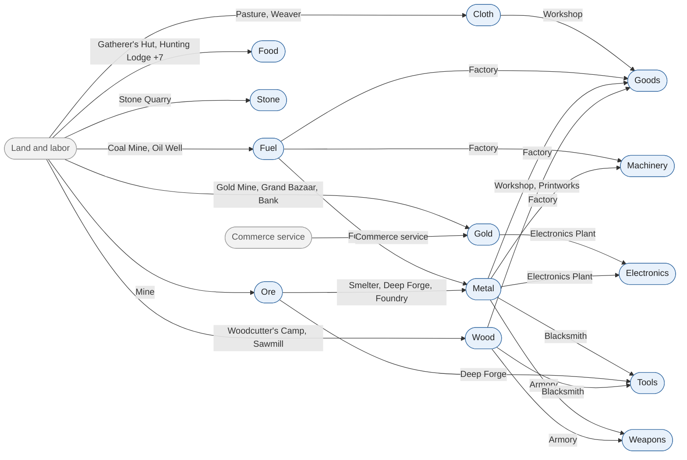


#### Food

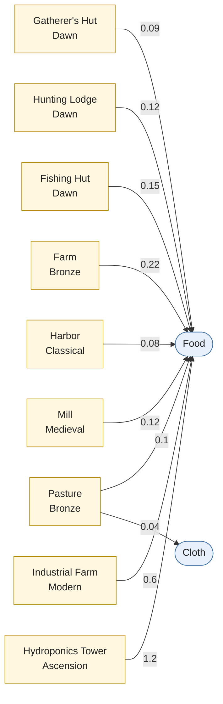


#### Raw materials

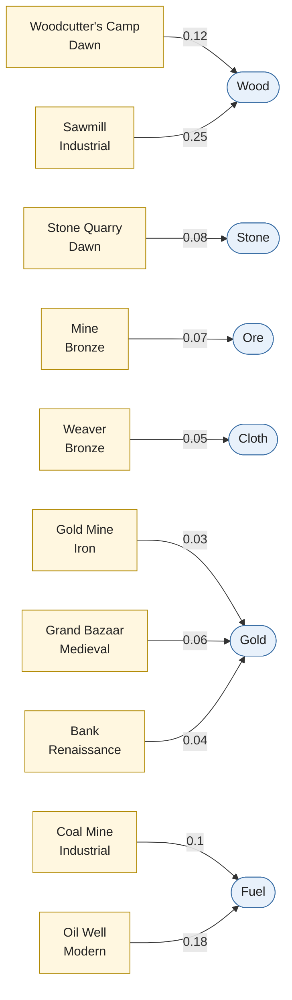


#### Processing and industry (Bronze–Classical)

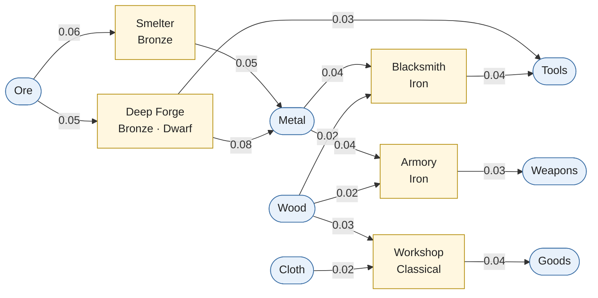


#### Processing and industry (Renaissance–Information)

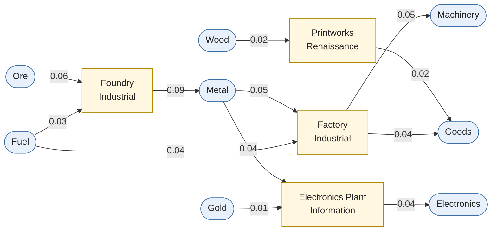


### Wonders

| Wonder              | Available                          | Races   | Cost                                                                                          |  Work | Services                      | Limits                                   |
| ------------------- | ---------------------------------- | ------- | --------------------------------------------------------------------------------------------- | ----: | ----------------------------- | ---------------------------------------- |
| **Deep Forge**      | Bronze                             | Dwarf   | 120 Wood, 300 Stone                                                                           |   600 | 6 Defense                     | ≥ Village, max 1/town, 1 per civ         |
| **War Idol**        | Bronze (from Dawn via tech)        | Orc     | 180 Wood, 120 Stone                                                                           |   300 | 10 Defense, 4 Faith           | ≥ Hamlet, max 1/town, 1 per civ          |
| **World Tree**      | Iron (from Bronze via tech)        | Elf     | 250 Wood, 60 Stone, 60 Cloth                                                                  |   600 | 8 Faith, 6 Research, 6 Health | ≥ Village, max 1/town, 1 per civ         |
| **Sun Pyramid**     | Iron (from Bronze via tech)        | Saurian | 60 Wood, 300 Stone, 40 Metal                                                                  |   700 | 10 Faith, 5 Research          | ≥ Village, max 1/town, 1 per civ         |
| **Great Library**   | Classical                          | All     | 400 Stone, 150 Wood, 120 Gold, 40 Cloth, 40 Goods, 30 Tools                                   |   750 | 25 Research                   | ≥ Town, pop ≥ 80, max 1/town, 1 per civ  |
| **Colossus**        | Classical                          | All     | 350 Stone, 200 Metal, 50 Tools, 120 Gold                                                      |   700 | 20 Commerce                   | ≥ Town, pop ≥ 70, max 1/town, 1 per civ  |
| **Grand Cathedral** | Medieval (from Classical via tech) | Human   | 150 Wood, 400 Stone, 120 Gold, 40 Tools, 60 Goods                                             |   700 | 20 Faith, 5 Entertainment     | ≥ Town, max 1/town, 1 per civ            |
| **Grand Bazaar**    | Medieval                           | All     | 300 Stone, 250 Wood, 100 Cloth, 80 Goods, 150 Gold                                            |   850 | 25 Commerce                   | ≥ Town, pop ≥ 90, max 1/town, 1 per civ  |
| **Ascension Gate**  | Ascension                          | All     | 500 Wood, 700 Stone, 700 Metal, 600 Gold, 400 Tools, 300 Fuel, 600 Machinery, 600 Electronics | 3,000 | 50 Faith, 50 Research         | ≥ Town, pop ≥ 250, max 1/town, 1 per civ |

- **Deep Forge**: A dwarven forge carved into the living rock and fed by magma vents. Master smiths turn ore into metal and tools, and its sealed halls double as a fortress. It must be dug into or beside a mountain. Dwarf only.
- **War Idol**: A towering idol of fire-hardened timber and piled stone hung with trophy skulls. Warbands gather before it to howl blood oaths, steeling the whole camp for battle. Orc only.
- **World Tree**: An ancient tree sung by elven druids to titanic size, its boughs hosting shrines, libraries and healing groves. It can only take root near a living forest. Elf only.
- **Sun Pyramid**: A stepped pyramid of sun-baked stone whose summit altar greets each dawn. Saurian priests chart the heavens from its terraces and the faithful climb it in procession. Saurian only.
- **Great Library**: A wonder of the world: endless galleries holding a copy of every scroll ever written, where sages from every nation gather to learn.
- **Colossus**: A wonder of the world: a titanic bronze god straddles the harbor mouth, its torch guiding ships and its gaze drawing traders from every coast.
- **Grand Cathedral**: A soaring cathedral of flying buttresses, bell towers and stained glass. Its choirs and feast-day festivals kindle faith and joy across the human realm. Human only.
- **Grand Bazaar**: A wonder of the world: a labyrinth of vaulted, lamp-lit arcades where silks, spices and secrets from every civilization change hands.
- **Ascension Gate**: The culmination of civilization: a colossal ring of light that opens a path beyond mortal existence. Raising it consumes the wealth of an empire, and each civilization may build only one.


## God powers

| Power                 | Category | Mana | Cooldown (ticks) | ≈ Game time | Radius | Alignment Δ |  Leaning   | Requirements                |
| --------------------- | -------- | ---: | ---------------: | ----------: | :----: | ----------: | :--------: | --------------------------- |
| **Bless**             | Blessing |   20 |               24 |        24 d |  3–10  |       +0.03 | benevolent | —                           |
| **Rain**              | Blessing |   15 |               12 |        12 d |  4–12  |       +0.01 | benevolent | —                           |
| **Fertility**         | Blessing |   30 |               48 |        48 d |  3–8   |       +0.03 | benevolent | —                           |
| **Inspire**           | Blessing |   40 |               96 |         1 y |  2–8   |       +0.02 | benevolent | settlement in range         |
| **Heal**              | Blessing |   25 |               24 |        24 d |  2–8   |       +0.03 | benevolent | —                           |
| **Bountiful Harvest** | Blessing |   30 |               48 |        48 d |  3–8   |       +0.02 | benevolent | —                           |
| **Prophet**           | Blessing |   80 |              480 |         5 y |  0–4   |       +0.04 | benevolent | settlement in range         |
| **Raise Land**        | Shaping  |   10 |                2 |         2 d |  1–6   |           0 |  neutral   | —                           |
| **Lower Land**        | Shaping  |   10 |                2 |         2 d |  1–6   |           0 |  neutral   | —                           |
| **Plant Forest**      | Shaping  |    8 |                4 |         4 d |  1–6   |      +0.005 | benevolent | —                           |
| **Reveal Ore**        | Shaping  |   35 |               96 |         1 y |  1–5   |           0 |  neutral   | —                           |
| **Spawn Tribe**       | Creation |  150 |              960 |        10 y |   0    |       +0.05 | benevolent | land target, race parameter |
| **Lightning**         | Wrath    |    5 |                1 |         1 d |  0–1   |       −0.01 |  wrathful  | —                           |
| **Wildfire**          | Wrath    |   25 |               24 |        24 d |  1–5   |       −0.04 |  wrathful  | —                           |
| **Earthquake**        | Wrath    |   60 |              192 |         2 y |  3–8   |       −0.06 |  wrathful  | —                           |
| **Meteor**            | Wrath    |  120 |              480 |         5 y |  2–6   |       −0.08 |  wrathful  | —                           |
| **Plague**            | Wrath    |   70 |              288 |         3 y |  2–8   |       −0.08 |  wrathful  | —                           |
| **Flood**             | Wrath    |   50 |              192 |         2 y |  3–8   |       −0.05 |  wrathful  | —                           |
| **Drought**           | Wrath    |   45 |              192 |         2 y |  4–12  |       −0.04 |  wrathful  | —                           |

| Category | Powers | Avg mana | Avg cooldown (ticks) | Total alignment Δ |
| -------- | -----: | -------: | -------------------: | ----------------: |
| Blessing |      7 |     34.3 |                  105 |             +0.18 |
| Shaping  |      4 |     15.8 |                   26 |            +0.005 |
| Creation |      1 |      150 |                  960 |             +0.05 |
| Wrath    |      7 |     53.6 |                  196 |             −0.36 |


### Power descriptions

- **Bless** (Blessing): A warm golden light washes over the land. Mortals within it feel lighter of heart and stronger of body, and whisper thanks to the sky.
- **Rain** (Blessing): Gather the clouds and let them weep. Parched soil drinks deep, fires hiss into smoke, and droughts are broken.
- **Fertility** (Blessing): Breathe life into soil and womb alike. Fields grow rich and dark, and cradles fill in every nearby village.
- **Inspire** (Blessing): Send visions to the scholars and dreamers. Ideas that would take a generation arrive in a single sleepless night.
- **Heal** (Blessing): Lay an unseen hand upon the sick and wounded. Fevers break, bones knit, and the dying rise from their beds.
- **Bountiful Harvest** (Blessing): Granaries overflow with grain that no farmer sowed. A feast season the elders will speak of for decades.
- **Prophet** (Blessing): Choose a mortal and speak through them. A prophet rises, heroic and magnetic, and the faithful flock to hear your word.
- **Raise Land** (Shaping): Lift the earth from below. Seas retreat into new shores, plains swell into hills, and hills crown themselves with snow.
- **Lower Land** (Shaping): Press the world down with a single finger. Mountains slump, valleys sink, and whatever stood too low is claimed by the sea.
- **Plant Forest** (Shaping): Scatter seeds from the heavens. Saplings burst from bare earth and grow to ancient woods before the season turns.
- **Reveal Ore** (Shaping): Crack open the hillsides to show what lies within: veins of ore, seams of good stone, and the glint of gold.
- **Spawn Tribe** (Creation): Shape a people from clay and starlight. A new tribe of the chosen race awakens on open land, devoted to its maker.
- **Lightning** (Wrath): Hurl a bolt from the storm. It strikes the unlucky dead and sets roofs ablaze.
- **Wildfire** (Wrath): Kindle the dry brush with a breath of divine fire. Forests and fields become a roaring sea of flame.
- **Earthquake** (Wrath): Shake the bones of the world. Walls crack, towers topple, and the proud are humbled amid the rubble.
- **Meteor** (Wrath): Pull a burning star from the firmament. It leaves a smoking crater, a ruined town, and sometimes a gift of rare metal.
- **Plague** (Wrath): Loose a pestilence upon the towns. The sick fill the streets and many will never rise again.
- **Flood** (Wrath): Command the rivers and the sea to rise. Low fields drown, houses wash away, and the unwary are swept off.
- **Drought** (Wrath): Turn your face away and withhold the rain. The land cracks, wells run dry, and harvests wither.


## Balance sanity

Computed from the data with base rates (no weather, no tier/age bonuses unless stated). Availability assumes a civilization that researched every tech it could in each age.


### Food per worker vs consumption

| Building              | Age                 | Slots | Food / worker | Inputs / worker | Human |  Elf | Dwarf |  Orc | Saurian | Fed / building (Human) |
| --------------------- | ------------------- | ----: | ------------: | --------------- | ----: | ---: | ----: | ---: | ------: | ---------------------: |
| **Gatherer's Hut**    | Dawn–Iron           |     3 |          0.09 | —               |   1.9 |  2.5 |   1.6 |  1.4 |     2.4 |                    5.7 |
| **Hunting Lodge**     | Dawn–Medieval       |     2 |          0.12 | —               |   2.5 |  3.3 |   2.2 |  1.8 |     3.2 |                      5 |
| **Fishing Hut**       | Dawn+               |     2 |          0.15 | —               |   3.1 |  4.1 |   2.7 |  2.3 |     4.0 |                    6.3 |
| **Farm**              | Bronze+             |     4 |          0.22 | —               |   4.6 |  6.1 |   4.0 |  3.3 |     5.9 |                   18.5 |
| **Pasture**           | Bronze+             |     2 |           0.1 | —               |   2.1 |  2.8 |   1.8 |  1.5 |     2.7 |                    4.2 |
| **Harbor**            | Classical+          |     3 |          0.08 | —               |   1.7 |  2.2 |   1.4 |  1.2 |     2.1 |                      5 |
| **Mill**              | Medieval–Industrial |     2 |          0.12 | —               |   2.5 |  3.3 |   2.2 |  1.8 |     3.2 |                      5 |
| **Industrial Farm**   | Modern+             |     4 |           0.6 | —               |  12.6 | 16.5 |  10.8 |  9.0 |    16.0 |                   50.4 |
| **Hydroponics Tower** | Ascension+          |     3 |           1.2 | —               |  25.2 | 33.0 |  21.6 | 18.0 |    32.0 |                   75.6 |

Race columns: people fed per worker = net food per worker × race food multiplier ÷ race `FoodPerTick` (· = race cannot build it). Bold values below 1 mean a worker cannot even feed themselves. With roughly half of a population being working adults, a food building needs ≥ 2 to sustain a town on its own. Idle adults also forage a little (Economy rule), which is not shown here.

| Race        | Food / person / yr | Adults (est.) | Founding, no techs | Adults on food | Dawn with techs | Adults on food  | Best overall             | Adults on food   | Forage feeds |
| ----------- | -----------------: | ------------: | ------------------ | -------------: | --------------- | --------------: | ------------------------ | ---------------: | -----------: |
| **Human**   |                4.8 |           77% | Fishing Hut (3.1)  |            41% | Farm (4.6)      |             28% | Hydroponics Tower (25.2) |               5% |         0.70 |
| **Elf**     |                3.8 |           91% | Fishing Hut (4.1)  |            27% | Farm (6.1)      |             18% | Hydroponics Tower (33.0) |               3% |         0.88 |
| **Dwarf**   |                4.8 |           85% | Fishing Hut (2.7)  |            44% | Farm (4.0)      |             30% | Hydroponics Tower (21.6) |               5% |         0.70 |
| **Orc**     |                5.8 |           76% | Fishing Hut (2.3)  |            58% | Farm (3.3)      |             40% | Hydroponics Tower (18.0) |               7% |         0.58 |
| **Saurian** |                4.3 |           89% | Fishing Hut (4.0)  |            28% | Farm (5.9)      |             19% | Hydroponics Tower (32.0) |               4% |         0.78 |

*Adults (est.)* = (life expectancy − adulthood) ÷ life expectancy. *Adults on food* = share of adults that must work in that building to feed the whole population (bold above 60%). *Forage feeds* = people fed by one idle adult foraging in Dawn–Bronze (0.035 food/tick, Economy rule; 0.015 later).


### Modifier ceilings per age

| Age             | Food prod. | All prod. | Research | Growth | Build speed | Faith | Military | Storage | Trade | Health | Happiness | Lifespan |
| --------------- | ---------: | --------: | -------: | -----: | ----------: | ----: | -------: | ------: | ----: | -----: | --------: | -------: |
| **Dawn**        |       +37% |       +0% |     +12% |    +0% |        +10% |  +15% |     +10% |     +0% |   +0% |  +0.07 |     +0.04 |     +0 y |
| **Bronze**      |       +52% |       +5% |     +31% |    +0% |        +10% |  +35% |     +20% |    +20% |   +0% |  +0.09 |     +0.06 |     +1 y |
| **Iron**        |       +77% |      +10% |     +51% |    +0% |        +35% |  +55% |     +25% |    +20% |  +20% |  +0.11 |     +0.09 |     +2 y |
| **Classical**   |       +93% |      +16% |     +87% |    +0% |        +40% |  +70% |     +25% |    +30% |  +35% |  +0.18 |     +0.13 |     +6 y |
| **Medieval**    |      +150% |      +23% |    +109% |    +5% |        +45% |  +85% |     +60% |    +40% |  +45% |   +0.2 |     +0.13 |     +8 y |
| **Renaissance** |      +163% |      +36% |    +152% |    +5% |        +60% |  +85% |     +85% |    +40% |  +80% |  +0.23 |     +0.18 |    +13 y |
| **Industrial**  |      +179% |      +52% |    +182% |   +15% |        +60% |  +85% |    +115% |    +40% | +100% |  +0.33 |     +0.18 |    +20 y |
| **Modern**      |      +232% |      +75% |    +220% |   +15% |        +70% |  +85% |    +145% |    +40% | +115% |  +0.38 |     +0.22 |    +28 y |
| **Information** |      +282% |     +100% |    +265% |   +15% |        +85% |  +85% |    +145% |    +40% | +140% |  +0.48 |     +0.27 |    +38 y |
| **Ascension**   |      +342% |     +160% |    +335% |   +15% |       +105% | +140% |    +165% |    +40% | +140% |  +0.58 |     +0.38 |    +51 y |

Additive sum of every general (all-race) tech of that age and earlier, plus the age's own bonus. Racial techs and race aptitudes come on top.


### Research per age vs thresholds

| Age                 |  Enter at | Gap to next | Tech cost (general) | Cost ÷ gap | Required next | Cheapest required | Best research building | RP / tick |       Ref. town RP / tick | Years (base) | Years (ceiling) |
| ------------------- | --------: | ----------: | ------------------: | ---------: | ------------: | ----------------: | ---------------------- | --------: | ------------------------: | -----------: | --------------: |
| **Dawn Age**        |         0 |         800 |                 324 |       0.41 |        5 of 8 |               172 | Town Center            |       0.2 |    0.18 (pop 25, 0 bldgs) |         46.3 |            41.3 |
| **Bronze Age**      |       800 |       3,000 |               1,365 |       0.46 |        5 of 8 |               765 | Town Center            |       0.2 |    0.28 (pop 50, 0 bldgs) |        111.6 |            85.2 |
| **Iron Age**        |     3,800 |       9,000 |               3,900 |       0.43 |        5 of 8 |             2,300 | Library                |         3 |    2.12 (pop 90, 2 bldgs) |         44.2 |        **29.3** |
| **Classical Age**   |    12,800 |      24,000 |              10,080 |       0.42 |        5 of 8 |             5,960 | Library                |         3 |      3 (pop 160, 3 bldgs) |         83.3 |            44.6 |
| **Medieval Age**    |    36,800 |      51,600 |              21,480 |       0.42 |        5 of 8 |            12,840 | University             |         7 |    6.2 (pop 260, 4 bldgs) |         86.7 |            41.5 |
| **Renaissance Age** |    88,400 |      96,000 |              46,880 |       0.49 |        5 of 9 |            25,120 | University             |         7 |   8.96 (pop 400, 6 bldgs) |        111.6 |            44.3 |
| **Industrial Age**  |   184,400 |     170,000 |              84,400 |       0.50 |        5 of 9 |            45,000 | University             |         7 |   9.76 (pop 600, 6 bldgs) |        181.4 |            64.3 |
| **Modern Age**      |   354,400 |     264,000 |             131,040 |       0.50 |        5 of 9 |            69,840 | Research Lab           |        15 |  16.76 (pop 850, 7 bldgs) |        164.1 |            51.3 |
| **Information Age** |   618,400 |     392,000 |             194,600 |       0.50 |        5 of 9 |           104,160 | Data Center            |        30 | 30.16 (pop 1200, 8 bldgs) |        135.4 |        **37.1** |
| **Ascension Age**   | 1,010,400 |           — |             281,400 |          — |             — |                 — | Data Center            |        30 |                         — |            — |               — |

*Gap to next* = research between this age's threshold and the next. *Cost ÷ gap* > 1 means the age's general tree cannot be finished before the next threshold. *Ref. town* = Town Center + one of each general (non-wonder) research building available in the age + 0.004 RP per resident (Progression rule) for the next age's minimum population. *Years (base)* = years for that town to bridge the gap without multipliers; *Years (ceiling)* applies the age's research-bonus ceiling. Design target: ~80–200 years per age (bold = under half or over twice that).


### Cost growth per age

| Age             | Buildings | Avg cost | Max cost | Most expensive | Avg work | Avg upkeep | Cost growth | Avg tech cost | Tech growth | Cost resources                                          |
| --------------- | --------: | -------: | -------: | -------------- | -------: | ---------: | ----------: | ------------: | ----------: | ------------------------------------------------------- |
| **Dawn**        |        11 |       17 |       60 | Town Center    |       18 |          0 |           — |            42 |           — | Wood, Stone                                             |
| **Bronze**      |         9 |       29 |       45 | Granary        |       27 |          0 |       ×1.76 |           173 |       ×4.11 | Wood, Stone, Metal                                      |
| **Iron**        |         8 |       68 |      105 | Temple         |       51 |      0.002 |       ×2.34 |           490 |       ×2.84 | Wood, Stone, Metal, Tools                               |
| **Classical**   |         9 |       78 |      148 | Arena          |      152 |      0.023 |       ×1.15 |         1,264 |       ×2.58 | Wood, Stone, Gold, Tools, Cloth                         |
| **Medieval**    |         6 |      155 |      325 | Castle         |      220 |      0.026 |       ×1.98 |         2,700 |       ×2.14 | Wood, Stone, Metal, Gold, Tools, Cloth, Goods           |
| **Renaissance** |         5 |      149 |      225 | University     |      236 |      0.034 |       ×0.96 |         5,209 |       ×1.93 | Wood, Stone, Metal, Gold, Tools, Cloth, Goods           |
| **Industrial**  |         5 |      181 |      240 | Factory        |      330 |      0.064 |       ×1.21 |         9,378 |       ×1.80 | Wood, Stone, Metal, Tools, Fuel                         |
| **Modern**      |         6 |      238 |      410 | Military Base  |      417 |      0.097 |       ×1.31 |        14,560 |       ×1.55 | Wood, Stone, Metal, Tools, Fuel, Machinery              |
| **Information** |         4 |      359 |      630 | Airport        |      563 |      0.145 |       ×1.51 |        21,622 |       ×1.49 | Stone, Metal, Gold, Tools, Fuel, Machinery, Electronics |
| **Ascension**   |         3 |      863 |    1,430 | Arcology       |      683 |      0.167 |       ×2.41 |        35,175 |       ×1.63 | Stone, Metal, Gold, Tools, Machinery, Electronics       |

Building costs are the sum of all resource units, excluding wonders, grouped by `MinAge`. Growth is relative to the previous age that introduced buildings/techs.


### Warnings

Detected automatically. **Errors** break play and fail `--check`; warnings are likely mistakes or balance smells; notes are for designers.

| Severity | Area      | Finding                                                                                                                                                                                                  |
| -------- | --------- | -------------------------------------------------------------------------------------------------------------------------------------------------------------------------------------------------------- |
| warning  | Resources | Weapons is produced by Armory but nothing consumes it (no worker input, construction cost or upkeep); Diplomacy only checks the stockpile for arming soldiers, so it accumulates up to storage capacity. |
| note     | Balance   | Harbor (Classical) yields 0.08 food per worker, less than Hunting Lodge (Dawn, 0.12).                                                                                                                    |
| note     | Balance   | Mill (Medieval) yields 0.12 food per worker, less than Farm (Bronze, 0.22).                                                                                                                              |
| note     | Balance   | Pasture (Bronze) yields 0.1 food per worker, less than Fishing Hut (Dawn, 0.15).                                                                                                                         |
| note     | Balance   | Renaissance buildings cost less on average (149) than Medieval ones (155).                                                                                                                               |
| note     | Resources | Goods is only used for construction costs (no building consumes it as a worker input).                                                                                                                   |
| note     | Resources | Machinery is only used for construction costs (no building consumes it as a worker input).                                                                                                               |
| note     | Resources | Stone is only used for construction costs (no building consumes it as a worker input).                                                                                                                   |
| note     | Resources | Tools is only used for construction costs (no building consumes it as a worker input).                                                                                                                   |

---

*Generated by `tools/GodSim.ContentReport`. Do not edit by hand; regenerate with `dotnet run --project tools/GodSim.ContentReport -c Release`.*
