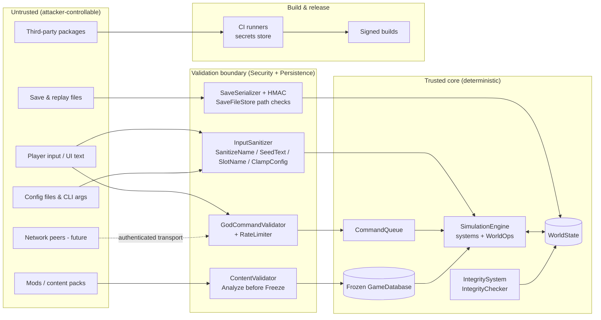

# GodSim Threat Model

Scope: the GodSim client (Unity player and editor), the headless runner (`tools/Headless`), the
static web viewer (`tools/WebViewer`), save, replay, config and mod files, the build pipeline, and
a planned multiplayer mode. Method: assets, then trust boundaries, then STRIDE per threat, with the
mitigations that exist today (named by class) and the residual risk. Review it whenever a new input
channel, file format or network feature is added. Secure-coding rules are in [SECURITY.md](SECURITY.md).

## 1. Assets

| Asset | Why it matters |
|---|---|
| Player machine (code execution, file system) | Highest impact. A crafted file must never run code or write outside the save directory. |
| Simulation integrity (`WorldState`) | Corruption crashes the game or silently ruins worlds. NaN spreads through every system. |
| Determinism (seed, `Rng`, tick order) | Saves, replays and future lockstep multiplayer need bit-exact results. |
| Save and replay files | Player progress. Shareable files are also an attack vector. |
| Game content (`GameDatabase`) | Frozen at startup. Mods extend it. Bad data crashes or soft-locks the game. |
| Availability (frame time, memory) | DoS through huge maps, command floods or pathological content. |
| Build pipeline, signing keys, store credentials | Supply-chain compromise reaches every player. |
| Player privacy | Local paths and usernames in logs or saves. |

## 2. Trust boundaries

Boundary rules:
1. Nothing crosses into the trusted core without passing a validator.
2. Inside the core, mutations go through `WorldOps`.
3. `IntegritySystem` re-checks invariants every simulated year and on load, as defense in depth.

## 3. STRIDE analysis

Legend: **S**poofing, **T**ampering, **R**epudiation, **I**nformation disclosure, **D**enial of
service, **E**levation of privilege.

| # | Threat | STRIDE | Attack | Mitigations implemented | Residual risk |
|---|---|---|---|---|---|
| T1 | **Save tampering** | T, D, E | Edit a save to give infinite mana, set NaN or undefined enum bytes, create dangling ids, cross-linked homes, stale `IdAllocator` (next `Create*` throws), or giant counts. | `Persistence.SaveSerializer` (version check, HMAC, bounded reads). `IntegrityChecker.Check/Repair` run by `IntegritySystem` at `Initialize` and every 96 ticks: NaN and Infinity reset to defaults, undefined enums clamped, dangling ids set to -1, asymmetric links fixed, over-capacity houses and over-staffed workplaces evicted, `BuildingAt` reconciled, id allocators advanced. Duplicate scans stay O(n) even for huge lists. `GodCommandValidator` blocks casts with NaN mana. | The HMAC key ships with the client, so a determined player can re-sign a save. Tampering for single-player advantage is accepted. Repairs keep the game running but cannot restore lost data. Population above the cap is reported, not repaired. |
| T2 | **Mod / content injection** | T, D, E | Mod data with NaN or huge numbers, undefined enum values, null arrays, bidi or control characters in names, `string.Format` bombs such as `{0,999999999}` in civ patterns, broken production chains, multi-race "uniques", free wrath powers, or 1M-deep tech chains. | Content is data only (no code loading, see SECURITY.md 3.3). `ContentValidator.Analyze` before `GameDatabase.Freeze` checks: finite and bounded numbers, defined enums and flag bits, non-null arrays, text length and `IsSafeDisplayText`, safe-pattern parsing (`{0}` only), reachability, transitive production-chain closure, Dawn essentials per race, exactly one race per racial unique, wrath cost > 0, and `MaxTechCount` before the recursive structural pass. Messages never echo content text. `GameDatabase.Freeze` makes the database read-only. | Balance problems are warnings only. Homoglyph or mixed-script names are allowed. `GameDatabase.Validate` cycle detection is recursive (contract code). It is guarded only by the tech count. |
| T3 | **Command spam / DoS** | D | Flood `TryEnqueue` (UI macro, replay, future peer). Rotate `Source` strings to dodge per-source limits. Send 10 MB `Source` strings. Forge `Sequence` to look like an execution-time re-validation. Resubmit the same object repeatedly. | `GodCommandValidator`: `Source` must be 1-64 printable ASCII (length checked first, O(1)). Never echoes `Source`. `RateLimiter`: global per-tick cap, per-source token bucket refilled by simulation tick, at most 64 tracked sources with deterministic LRU eviction and recycled buckets, keys truncated to 64 chars, and a global-cap rejection never creates per-source state. Re-validation is free only for objects this validator admitted, once per paid admission, so forged `Sequence` values gain nothing and resubmission is capped at 2x. Admission table is bounded (2048). Invalid commands are rejected before touching the limiter. `CommandQueue` capacity is bounded. | With many sources, an attacker can take the whole global cap each tick and starve the local player. Fairness needs authenticated peers (T6). Limiter state is not saved: after a load, buckets are full. |
| T4 | **Config DoS via huge maps** | D | Config sets 1024x1024 with 16 races, 100k population, NaN multipliers, or negative sizes, causing allocation spikes, out-of-memory and pathfinding stalls. | `SimConfig.Sanitize` clamps every field. `InputSanitizer.ClampConfig` also enforces width x height x races <= `MaxTileRaceBudget` (512 x 512 x 5) by shrinking the map (aspect preserved, minimum size respected) and fits the founding population into `MaxPopulation`. `GridPathfinder` has an expansion budget. `IntegrityChecker` reports populations above 105% of the cap. | 1024 x 1024 with one race is still allowed (about 31 MB of tile data). Low-memory devices may need a platform-specific budget. |
| T5 | **Path traversal** | T, E | A slot name like `../../AppData/x`, `C:\`, `CON`, `name:stream`, or a trailing space or dot used to escape the save directory or hit device files. | `InputSanitizer.IsValidSlotName` (allow-list `[A-Za-z0-9_- ]`, at most 32 chars, no dots or separators, no leading separator, no trailing space, Windows device names rejected). `InputSanitizer.SanitizeSlotName` for UI input. `Persistence.SaveFileStore` checks that the full path stays inside the root and writes atomically. | Symlinks or junctions planted inside the save directory by local malware are out of scope. |
| T6 | **Replay forgery** | S, T, R | Edit a replay to inject commands that were never issued, out-of-order sequences or impossible casts, and share it as "legit". | Replays carry commands only. On playback every command goes through `CommandQueue`, then `GodCommandValidator` (all checks plus rate limits), then re-validation at execution, so impossible casts are rejected deterministically. Persistence HMAC and `StateHasher` checkpoints detect divergence. | A forged replay made only of *valid* commands cannot be told apart from a real one, because the signing key is client-side. Leaderboards or competitive use need server-side signing (future). |
| T7 | **Future multiplayer desync / cheating** | S, T, I, D, E | A modified client sends forged `Source` or `Sequence` values, commands outside its rights, or floods. It reads hidden state, or diverges on purpose. A nondeterministic float path desyncs honest peers. | Deterministic core (PCG32 `Rng`, index-ordered iteration, tick-based `RateLimiter`, no wall clock, sanitize before entering state). The validator treats `Source`/`Sequence` as untrusted. `StateHasher` lets peers compare state hashes. `IntegritySystem` repairs deterministically on every peer. | Planned but not implemented: authenticated transport, server-assigned `Source`, per-player permissions and ownership checks, host-authoritative command ordering, periodic hash exchange with desync kick. Lockstep cannot hide state (map hacks). Cross-platform float determinism needs testing on every target. |
| T8 | **Supply chain** | T, E | A compromised NuGet or Unity package, a typosquat, a floating version pulling a malicious update, or a vendored binary. | Exact version pins (template csproj pins NUnit, Test SDK and adapter). Core may only use BCL namespaces (contract rule 1). No reflection or dynamic loading in Core. New dependencies need security-owner review. Lock files are committed. | Unity editor and BCL binaries are trusted. Lock files and pins do not protect against a compromised upstream at a pinned version (needs hash verification). |
| T9 | **CI/CD compromise** | T, I, E | A malicious PR exfiltrates secrets via `pull_request_target`, a poisoned action tag, a cache-poisoning attack, or a leaked signing key. | Policy in SECURITY.md 3.5: no secrets for fork PRs, actions pinned by SHA, least-privilege `permissions:`, protected environments with approval for signing and upload, secret scanning with push protection, rotate-first incident rule. Per-module isolated builds (`build/checks/<Module>`) run without secrets. | Self-hosted runners (if introduced) need ephemeral isolation. Insider risk is handled by branch protection and two-person review, not by code. |
| T10 | **Text / UI injection** | S, T | Player or mod names with bidi overrides (`U+202E`), zero-width or invisible fillers (`U+3164`), Zalgo stacks, control characters (log forging), lone surrogates (crash in `Normalize`), or very long input. | `InputSanitizer.SanitizeName`: bounded raw prefix, invisible, format, bidi and control characters stripped before NFC (exceptions caught), allow-list of letters, digits, space, `-` and `'`, at most 2 marks per base, length counted in UTF-16 units and cut only between text elements. `ContentValidator` rejects unsafe content text. Validators never echo untrusted text. `Chronicle` caps entries at 300 chars. | Confusable (homoglyph) names, such as a Cyrillic `а` in "Rome", are allowed. Unicode tables differ by runtime, so names are sanitized once at input and stored. |

## 4. Repudiation and logging

Security events are logged through `ISimLogger` using ids only:
- the `CommandQueue.RejectedCount` and the validator's `RejectedCount` and `AdmittedCount` counters;
- integrity issue lines (at most 10 per run, then a summary);
- cumulative counters in `WorldState.Memory["sec.integrityIssues"]` and `["sec.integrityRepairs"]`, which are saved with the world.

Logs never contain player text, file contents or secrets.

## 5. Residual risk summary and follow-ups

1. Client-side HMAC key: saves and replays are tamper-*evident*, not tamper-*proof*. Accepted for
   single-player. Competitive features need server-side signing.
2. Multiplayer controls (authenticated peers, server-assigned `Source`, host ordering, hash
   exchange) are design-only until networking lands.
3. `GameDatabase.Validate` uses recursive cycle detection (contract code). It is mitigated by
   `ContentValidator.MaxTechCount`, and an iterative version has been requested.
4. Limiter and admission state live outside `WorldState`, so they are not saved or replayed.
   Replays re-derive them deterministically from the same command stream.
5. Fairness under multi-source floods depends on transport authentication.
